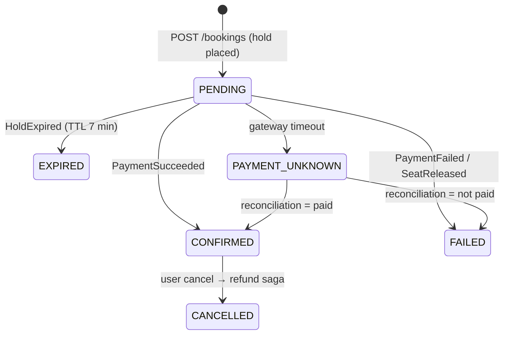

# 10: Architecture Modelling (C4, 4+1), Artifacts (HLD/LLD/SAD/SARR), Governance & Technology Selection

> JD §1: *"Apply structured architectural modelling frameworks and visual notation (C4 or 4+1); HLD & LLD; SAD & SARR; deployment, integration, security architectures; drive architecture discussions, technology selection, and technical governance."*

| Level | Questions |
|---|---|
| Basic | B1–B6 |
| Medium | M1–M9 |
| Advanced | A1–A6 (incl. full C4 + 4+1 for the scheduler) |

---

## Basic

### B1. What is the C4 model?
🎤 "Simon Brown's hierarchical notation with four zoom levels. **Context**: the system, its users and external systems, for everyone including business people. **Container**: deployable or runnable units (web app, API, database, broker) and how they communicate, for architects, developers and ops. **Component**: the major building blocks inside a container, for developers. **Code**: classes, only when useful. Plus supplementary diagrams: deployment, dynamic (sequence) and system landscape. Its strength is that it's notation-light and audience-oriented."

### B2. What is the 4+1 view model?
🎤 "Kruchten's model: **Logical** view (functionality: domain model, components), **Process** view (concurrency, distribution, runtime behaviour), **Development** view (code organization, modules, layers, build), **Physical** view (deployment onto infrastructure), and **+1 Scenarios** (use cases that tie the views together and validate them). It's stakeholder-driven: end users care about the logical view, integrators about process, developers about development, ops about physical."

### B3. HLD vs LLD?
🎤 "The **HLD** describes the overall architecture: system context, major services or components, responsibilities, data ownership, integration styles, technology choices, deployment topology and how NFRs are addressed. The **LLD** goes per component: API contracts, data models and schemas, class or module design, sequence diagrams including error paths, state machines, algorithms, configuration and specific error handling. The HLD answers *what and why*; the LLD answers *exactly how*."

### B4. What is an ADR?
🎤 "An Architecture Decision Record: a short document per significant decision with **context, options considered, decision, consequences**, and status. It lives in the repo, is immutable once accepted, and is superseded rather than edited. It preserves the *why* for future teams. I add a **'revisit when'** trigger, for example 'revisit if we need long-running stateful workflows', which correctly predicted our later Temporal adoption for the scheduler."

### B5. What's a SAD?
🎤 "The Solution Architecture Document: the master description of a solution for a specific initiative. Business context and goals, scope, requirements and constraints, architecture drivers (key NFRs), the solution overview with views (C4 / 4+1), key decisions (ADR links), data, integration, security and deployment architecture, NFR traceability, risks, assumptions and dependencies, transition plan and roadmap."

### B6. What's a SARR?
🎤 "The Solution Architecture Review Report: the output of a formal **review** of a solution, often by an architecture board or an independent architect. It assesses the solution against requirements, principles, standards and NFRs, and lists **findings, risks with severity, recommendations, waivers or exceptions, and actions with owners and dates**, ending with a verdict: approved, approved with conditions, or rejected. It's the governance checkpoint before build or go-live."

---

## Medium

### M1. What sections do you put in a SAD? ✅
🎤 (~1.5 min) "My template, as used for the ticketing platform:
1. **Document control**: version, reviewers, approvals.
2. **Executive summary**: problem, solution and key decisions on one page.
3. **Business context**: goals, KPIs, stakeholders, scope in and out.
4. **Requirements**: functional summary (link to the SRS), **NFRs as quantified scenarios**, constraints (technology, regulatory, budget, timeline).
5. **Architecture principles** applied.
6. **Solution overview**: C4 context and container, key flows.
7. **Detailed views**: logical, process, data, integration, security, deployment, operational.
8. **Key decisions**: an ADR table.
9. **NFR traceability**: NFR → tactic → verification.
10. **Risks, assumptions, issues, dependencies** (RAID).
11. **Transition and migration architecture**, rollout plan.
12. **Cost estimate** and capacity model.
13. **Open questions**, glossary, appendices.

I keep the SAD lean (20–40 pages), with the volatile details (API specs, schemas) as linked docs-as-code."

### M2. How do you conduct an architecture review that produces a SARR? ✅🟡
🎤 (~1.5 min) "**Prepare**: get the SAD, ADRs and NFRs in advance. Define the review scope and checklist (principles, NFRs, security, data, integration, operability, cost, compliance). **Run**: a 90-minute session where the team walks through scenarios, especially failure scenarios: 'the payment gateway times out', 'an AZ goes down', 'tenant B tries to read tenant A's data'. I use lightweight **ATAM**-style quality-attribute scenarios to surface **sensitivity points and trade-offs**. **Document**: findings classified as critical, major or minor; each with risk, recommendation, owner and due date; waivers with expiry and compensating controls. **Follow up**: track actions to closure, and re-review if critical findings exist. The tone matters: a review is there to help the team succeed, not a gate to embarrass them."

### M3. What goes in deployment, integration and security architecture documents? ✅
🎤 (~1.5 min) "**Deployment**: environments, clusters and namespaces, regions and AZs, network topology (VPCs, subnets, ingress and egress), scaling policies, resource sizing, CI/CD flow and promotion, release strategy (canary), backup and DR, and configuration and secrets management. **Integration**: an inventory of interfaces (protocol, pattern, payload and schema, volume, SLA, security, error and retry policy, idempotency, owner), context and sequence diagrams, canonical models or ACLs, and monitoring per integration. **Security**: trust boundaries and data-flow diagrams, data classification, identity and access (IdP, OAuth2 flows, token lifetimes, roles), encryption and key management, secrets, network security, logging, audit and monitoring (SIEM), threat model (STRIDE) with mitigations, compliance mapping (GDPR, PCI), and vulnerability management."

### M4. How do you run technology selection? ✅
🎤 (~1.5 min) "**One, frame the decision**: what problem, which quality attributes matter most, the constraints (skills, licensing, cloud, budget, compliance). **Two, long list → short list** of 2–3 options. **Three, weighted scoring matrix**: criteria weighted with stakeholders *before* scoring, to avoid post-hoc rationalization. **Four, a proof of concept** on the riskiest criterion, time-boxed, hands-on. I build these myself. **Five, total cost of ownership**: licences, infrastructure, people and skills, migration and exit cost. **Six, an ADR** with consequences and a revisit trigger. **Seven, communicate**: present the trade-offs honestly, including what we give up. Example: Quartz clustered vs Spring `@Scheduled` + ShedLock vs Temporal for the scheduler."

| Criterion (weight) | `@Scheduled` + ShedLock | **Quartz clustered (chosen)** | Temporal |
|---|---|---|---|
| No duplicate runs across pods (25%) | 3 | 5 | 5 |
| Persistence & misfire handling (20%) | 2 | 5 | 5 |
| Chained/long-running workflows (15%) | 1 | 3 | 5 |
| Team skills / time to deliver (20%) | 5 | 4 | 2 |
| Infra footprint on OpenShift (10%) | 5 | 4 | 2 |
| Operability / UI (10%) | 2 | 3 | 5 |
| **Weighted** | 3.0 | **4.25** | 3.95 |

### M5. How do you keep architecture documentation alive?
🎤 (~1 min) "**Docs-as-code**: Markdown and diagrams-as-code (Structurizr DSL, Mermaid, PlantUML) in the same repo, reviewed in PRs. ADRs per decision. Generate what you can: OpenAPI and AsyncAPI docs from specs, dependency graphs from code, deployment diagrams partly from manifests. **Ownership**: each doc has an owner and a review date. Keep the SAD lean and link to the living artifacts. And add **fitness functions**, so the architecture is checked by CI, not just described."

### M6. Architecture governance without slowing teams down? ✅
🎤 (~1.5 min) "Governance should be **proportionate and mostly automated**. **Principles and standards**: one page of principles, a tech radar (adopt, trial, assess, hold), reference architectures and starters. **Decision rights**: teams decide within their service; cross-cutting or irreversible decisions (new datastore type, new language, public API changes, security model) go through a lightweight review with ADRs. **Automated guardrails**: CI checks for API breaking changes, dependency rules, security scans, coverage, policy-as-code for infrastructure. **Forums**: an architecture guild or community of practice to share learnings; an architecture review board only for high-impact items, with a fixed SLA, say a decision within a week. **Measure**: decision lead time, the number of waivers, and the incidents traced to architecture gaps."

### M7. How do you present architecture to executives vs engineers? ✅
🎤 (~1 min) "**Executives**: outcomes, risks, cost, timeline, and options with trade-offs. A C4 context diagram at most, and a clear recommendation and ask. **Product owners**: capabilities, user journeys, what's in each release. **Engineers**: container and component views, contracts, sequence diagrams, failure handling and NFR tactics. **Ops/SRE**: deployment, scaling, observability, runbooks. In pre-sales and RFPs I usually start from the client's business problem and success metrics, then show how the architecture achieves them, with phased delivery to de-risk."

### M8. ATAM / quality-attribute scenarios: what and why?
🎤 (~1 min) "The Architecture Tradeoff Analysis Method evaluates an architecture against **quality-attribute scenarios** prioritized by stakeholders in a utility tree. For each scenario, analyse the architectural approaches and identify **sensitivity points** (decisions a quality attribute depends on), **trade-off points** (decisions affecting several attributes in opposite ways, like the cache improving latency but hurting consistency) and **risks**. I use a lightweight version in design reviews. Full ATAM is heavy, but the scenario discipline is valuable."

### M9. How do you handle disagreement with enterprise architects or client stakeholders?
🎤 (~1 min) "Make the disagreement about **criteria, not opinions**. Agree on the decision drivers and weights first, then evaluate the options against them, with data or a quick POC where possible. Acknowledge constraints I may not see (enterprise standards, licensing, support contracts). If we still disagree, escalate with a clear options paper and the risks of each, record the decision in an ADR, and fully commit to the chosen path. For example, an enterprise standard mandated a specific message broker. I documented the throughput risk, we agreed a load test as the acceptance criterion, and the standard held because the test passed."

---

## Advanced

### A1. Walk through the C4 model of the centralized job scheduler ✅

🎤 (~2 min) "**Level 1, Context**: the Scheduler Platform in the middle. Users: operations engineers and product-team developers via the admin console and APIs. External systems: downstream business microservices (billing, reporting, data sync) that jobs invoke; the corporate IdP for SSO; Kafka as the async channel; the monitoring stack; the audit store.

**Level 2, Containers**: React admin console (SPA on a CDN or Route); Scheduler API (Spring Boot, REST, OAuth2 resource server); Scheduler Workers (Spring Boot + Quartz clustered, several pods on OpenShift); PostgreSQL (Quartz JDBC store, job definitions, runs, audit); Redis (metadata cache, invalidation pub/sub); Kafka (job commands for the async channel, job events); Prometheus, Grafana and OTel collector.

**Level 3, Components inside Workers**: Trigger Manager (Quartz listeners), Job State Machine (lock-scoped transitions), Channel Selector (REST or Kafka based on circuit-breaker state), Downstream Invoker (Resilience4j breaker, bulkhead, timeouts), Outbox Publisher, Audit Publisher, Metadata Cache.

**Supplementary**: a dynamic diagram for 'downstream slow → breaker opens → command via Kafka', and a deployment diagram (3 OpenShift worker nodes across zones, Postgres primary/standby)."

```text
workspace "Centralized Job Scheduler" {
  model {
    ops = person "Operations Engineer"
    dev = person "Product Team Developer"
    idp = softwareSystem "Corporate IdP" "OIDC/SSO" "External"
    downstream = softwareSystem "Downstream Business Services" "Billing, reports, sync" "External"
    scheduler = softwareSystem "Scheduler Platform" {
      console = container "Admin Console" "React + TypeScript SPA"
      api     = container "Scheduler API" "Spring Boot, OAuth2 resource server"
      workers = container "Scheduler Workers" "Spring Boot + Quartz (clustered)" {
        trigger = component "Trigger Manager" "Quartz listeners"
        fsm     = component "Job State Machine" "Lock-scoped transitions"
        channel = component "Channel Selector" "REST ↔ Kafka by breaker state"
        invoker = component "Downstream Invoker" "Resilience4j breaker/bulkhead/timeout"
        outbox  = component "Outbox Publisher" "Transactional outbox → Kafka"
      }
      db    = container "PostgreSQL" "Quartz store, jobs, runs, audit" "Database"
      cache = container "Redis" "Metadata cache, pub/sub invalidation" "Database"
      kafka = container "Kafka" "job-commands, job-events" "Queue"
    }
    ops -> console "Manages jobs"
    dev -> api "Registers jobs via API"
    console -> api "REST/JSON (OIDC token)"
    api -> idp "Validates tokens (JWKS)"
    api -> db "Reads/writes"
    workers -> db "Clustered locks, state"
    workers -> cache "Job metadata"
    trigger -> fsm "Fires"
    fsm -> channel "Dispatch"
    channel -> invoker "Sync path"
    channel -> outbox "Async path (breaker open)"
    invoker -> downstream "REST"
    outbox -> kafka "Publishes commands"
    kafka -> downstream "Consumes commands"
  }
  views {
    systemContext scheduler { include * autolayout lr }
    container scheduler     { include * autolayout lr }
    component workers       { include * autolayout lr }
  }
}
```

### A2. Map the same scheduler to 4+1 views ✅
🎤 (~1.5 min)

| View | Content for the scheduler | Audience |
|---|---|---|
| **Logical** | Domain: JobDefinition, Trigger, JobRun, Chain, StateTransition, AuditEvent; components as in C4 L3 | Architects, product |
| **Process** | Clustered Quartz pods competing for triggers via `QRTZ_LOCKS`; lock-scoped state transitions; async channel through outbox/Kafka; thread pools and bulkheads per downstream | Developers, performance engineers |
| **Development** | Hexagonal modules (domain, application, adapters-in REST/Kafka, adapters-out JPA/REST/Kafka); platform starter; CI pipeline with ArchUnit, Testcontainers, coverage gates | Developers |
| **Physical** | OpenShift: 3+ worker pods across zones, API pods behind Routes, Postgres primary + standby, Redis replicas, Kafka 3 brokers; network policies; monitoring stack | Ops / DevOps |
| **+1 Scenarios** | "Pod dies mid-job" (another node recovers trigger via misfire handling); "downstream slow" (breaker → Kafka); "two operators pause/delete simultaneously" (row lock serializes; 409 to loser) | Everyone, used to validate views |

"I use C4 for day-to-day communication and 4+1 when the client's architecture board uses it. The scenarios view is the most valuable part: it's where the design gets stress-tested."

### A3. Write an ADR live: "Saga over 2PC for booking" ✅

```markdown
# ADR-007: Use choreographed Saga (Kafka) instead of XA/2PC for booking consistency
Status: Accepted (supersedes none)   Date: 2023-03   Deciders: Solution Architect, Tech Leads, Payments PO

## Context
Booking spans Inventory, Payment, Booking, Invoicing (separate DBs). Peak ~3,500 booking req/s.
Requirement: zero double-bookings; no lost seats on payment failure. Payment gateway is external (no XA).

## Options
1. XA/2PC across Inventory DB + Payment DB (+ JMS)
2. Choreographed Saga on Kafka with compensations, Redis TTL holds, outbox/inbox
3. Orchestrated Saga (central orchestrator)

## Decision
Option 2. Orchestration (3) reconsidered for refunds/partial cancellations (see ADR-019).

## Consequences
+ No distributed locks; scales with partitions; services deploy independently
+ Explicit PENDING/UNKNOWN states; reconciliation for payment timeouts
− Eventual consistency visible in UX; need Saga monitor + tracing
− Compensation logic must be idempotent and tested (failure matrix in LLD §4.3)

## Revisit when
Flow exceeds ~6 steps, needs human approval steps, or cross-team visibility complaints arise.
```

### A4. HLD vs LLD: show what the LLD contains for one service ✅
🎤 (~1 min) "For the Booking service LLD: API (the OpenAPI spec, with idempotency and ETag rules); events produced and consumed (Avro schemas, keys, topics, compatibility); data model (tables, indexes, constraints, partitioning, the outbox table); the **state machine** (PENDING → CONFIRMED / FAILED / EXPIRED / CANCELLED with allowed transitions); **sequence diagrams** for the happy path, payment failure, payment timeout and hold expiry; error handling (problem types, retry and DLT policy); configuration (timeouts, TTLs); security (scopes per endpoint, PII fields); observability (metrics, spans, log fields); and the test strategy."



### A5. How would you lead an RFP / pre-sales solution? ✅
🎤 (~1.5 min) "I lead whiteboarding, scoping, RFP and pre-sales work with business stakeholders. My approach: **understand the business drivers** and evaluation criteria in the RFP, beyond the technical asks. **Clarify assumptions** through the Q&A window. **Shape the solution**: a context and container view, key architecture decisions, how NFRs are met, an integration approach, security and compliance, and a migration or transition plan. **Estimate** using a work breakdown by capability with complexity drivers, a three-point estimate, and explicit assumptions and exclusions. **Phased delivery**: a discovery sprint, an MVP slice, then increments to de-risk. **Team model and governance**. **Risks and mitigations**. **Differentiators**: accelerators like reusable starters, reference implementations and AI-assisted delivery. Then I present it as a story: their problem, our approach, evidence we can do it, a low-risk path."

### A6. Architecture modelling decisions that could be better ✅
🎤 (~45 s) "On earlier projects we produced large Visio diagrams and Word LLDs that drifted from reality within weeks. Now it's diagrams-as-code and lean documents. We also skipped the **scenarios view** once and missed a failover edge case (a pod dying mid-chain) that a 15-minute scenario walkthrough would have caught. Scenarios are now mandatory in my reviews."
