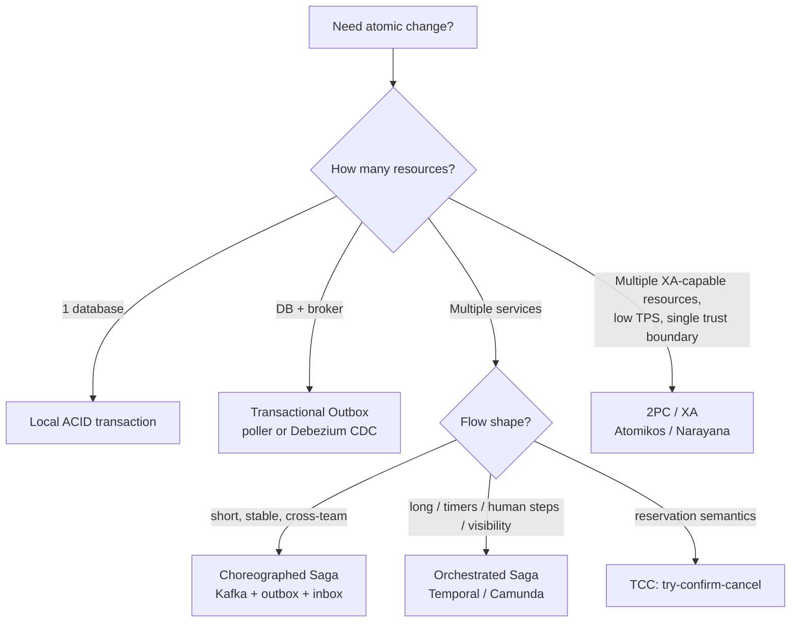

# 13: Implementing Saga, 2PC, Outbox (Poller & CDC) and Temporal in Spring Boot: Ticket Booking & the Centralized Scheduler

> The hands-on deep dive EPAM asks for when they say *"don't just explain it, how would you build it?"*
> Every question has: **⭐ STAR** → **🎤 spoken answer (1–2 min)** → **🛠 implementation steps** → **💻 code** → **⚖️ why / when / trade-offs**.
>
> **Honesty legend:** ✅ = built (resume) · 🟡 = **recommended design / POC**. Your resume shows the Kafka Saga, outbox thinking and Quartz scheduler, **not** Temporal in production. Present Temporal as *"the evolution I recommended and prototyped"*, or *"how I'd do it"*, unless you've actually run it.
>
> Snippets target **Spring Boot 3.x, Java 21, Temporal Java SDK 1.2x, Debezium 2.x/3.x**. Check exact artifact versions before using them in production.

---

## Contents

| # | Question | Theme |
|---|---|---|
| D0 | 60-second decision map | The whole topic in one breath |
| D1 | Choreographed Saga in Spring Boot + Kafka (booking) | ✅ What you built |
| D2 | Orchestrated Saga with Temporal (booking) | 🟡 The better version |
| D3 | How do you implement 2PC in Spring Boot, and should you? | XA with Atomikos/Narayana; when it's OK |
| D4 | "Local 2PC" between DB and Kafka: why it fails, and what replaces it | The dual-write problem |
| D5 | Transactional outbox with a **polling publisher** | Implementation |
| D6 | Transactional outbox with **CDC (Debezium)** | Implementation |
| D7 | Poller vs CDC: decision | When, why |
| D8 | TCC (Try-Confirm-Cancel): the seat-hold pattern | An innovative framing |
| D9 | Can Temporal replace Quartz in the centralized scheduler? | Feasibility + advantages |
| D10 | Quartz → Temporal migration plan | Step-by-step, zero downtime |
| D11 | Other open-source options (Camunda, Conductor, Seata, Axon, Eventuate, Airflow) | Tool selection |
| D12 | Testing Sagas and Temporal workflows | Time-skipping tests |
| D13 | Observability for Sagas and workflows | Tracing, search attributes, Saga monitor |
| D14 | Rapid-fire failure questions | Interview traps |
| D15 | Recommendations: what, why, how, when | Closing summary |

---

## D0. The 60-second decision map (say this first if asked "how would you handle distributed transactions?")

🎤 "I start by asking what kind of consistency the business actually needs.

If all the data lives in **one database**, I use a **local ACID transaction**. No distributed transaction is needed.

If it spans **one database plus a message broker**, which is the most common case, I use the **transactional outbox**. The event is written in the same local transaction and published by a **poller** or by **CDC with Debezium**. That gives you the guarantee people want from '2PC with Kafka', without XA.

If it spans **several services**, I use a **Saga**. **Choreography** for short, stable flows across teams, **orchestration** for long or complex flows, flows with timers or human steps, or flows that need visibility. My preferred orchestrator is **Temporal**, because the workflow code *is* the Saga, with durable timers and retries built in.

If the business step is a **reservation**, I model it as **TCC** (try, confirm, cancel), because that's exactly what a seat hold is.

**2PC/XA** only within a single trusted boundary, at low throughput, where every resource supports XA. In practice, almost never in microservices."



---

## D1. "How did you implement the Saga in Spring Boot for ticket booking?" (choreography + Kafka) ✅

### ⭐ STAR
| | |
|---|---|
| **S** | ~1M users/day, peak ~3,500 booking req/s; DB row locks across checkout → P99 4.2 s, risk of double-booking and lost seats |
| **T** | Consistency across Inventory, Payment, Booking, Invoicing, each with its own DB, without distributed locks |
| **A** | Choreographed Saga on Kafka: Redis TTL seat holds, outbox in every producer, inbox (idempotent) in every consumer, compensations, UNKNOWN state + reconciliation for payment timeouts |
| **R** | **0** double-bookings, **99.99%** inventory accuracy, checkout P99 **4.2 s → 240 ms** |

### 🎤 Spoken answer (~2 min)
"In the ticketing platform, a booking touches four services: Inventory, Payment, Booking and Invoicing. Each owns its own database, so there's no single transaction to rely on. I implemented a **choreographed Saga** on Kafka, where each service does its local transaction and announces it with an event.

The flow: the Booking service creates a PENDING booking. Inventory claims the seat atomically in Redis with a seven-minute TTL and publishes **SeatHeld**. Payment consumes it, charges the card with the booking ID as the idempotency key, and publishes **PaymentSucceeded** or **PaymentFailed**. Booking confirms or fails accordingly. On failure, Inventory runs the **compensation**: release the seat.

Three implementation details made it reliable. **First, no dual writes.** Every service writes its state change and its outgoing event into an **outbox table in the same local transaction**. A relay publishes to Kafka, so an event can never be lost or invented. **Second, every consumer is idempotent.** Kafka is at-least-once, so each consumer records the event ID in a processed-events table in the same transaction as its side effect, and duplicates are ignored. **Third, ambiguity is a state.** If the bank times out, we don't guess. The payment goes to UNKNOWN and a reconciliation job asks the gateway before we either confirm or compensate.

Topics are keyed by booking ID, so all events for one booking are processed in order. The result was zero double-bookings and checkout P99 down from 4.2 seconds to 240 milliseconds."

### 🛠 Implementation steps
1. **Model states**: `Booking: PENDING → CONFIRMED | FAILED | EXPIRED | PAYMENT_UNKNOWN`.
2. **Define events** (Avro/JSON with schema registry): `BookingRequested`, `SeatHeld`, `SeatHoldFailed`, `PaymentSucceeded`, `PaymentFailed`, `SeatReleased`, `BookingConfirmed`.
3. **Topics keyed by `bookingId`** so per-booking ordering holds.
4. **Outbox table** in each service DB; write it in the same `@Transactional` method (see D5/D6 for publishing).
5. **Inbox table** (`processed_events`) in each consumer for idempotency.
6. **Compensations**: `PaymentFailed → releaseSeat`; `HoldExpired → expireBooking`; late `PaymentSucceeded` after expiry → re-hold, or **auto-refund**.
7. **Reconciliation job** for `PAYMENT_UNKNOWN`.
8. **Saga monitor**: a read model built from all events, so ops can answer "where is booking X stuck?".

### 💻 Code (key pieces)

```java
// ---------- Booking service: start saga (state + event in ONE local tx) ----------
@Service
@RequiredArgsConstructor
public class BookingCommandService {
    private final BookingRepository bookings;
    private final OutboxRepository outbox;

    @Transactional
    public BookingId requestBooking(BookingRequest req, String idempotencyKey) {
        var existing = bookings.findByIdempotencyKey(idempotencyKey);
        if (existing.isPresent()) return existing.get().id();              // safe client retry

        Booking b = Booking.pending(req, idempotencyKey);
        bookings.save(b);
        outbox.save(OutboxEvent.of("booking", b.id().value(), "BookingRequested",
                Json.write(new BookingRequested(b.id().value(), req.trainId(), req.seatId(), req.amount()))));
        return b.id();
    }
}

// ---------- Inventory service: idempotent consumer + atomic seat claim ----------
@Component
@RequiredArgsConstructor
class InventorySagaParticipant {
    private final ProcessedEventRepository inbox;
    private final SeatHoldService holds;            // Redis SET NX PX + DB record
    private final OutboxRepository outbox;

    @KafkaListener(topics = "booking.events", groupId = "inventory")
    @Transactional
    public void on(ConsumerRecord<String, String> rec, @Header("eventType") String type,
                   @Header("eventId") String eventId) {
        if (!inbox.markProcessed(eventId)) return;   // INSERT ... ON CONFLICT DO NOTHING → false if duplicate

        switch (type) {
            case "BookingRequested" -> {
                var e = Json.read(rec.value(), BookingRequested.class);
                boolean held = holds.tryHold(e.trainId(), e.seatId(), e.bookingId(), Duration.ofMinutes(7));
                outbox.save(OutboxEvent.of("inventory", e.bookingId(),
                        held ? "SeatHeld" : "SeatHoldFailed", rec.value()));
            }
            case "PaymentFailed", "BookingExpired" -> {          // COMPENSATION
                var e = Json.read(rec.value(), BookingRef.class);
                holds.release(e.bookingId());                    // idempotent: releasing twice is a no-op
                outbox.save(OutboxEvent.of("inventory", e.bookingId(), "SeatReleased", rec.value()));
            }
            default -> { /* ignore events not for us */ }
        }
    }
}

// ---------- Redis atomic hold (TCC "try") ----------
@Component
@RequiredArgsConstructor
class SeatHoldService {
    private final StringRedisTemplate redis;
    boolean tryHold(String trainId, String seatId, String bookingId, Duration ttl) {
        return Boolean.TRUE.equals(redis.opsForValue()
                .setIfAbsent("hold:%s:%s".formatted(trainId, seatId), bookingId, ttl));   // SET NX PX
    }
    void release(String bookingId) { /* delete only if value == bookingId (Lua compare-and-delete) */ }
}
```

```sql
-- Inbox (idempotency) table used by every consumer
CREATE TABLE processed_events (
  event_id     uuid PRIMARY KEY,
  processed_at timestamptz NOT NULL DEFAULT now()
);
-- markProcessed(): INSERT INTO processed_events(event_id) VALUES (?) ON CONFLICT DO NOTHING  → rowcount 1 = new
```

### ⚖️ Why choreography here, and its limits
| ✅ Why | ⚠️ Limits we hit |
|---|---|
| Only 4–5 steps; owned by different teams | Flow is implicit; we needed a Saga monitor + tracing |
| High throughput; no central bottleneck | Adding refunds and partial cancellations touched many services |
| Loose coupling; services know events, not each other | Timeouts (hold expiry) need a separate sweeper; compensations scattered |

---

## D2. "How would you implement the booking Saga with Temporal?" (orchestration) 🟡

### ⭐ STAR (recommended evolution)
| | |
|---|---|
| **S** | Choreographed Saga grew with refunds, partial cancellations and payment reconciliation; hard to see and change the flow; hold-expiry sweeper and reconciliation jobs were separate moving parts |
| **T** | Make the end-to-end booking flow visible, testable and easier to evolve, without losing reliability |
| **A** | Proposed and prototyped an **orchestrated Saga on Temporal**: one `BookingWorkflow` with activities per service, **durable timer** for the 7-min hold, **signal** for the payment callback, **Saga compensations**, idempotent activities, a query for live status |
| **R** | Prototype removed the sweeper and reconciliation cron (now workflow timers), flow logic went from **5 services to 1 workflow class**, and hold expiry became testable in milliseconds with time-skipping tests |

### 🎤 Spoken answer (~2 min)
"Once the booking flow grew refunds, partial cancellations and payment reconciliation, choreography became hard to follow. The logic was spread across five services and two background jobs. So I recommended moving that flow to an **orchestrated Saga on Temporal**.

In Temporal, the Saga is just Java code. A `BookingWorkflow` calls **activities**: hold seat, create payment, confirm booking, issue invoice. Each activity is a normal Spring bean that calls the existing service API. Temporal **persists every step**, so if a worker crashes halfway, another worker resumes exactly where it stopped. It never restarts from scratch and never repeats a completed step.

The really elegant part is the **seven-minute hold**. Instead of a Redis TTL plus a sweeper job, the workflow simply waits: `Workflow.await(7 minutes, () -> paymentResult != null)`. The payment gateway's callback arrives as a **signal**. If the signal arrives, we confirm. If the timer fires first, we run the compensation and release the seat. That durable timer survives restarts and deployments.

Compensations are registered as we go with Temporal's `Saga` helper: hold seat, register 'release seat'; charge, register 'refund'. On any failure, `saga.compensate()` runs them in reverse order.

Two rules keep it correct. Workflow code must be **deterministic**, so all I/O lives in activities. And activities must be **idempotent**. I pass the workflow ID as the idempotency key to the payment gateway, so a retried activity can never double-charge.

The result is one readable class that *is* the business process, with retries, timeouts, compensation and visibility built in."

### 🛠 Implementation steps
1. **Run Temporal**: Temporal Cloud, or self-hosted on OpenShift/EKS (Helm chart) with PostgreSQL persistence and Elasticsearch/OpenSearch for visibility.
2. Add **`io.temporal:temporal-spring-boot-starter`**; configure the connection, namespace and worker auto-discovery.
3. Define the **workflow interface** (`@WorkflowInterface`), with a **signal** for the payment callback and a **query** for status.
4. Define **activity interfaces** per participant (inventory, payment, booking, notification). Implement them as Spring beans calling existing services. **Idempotency key = workflowId**.
5. Configure **ActivityOptions**: timeouts, retry policy, and `doNotRetry` for business failures like `CardDeclined`.
6. Implement the workflow with **`Saga`** compensations and **`Workflow.await`** for the hold timer.
7. **Start the workflow** from the REST controller with `workflowId = "booking-" + idempotencyKey` and a reject-duplicate policy, which gives HTTP idempotency for free.
8. **Payment webhook** → `workflowStub.paymentCompleted(result)` signal.
9. **Test** with `TestWorkflowEnvironment` (time skipping); see D12.

### 💻 Code

```yaml
# application.yml
spring:
  temporal:
    connection:
      target: temporal-frontend.temporal.svc:7233      # or <ns>.tmprl.cloud:7233 with mTLS
    namespace: ticketing
    workers-auto-discovery:
      packages: com.acme.booking.temporal
```

```java
// ---------- Workflow contract ----------
@WorkflowInterface
public interface BookingWorkflow {
    @WorkflowMethod BookingResult book(BookingRequest req);
    @SignalMethod  void paymentCompleted(PaymentResult result);   // from gateway webhook
    @QueryMethod   BookingStatus status();                         // for UI / ops
}

// ---------- Activities (each = existing service call) ----------
@ActivityInterface
public interface BookingActivities {
    void holdSeat(String bookingId, String trainId, String seatId);
    void releaseSeat(String bookingId);
    String createPaymentIntent(String bookingId, BigDecimal amount);   // returns gateway redirect/intent id
    void refundPayment(String bookingId);
    void confirmBooking(String bookingId);
    void markBookingFailed(String bookingId, String reason);
    void issueInvoice(String bookingId);
    void notifyCustomer(String bookingId, String template);           // irreversible → always last
}

// ---------- Workflow implementation ----------
@WorkflowImpl(taskQueues = "booking")
public class BookingWorkflowImpl implements BookingWorkflow {

    private final BookingActivities act = Workflow.newActivityStub(BookingActivities.class,
            ActivityOptions.newBuilder()
                    .setStartToCloseTimeout(Duration.ofSeconds(30))
                    .setRetryOptions(RetryOptions.newBuilder()
                            .setInitialInterval(Duration.ofSeconds(1))
                            .setBackoffCoefficient(2.0)
                            .setMaximumAttempts(5)
                            .setDoNotRetry(SeatUnavailableException.class.getName(),   // business failures
                                           CardDeclinedException.class.getName())
                            .build())
                    .build());

    private PaymentResult payment;                 // set by signal
    private BookingStatus status = BookingStatus.STARTED;

    @Override
    public BookingResult book(BookingRequest req) {
        String id = Workflow.getInfo().getWorkflowId();          // stable idempotency key for all activities
        Saga saga = new Saga(new Saga.Options.Builder().setParallelCompensation(false).build());
        try {
            act.holdSeat(id, req.trainId(), req.seatId());          // TCC "try"
            saga.addCompensation(act::releaseSeat, id);             // TCC "cancel"
            status = BookingStatus.SEAT_HELD;

            act.createPaymentIntent(id, req.amount());
            status = BookingStatus.AWAITING_PAYMENT;

            // Durable 7-minute hold: replaces Redis TTL + sweeper job. Survives crashes and deploys.
            boolean paid = Workflow.await(Duration.ofMinutes(7), () -> payment != null);
            if (!paid) throw ApplicationFailure.newNonRetryableFailure("hold expired", "HoldExpired");
            if (!payment.success()) throw ApplicationFailure.newNonRetryableFailure("payment failed", "PaymentFailed");
            saga.addCompensation(act::refundPayment, id);

            act.confirmBooking(id);                                 // pivot transaction: point of no return
            status = BookingStatus.CONFIRMED;
            act.issueInvoice(id);                                   // retried until success, never compensated
            act.notifyCustomer(id, "booking-confirmed");
            return BookingResult.confirmed(id);

        } catch (ActivityFailure | ApplicationFailure e) {
            saga.compensate();                                      // reverse order: refund → release
            act.markBookingFailed(id, e.getMessage());
            act.notifyCustomer(id, "booking-failed");
            status = BookingStatus.FAILED;
            return BookingResult.failed(id, e.getMessage());
        }
    }

    @Override public void paymentCompleted(PaymentResult r) { this.payment = r; }
    @Override public BookingStatus status() { return status; }
}

// ---------- Activity implementation: a normal Spring bean ----------
@Component
@ActivityImpl(taskQueues = "booking")
@RequiredArgsConstructor
public class BookingActivitiesImpl implements BookingActivities {
    private final InventoryClient inventory;
    private final PaymentGatewayClient gateway;
    private final BookingRepository bookings;

    @Override public void holdSeat(String bookingId, String trainId, String seatId) {
        if (!inventory.hold(trainId, seatId, bookingId))                       // idempotent by bookingId
            throw new SeatUnavailableException(seatId);                         // non-retryable
    }
    @Override public String createPaymentIntent(String bookingId, BigDecimal amount) {
        return gateway.createIntent(amount, /* idempotencyKey */ bookingId);   // retry-safe
    }
    @Override public void refundPayment(String bookingId) { gateway.refund(bookingId, bookingId); }
    // ... others delegate the same way
}

// ---------- REST entry + webhook ----------
@RestController
@RequiredArgsConstructor
class BookingController {
    private final WorkflowClient client;

    @PostMapping("/v1/bookings")
    ResponseEntity<Map<String, String>> book(@RequestBody BookingRequest req,
                                             @RequestHeader("Idempotency-Key") String key) {
        var wf = client.newWorkflowStub(BookingWorkflow.class, WorkflowOptions.newBuilder()
                .setTaskQueue("booking")
                .setWorkflowId("booking-" + key)                                        // HTTP idempotency
                .setWorkflowIdReusePolicy(WorkflowIdReusePolicy.WORKFLOW_ID_REUSE_POLICY_REJECT_DUPLICATE)
                .setWorkflowExecutionTimeout(Duration.ofMinutes(30))
                .build());
        try { WorkflowClient.start(wf::book, req); }
        catch (WorkflowExecutionAlreadyStarted ignored) { /* retry of same request: fine */ }
        return ResponseEntity.accepted().body(Map.of("bookingId", "booking-" + key,
                                                     "status", "/v1/bookings/booking-" + key));
    }

    @PostMapping("/webhooks/payment")                  // verify gateway signature first (see 07-API-M4)
    void paymentWebhook(@RequestBody GatewayEvent ev) {
        client.newWorkflowStub(BookingWorkflow.class, ev.bookingId())
              .paymentCompleted(new PaymentResult(ev.succeeded(), ev.reference()));
    }

    @GetMapping("/v1/bookings/{id}")
    BookingStatus status(@PathVariable String id) {
        return client.newWorkflowStub(BookingWorkflow.class, id).status();       // query, no DB hit
    }
}
```

### ⚖️ Why / when Temporal for the Saga
| Question | Answer |
|---|---|
| **Why** | Flow in one place; durable timers replace sweeper/cron; built-in retries and backoff; compensation helper; full event history = audit; signals for callbacks; queries for status |
| **When** | More than ~5 steps, timers or human steps, frequent changes, a need for visibility or audit, or long-running flows (minutes to days) |
| **When not** | 2–3 step, high-volume, fire-and-forget event reactions. Choreography is simpler and has no extra infrastructure |
| **Cost** | A Temporal cluster (or Cloud), the determinism discipline, workflow versioning, and a learning curve |
| **Throughput** | Scale workers horizontally. Temporal history shards scale the server. For 3,500 bookings/s, size the cluster and load-test it; keep workflows short and payloads small (IDs, not documents) |

---

## D3. "How do you implement 2PC in a Spring Boot application, and would you?"

### ⭐ STAR
| | |
|---|---|
| **S** | During ticketing design, a proposal was XA 2PC across Inventory DB, Payment DB and a JMS queue to "guarantee consistency" |
| **T** | Evaluate objectively and decide |
| **A** | Built a quick XA spike (Atomikos + two PostgreSQL XA datasources) and load-tested it; analysed blocking behaviour, coordinator failure and the gateway's lack of XA support; wrote ADR-007 |
| **R** | Rejected XA for booking (locks held across prepare/commit collapsed throughput in the spike; external gateway couldn't participate). Chose Saga + outbox. Documented where XA *is* acceptable |

### 🎤 Spoken answer (~2 min)
"Technically, 2PC in Spring Boot means **JTA with XA resources**. Each participant (two PostgreSQL databases, or a database and a JMS broker) exposes an XA interface. A **transaction manager** such as **Atomikos** or **Narayana** coordinates them. Spring's `JtaTransactionManager` plugs in, so an ordinary `@Transactional` method spans both resources.

The protocol: in **phase one**, the coordinator asks each resource to **prepare**. Each writes its changes durably, **keeps its locks**, and votes yes. In **phase two**, if everyone voted yes, it tells them to commit. The coordinator keeps a **transaction log**, so after a crash it can recover in-doubt transactions.

I've evaluated it for booking and rejected it, for three reasons. **Locks are held across network round trips** between prepare and commit, which is exactly the contention we were removing at 3,500 requests a second. **The coordinator blocks**: if it dies after prepare, participants sit 'in doubt', holding locks until it recovers. And the real boundary includes a **payment gateway and Kafka, which don't support XA**, so 2PC couldn't even cover the actual problem.

When would I still use it? A **single trusted boundary, modest throughput, all resources XA-capable**. For example, a legacy app writing to one Oracle or Postgres database and one IBM MQ or Artemis queue, where correctness matters more than scale. Even there, the outbox pattern usually gives the same guarantee with fewer moving parts.

So my answer is: I know how to build it, and I know when it's the wrong tool."

### 🛠 Implementation steps (if you must)
1. Add a JTA transaction manager: **Atomikos** (`com.atomikos:transactions-spring-boot3-starter`) or **Narayana** (`dev.snowdrop:narayana-spring-boot-starter`). Spring Boot 3 no longer ships its own JTA starters.
2. Configure **XA datasources** (`org.postgresql.xa.PGXADataSource`) and an **XA connection factory** for the broker (ActiveMQ Artemis XA).
3. On PostgreSQL set **`max_prepared_transactions > 0`** (default 0 = XA disabled).
4. Use `@Transactional` with Spring's `JtaTransactionManager` (auto-configured by the starter).
5. Persist the **transaction log** on a durable volume and configure **recovery**. Monitor for in-doubt transactions (`pg_prepared_xacts`).
6. Set short transaction timeouts; never call remote HTTP inside the XA transaction.

### 💻 Code (illustrative)

```java
@Configuration
class XaConfig {

    @Bean(initMethod = "init", destroyMethod = "close")
    AtomikosDataSourceBean inventoryDs() {
        var ds = new AtomikosDataSourceBean();
        ds.setUniqueResourceName("inventoryDb");
        ds.setXaDataSourceClassName("org.postgresql.xa.PGXADataSource");
        var p = new Properties();
        p.setProperty("url", "jdbc:postgresql://inventory-db:5432/inventory");
        p.setProperty("user", "app"); p.setProperty("password", System.getenv("INV_DB_PWD"));
        ds.setXaProperties(p);
        ds.setMaxPoolSize(20);
        return ds;
    }

    @Bean(initMethod = "init", destroyMethod = "close")
    AtomikosDataSourceBean paymentDs() { /* same, uniqueResourceName = "paymentDb" */ return null; }
}

@Service
@RequiredArgsConstructor
class XaBookingService {
    private final JdbcTemplate inventoryJdbc;   // bound to inventoryDs
    private final JdbcTemplate paymentJdbc;     // bound to paymentDs

    @Transactional                               // JtaTransactionManager → 2PC across both DBs
    public void reserveAndRecordPayment(String bookingId, String seatId, BigDecimal amount) {
        int updated = inventoryJdbc.update(
                "UPDATE seat SET held_by=? WHERE id=? AND held_by IS NULL", bookingId, seatId);
        if (updated == 0) throw new SeatUnavailableException(seatId);
        paymentJdbc.update("INSERT INTO payment(booking_id, amount, status) VALUES (?,?, 'PENDING')",
                bookingId, amount);
        // both commit in phase 2, or both roll back
    }
}
```

### ⚖️ 2PC vs Saga vs Outbox
| | 2PC / XA | Saga | Outbox |
|---|---|---|---|
| Consistency | Atomic (strong) | Eventual, with compensation | Atomic between DB and event |
| Locks | Held across phases | Local only | Local only |
| Failure mode | Blocking, in-doubt transactions | Compensation logic must be correct | Duplicates → idempotent consumers |
| Works with Kafka / REST / SaaS | ❌ | ✅ | ✅ |
| Throughput | Low–moderate | High | High |
| Use | Legacy, single trust boundary | Cross-service business transactions | Every "DB change + event" |

> **3PC** (one line if asked): adds pre-commit so participants can time out without blocking, but it's unsafe under real network partitions. Mostly academic. Use consensus (Raft) or Sagas instead.

---

## D4. "Instead of 'local 2PC' between the database and Kafka, what do you do?"

### ⭐ STAR
| | |
|---|---|
| **S** | Scheduler and booking services did `repository.save()` then `kafkaTemplate.send()`; a crash between them caused "job ran but no event" and occasional ghost events after rollbacks |
| **T** | Make DB state and published events consistent without XA |
| **A** | Replaced direct sends with the **transactional outbox**; started with a polling publisher, recommended **Debezium CDC** at scale |
| **R** | **0** lost or ghost events after rollout; event publishing decoupled from request latency |

### 🎤 Spoken answer (~1.5 min)
"This is the **dual-write problem**. Your method saves to Postgres and sends to Kafka. Kafka doesn't take part in XA, so there's no real two-phase commit between them. Whichever order you choose, a crash in between leaves them inconsistent. Commit the DB, then crash before sending: the event is lost. Send first, then the DB rolls back: you've published a **ghost event** for something that never happened.

People try workarounds: sending in `@TransactionalEventListener(AFTER_COMMIT)`, or chaining a Kafka and a JDBC transaction manager. Those are **best-effort one-phase commits**. They narrow the window but don't close it.

The fix is the **transactional outbox**. In the **same local transaction** as the business change, insert the event into an `outbox` table. Now it's one database, one ACID transaction: both happen or neither does. A separate relay reads the outbox and publishes to Kafka, either a **polling publisher** or **CDC with Debezium**, which tails the database's write-ahead log. Delivery is at-least-once, so consumers are idempotent with an inbox table.

So the answer to 'can we replace local 2PC with an outbox plus CDC or a poller?' is yes. That's the recommended approach, and it's simpler and more reliable than XA."

### 💻 Code: the before and after

```java
// ❌ BEFORE: dual write (no atomicity between DB and Kafka)
@Transactional
public void confirm(Booking b) {
    bookings.save(b.confirm());
    kafka.send("booking.events", b.id(), json(b));       // crash here → DB committed, event lost
}                                                          // or DB rollback after send → ghost event

// ✅ AFTER: transactional outbox (one local ACID transaction)
@Transactional
public void confirm(Booking b) {
    bookings.save(b.confirm());
    outbox.save(OutboxEvent.of("booking", b.id(), "BookingConfirmed", json(b)));
}   // relay (poller or Debezium) publishes later; consumers are idempotent
```

---

## D5. "How do you implement the outbox with a polling publisher?"

### ⭐ STAR
| | |
|---|---|
| **S** | Small-to-medium services needed reliable event publishing without new infrastructure |
| **T** | Implement the outbox relay with what we already had (Spring Boot + Postgres) |
| **A** | Outbox table + a scheduled poller using `FOR UPDATE SKIP LOCKED`, batch publishing with acks, per-aggregate ordering, cleanup job, outbox-age metric |
| **R** | Reliable publishing within ~200–500 ms; zero new infrastructure; easy to operate |

### 🎤 Spoken answer (~1.5 min)
"The polling publisher is the simplest outbox relay, and often the right first step.

The outbox table holds the event ID, aggregate type and ID, event type, payload, created time, and a published flag or timestamp. A scheduled component, every 200 milliseconds or so, **selects a batch of unpublished rows with `FOR UPDATE SKIP LOCKED`**, sends them to Kafka **keyed by aggregate ID**, **waits for the broker acks**, and marks them published in the same transaction. If the publish fails, the transaction rolls back and the rows are retried next cycle. Because a crash can happen after Kafka acknowledged but before we mark the row, we get **at-least-once** delivery, which is why consumers are idempotent.

The subtle part is **ordering**. If several pods poll in parallel with SKIP LOCKED, two events for the same booking could be published by different pods out of order. So either run a **single active poller** (ShedLock or leader election), or **partition the pollers**: each pod owns `hash(aggregate_id) % N`.

Operationally: a partial index on unpublished rows keeps the query fast, a cleanup job deletes published rows after a few days, and I alert on **outbox age**, the oldest unpublished event, as the health signal.

The trade-off is polling latency and extra database load. At high volume I move to CDC."

### 🛠 Implementation steps
1. Create the `outbox` table + partial index on unpublished rows.
2. Write to it inside the business `@Transactional` method (D4).
3. Implement the **poller**: lock a batch with `SKIP LOCKED`, publish **asynchronously then wait for all acks**, mark them published.
4. Ensure **ordering**: a single active poller via **ShedLock**, or hash-partitioned pollers.
5. Configure the producer: `acks=all`, `enable.idempotence=true`.
6. **Cleanup** published rows (or partition the table by day and drop old partitions).
7. **Metrics**: outbox backlog, oldest-unpublished age, publish failures.

### 💻 Code

```sql
CREATE TABLE outbox (
  id              uuid PRIMARY KEY,
  aggregate_type  text        NOT NULL,         -- e.g. 'booking'  → topic booking.events
  aggregate_id    text        NOT NULL,         -- Kafka key → per-aggregate ordering
  event_type      text        NOT NULL,
  payload         jsonb       NOT NULL,
  created_at      timestamptz NOT NULL DEFAULT now(),
  published_at    timestamptz
);
CREATE INDEX outbox_unpublished_idx ON outbox (created_at) WHERE published_at IS NULL;
```

```java
public interface OutboxRepository extends JpaRepository<OutboxEvent, UUID> {
    @Query(value = """
        SELECT * FROM outbox
        WHERE published_at IS NULL
        ORDER BY created_at
        LIMIT :limit
        FOR UPDATE SKIP LOCKED""", nativeQuery = true)
    List<OutboxEvent> lockNextBatch(@Param("limit") int limit);
}

@Component
@RequiredArgsConstructor
class OutboxPoller {
    private final OutboxRepository outbox;
    private final KafkaTemplate<String, String> kafka;
    private final MeterRegistry meters;

    @Scheduled(fixedDelayString = "${outbox.poll-ms:200}")
    @SchedulerLock(name = "outbox-poller", lockAtMostFor = "PT30S")   // ShedLock: single active poller → ordering
    @Transactional
    public void publish() {
        List<OutboxEvent> batch = outbox.lockNextBatch(200);
        if (batch.isEmpty()) return;

        // send all, then wait for all acks (much faster than send().get() one by one)
        List<CompletableFuture<SendResult<String, String>>> acks = batch.stream()
                .map(e -> {
                    var rec = new ProducerRecord<>(e.getAggregateType() + ".events", e.getAggregateId(), e.getPayload());
                    rec.headers().add("eventId", e.getId().toString().getBytes(UTF_8));
                    rec.headers().add("eventType", e.getEventType().getBytes(UTF_8));
                    return kafka.send(rec);
                }).toList();
        CompletableFuture.allOf(acks.toArray(CompletableFuture[]::new)).orTimeout(10, TimeUnit.SECONDS).join();

        Instant now = Instant.now();
        batch.forEach(e -> e.setPublishedAt(now));           // same tx: commit marks them published
        meters.counter("outbox.published").increment(batch.size());
    }   // any exception → rollback → rows retried next cycle (at-least-once)

    @Scheduled(cron = "0 0 * * * *")
    @Transactional
    public void cleanup() { outbox.deletePublishedBefore(Instant.now().minus(Duration.ofDays(3))); }
}
```

---

## D6. "How do you implement the outbox with CDC (Debezium)?"

### ⭐ STAR
| | |
|---|---|
| **S** | At high volume (booking peaks, scheduler job events), polling added DB load and latency; multiple services each ran their own poller |
| **T** | Lower-latency, lower-overhead, standardized event publishing |
| **A** | Recommended **Debezium Postgres connector + Outbox Event Router** on Kafka Connect (Strimzi on OpenShift / MSK Connect on AWS); logical replication with `pgoutput`; insert-and-delete outbox rows; replication-slot monitoring |
| **R** | Publishing latency from **hundreds of ms to tens of ms**, no polling queries on the primary, one standard pattern for every service |

### 🎤 Spoken answer (~2 min)
"With CDC, nobody polls. **Debezium reads PostgreSQL's write-ahead log** through logical replication. Every committed insert into the outbox table becomes a change event, in commit order, and Debezium publishes it to Kafka.

Implementation: enable `wal_level=logical` on Postgres, create a replication user and a publication for the outbox table, then deploy Debezium on **Kafka Connect**. That's Strimzi on OpenShift, or MSK Connect on AWS. The key piece is Debezium's **Outbox Event Router** transform. It turns a raw row change into a clean domain event: it routes to a topic by aggregate type, uses the aggregate ID as the Kafka key so ordering per booking is preserved, puts the event type and ID into headers, and uses the payload column as the message body.

A nice trick: the service can **insert the outbox row and delete it in the same transaction**. The table stays empty, so no cleanup job, yet the insert is still in the WAL, so Debezium still publishes it.

The benefits are **low latency** (tens of milliseconds), **no polling load**, **strict commit ordering**, and the **application stays simple**: it just inserts a row.

The operational cost is real, and I always call it out. You run Kafka Connect. You must monitor the **replication slot**, because if the connector stops, Postgres retains WAL and the disk can fill. You handle connector restarts and snapshots, and database failover needs the slot recreated or failover slots. Delivery is still at-least-once, so consumers stay idempotent.

My recommendation: start with the poller for a few services. Once you have many services or high volume, standardize on Debezium."

### 🛠 Implementation steps
1. PostgreSQL: `wal_level=logical`, `max_replication_slots`, `max_wal_senders`. On RDS/Aurora set `rds.logical_replication=1`.
2. Create a Debezium user with `REPLICATION` + `SELECT` on the outbox, and a **publication** for the outbox table only.
3. Outbox table with Debezium's default router columns (`id, aggregatetype, aggregateid, type, payload`), or map custom names.
4. Deploy **Kafka Connect** with the Debezium Postgres plugin (Strimzi `KafkaConnect` + `KafkaConnector` CRDs, or MSK Connect).
5. Configure the connector with the **EventRouter SMT**.
6. Optional: **insert + delete in the same transaction** to keep the table empty.
7. **Monitor**: connector status, replication-slot lag (`pg_replication_slots`), WAL disk, Kafka Connect task errors. Add a **heartbeat** to advance the slot on quiet databases.
8. **Consumers stay idempotent** (`eventId` header → inbox).

### 💻 Code / config

```sql
-- PostgreSQL setup
ALTER SYSTEM SET wal_level = logical;               -- RDS/Aurora: parameter group rds.logical_replication=1
CREATE ROLE debezium WITH LOGIN REPLICATION PASSWORD '***';
GRANT SELECT ON outbox TO debezium;
CREATE PUBLICATION booking_outbox_pub FOR TABLE outbox;

-- Outbox table using Debezium EventRouter default column names
CREATE TABLE outbox (
  id            uuid  PRIMARY KEY,
  aggregatetype text  NOT NULL,     -- routes to topic  "<aggregatetype>.events"
  aggregateid   text  NOT NULL,     -- Kafka message key
  type          text  NOT NULL,     -- event type → header
  payload       jsonb NOT NULL
);
```

```java
// Insert-and-delete trick: event reaches the WAL (→ Debezium) but the table never grows
@Transactional
public void confirm(Booking b) {
    bookings.save(b.confirm());
    UUID id = UUID.randomUUID();
    jdbc.update("INSERT INTO outbox(id, aggregatetype, aggregateid, type, payload) VALUES (?,?,?,?,?::jsonb)",
            id, "booking", b.id(), "BookingConfirmed", json(b));
    jdbc.update("DELETE FROM outbox WHERE id = ?", id);
}
```

```yaml
# Strimzi KafkaConnector on OpenShift (MSK Connect uses the same "config" keys)
apiVersion: kafka.strimzi.io/v1beta2
kind: KafkaConnector
metadata:
  name: booking-outbox
  labels: { strimzi.io/cluster: connect-cluster }
spec:
  class: io.debezium.connector.postgresql.PostgresConnector
  tasksMax: 1
  config:
    plugin.name: pgoutput
    database.hostname: booking-db
    database.port: "5432"
    database.user: debezium
    database.password: ${secrets:booking/debezium-credentials:password}
    database.dbname: booking
    topic.prefix: booking
    table.include.list: public.outbox
    publication.name: booking_outbox_pub
    slot.name: booking_outbox_slot
    tombstones.on.delete: "false"              # ignore the DELETE from insert-and-delete
    heartbeat.interval.ms: "10000"             # keep slot advancing on quiet DBs
    transforms: outbox
    transforms.outbox.type: io.debezium.transforms.outbox.EventRouter
    transforms.outbox.route.topic.replacement: "${routedByValue}.events"     # booking.events
    transforms.outbox.table.fields.additional.placement: "type:header:eventType,id:header:eventId"
    transforms.outbox.table.expand.json.payload: "true"
    key.converter: org.apache.kafka.connect.storage.StringConverter
    value.converter: org.apache.kafka.connect.json.JsonConverter
    value.converter.schemas.enable: "false"
```

```sql
-- The #1 CDC alert: retained WAL behind the replication slot
SELECT slot_name, active,
       pg_size_pretty(pg_wal_lsn_diff(pg_current_wal_lsn(), confirmed_flush_lsn)) AS retained_wal
FROM pg_replication_slots;
```

---

## D7. "Poller or CDC: which do you recommend, and when?"

### 🎤 Spoken answer (~1.5 min)
"Both give the same guarantee, atomic state plus event with at-least-once delivery. The difference is operational.

I recommend the **polling publisher** when there are **few services**, **moderate volume** (hundreds of events per second), **sub-second latency is fine**, or the team has **no Kafka Connect platform**. It's just Spring code and a table. Easy to understand, test and debug.

I recommend **Debezium CDC** when there are **many services** that should share one standard, **high volume** where polling queries would load the primary, **low latency** matters, or you also need CDC for other purposes like syncing search indexes or strangling a legacy database. Then the platform cost of Kafka Connect is shared.

For the **ticketing platform** at 3,500 bookings a second, I'd choose CDC. For the **scheduler** at the time, a poller per service was fine. As we standardized across teams, CDC became the platform default. And either way, I hide it behind the same contract: services write to the outbox, and how it reaches Kafka is a platform concern. That makes switching from poller to CDC a configuration change, not a code change."

| Criterion | Polling publisher | Debezium CDC |
|---|---|---|
| Latency | Poll interval (100 ms–1 s) | Tens of ms |
| DB load | Repeated queries on primary | Reads WAL (low) |
| Ordering | Needs single poller / partitioning | Commit order per table, key per aggregate |
| Infra | None extra | Kafka Connect + Debezium + slot monitoring |
| Failure risk | Backlog grows (visible) | WAL retention can fill disk if connector stops |
| Table growth | Needs cleanup | Insert-and-delete keeps it empty |
| Best for | Few services, moderate TPS, quick start | Many services, high TPS, platform standard |

---

## D8. "What is TCC, and how does it relate to seat booking?" 🟡 (innovative framing)

### 🎤 Spoken answer (~1.5 min)
"TCC stands for **Try, Confirm, Cancel**. It's a reservation-based variant of a Saga, and I like it because seat booking already *is* TCC.

**Try** reserves resources without committing them: place the seat hold, authorize (not capture) the card. **Confirm** finalizes: book the seat, capture the payment. **Cancel** releases the reservation: free the seat, void the authorization.

Why is it better than a plain Saga here? With a normal Saga, the first step really commits, and compensation must undo something already visible. With TCC, nothing is final until confirm, so **cancel is cheap and invisible to the customer**. No refund appears on a statement, because the card was only authorized.

Implementation rules: every participant exposes try, confirm and cancel; all three must be **idempotent**; reservations have **timeouts**, so a forgotten try auto-cancels, which is our seven-minute hold; and a cancel that arrives *before* the try (out of order) must be recorded, so the late try is rejected. That's the 'anti-hanging' rule.

In Temporal, TCC maps beautifully: try activities, a durable timer, then confirm or cancel. Open-source frameworks like **Apache Seata** also offer a TCC mode for Spring Cloud."

```java
public interface SeatTcc {                 // each participant exposes all three, all idempotent
    void tryHold(String txId, String seatId, Duration ttl);
    void confirm(String txId);
    void cancel(String txId);              // must tolerate "cancel before try" (record it, reject late try)
}
public interface PaymentTcc {
    void tryAuthorize(String txId, BigDecimal amount);   // authorize only
    void confirm(String txId);                            // capture
    void cancel(String txId);                             // void authorization: no refund on statement
}
```

---

## D9. "Can we use Temporal instead of Quartz in the centralized job scheduler? Is it feasible, and what are the advantages?" 🟡

### ⭐ STAR (recommendation)
| | |
|---|---|
| **S** | Quartz clustered scheduler on OpenShift worked well for triggering (P99 680 → 210 ms after lock + cache tuning), but **chained jobs**, retries, checkpoints, pause/resume mid-chain and the dual-channel failover were **hand-built** on top of Quartz and the DB |
| **T** | Assess whether Temporal can replace or complement Quartz, and recommend a path |
| **A** | Mapped every Quartz capability to Temporal (Schedules, overlap policies, catch-up windows, workflows, signals, activities); built a POC of one chained job; assessed ops cost; recommended a **phased hybrid → full migration** |
| **R** | POC replaced roughly a third of the custom orchestration code (checkpoint tables, retry loops, chain state) with framework features; got a clear go/no-go per job type; recommendation accepted with explicit exit criteria |

### 🎤 Spoken answer (~2 min)
"Yes, it's feasible, and for our scheduler I recommended it, in phases.

First, the key insight: **Quartz is a trigger engine; Temporal is a durable execution engine that also has scheduling.** Quartz is excellent at 'fire this at 1:30 every night, exactly once across the cluster'. Everything *after* the trigger (chained steps, retries, checkpoints, pausing mid-chain, waiting on a downstream service) we built ourselves with tables, locks and the REST-to-Kafka failover.

Temporal covers both. **Temporal Schedules** handle cron and intervals, with **overlap policies** (skip, buffer one, allow all), which replaces Quartz's `DisallowConcurrentExecution`. A **catch-up window** replaces misfire policies. Plus pause, unpause, trigger-now and **backfill**, which Quartz doesn't really have. And the job itself becomes a **workflow**: each step is an activity with retries and timeouts, chained jobs are just sequential code or child workflows, pause and resume mid-chain are **signals**, and status is a **query**. Crash recovery is automatic, because every completed step is persisted in the workflow history.

The advantages: far less custom code, exactly-once *step* progress, built-in visibility, durable timers for 'wait two hours then retry', and a full audit history per run.

The costs I'd be honest about: running a Temporal cluster (or paying for Temporal Cloud), the team learning determinism and **workflow versioning**, and cron syntax differences, since Quartz has a seconds field.

So the recommendation was: keep Quartz for simple cron triggers at first, move **chained and long-running jobs to Temporal** first where the value is highest, then migrate simple schedules, and retire Quartz once we reach parity."

### 🔁 Quartz → Temporal concept mapping

| Quartz | Temporal | Notes |
|---|---|---|
| `Job` | **Workflow** (+ activities for I/O) | Business steps become activities with retry policies |
| `Trigger` (cron/simple) | **Schedule** (cron / interval / calendar spec) | Temporal cron is 5-field (no seconds); timezone supported |
| Clustered JDBC store + `QRTZ_LOCKS` | Temporal server (history shards, task queues) | No app-level DB locking for coordination |
| `@DisallowConcurrentExecution` | **Overlap policy** `SKIP` / `BUFFER_ONE` / `CANCEL_OTHER` / `ALLOW_ALL` | Richer than Quartz |
| Misfire instructions | **Catch-up window** (+ backfill API) | Explicit replay of missed runs |
| Pause/resume trigger | `ScheduleHandle.pause()/unpause()` | Pause the schedule |
| Pause/resume a *running* chain | **Signal** to workflow (`pause()` / `resume()`) | Not possible natively in Quartz |
| Job chaining (listeners) | Sequential code / **child workflows** | Readable, testable |
| Retry on failure (custom) | **Activity RetryOptions** | Backoff, max attempts, non-retryable types |
| Job data map | Workflow arguments + **memo / search attributes** | Searchable in UI |
| Custom status tables | **Query** + visibility (search by `TenantId`, `JobType`) | Built-in UI |
| REST→Kafka fallback for slow downstream | Activity retries with backoff + **heartbeats** + timeouts | Durable waiting replaces the async channel for most cases |

### 💻 Code: a Temporal Schedule plus a chained-job workflow with pause/resume

```java
// ---------- Create / manage a schedule (replaces a Quartz cron trigger) ----------
@Service
@RequiredArgsConstructor
public class TemporalJobScheduler implements SchedulerPort {    // same port the API used for Quartz
    private final ScheduleClient schedules;

    @Override
    public void register(JobDefinition def) {
        Schedule schedule = Schedule.newBuilder()
                .setAction(ScheduleActionStartWorkflow.newBuilder()
                        .setWorkflowType(ChainedJobWorkflow.class)
                        .setArguments(def.toRequest())
                        .setOptions(WorkflowOptions.newBuilder()
                                .setWorkflowId("job-" + def.id())          // + schedule appends timestamp
                                .setTaskQueue("scheduler-jobs")
                                .setTypedSearchAttributes(SearchAttributes.newBuilder()
                                        .set(SearchAttributeKey.forKeyword("TenantId"), def.tenantId())
                                        .set(SearchAttributeKey.forKeyword("JobType"), def.type()).build())
                                .build())
                        .build())
                .setSpec(ScheduleSpec.newBuilder()
                        .setCronExpressions(List.of(def.cron5Field()))    // Quartz "0 30 1 * * ?" → "30 1 * * *"
                        .setTimeZoneName(def.zoneId())                    // avoid the IST/UTC trap
                        .setJitter(Duration.ofSeconds(def.jitterSeconds()))
                        .build())
                .setPolicy(SchedulePolicy.newBuilder()
                        .setOverlap(ScheduleOverlapPolicy.SCHEDULE_OVERLAP_POLICY_SKIP)   // = @DisallowConcurrentExecution
                        .setCatchupWindow(Duration.ofMinutes(15))                         // = misfire policy
                        .build())
                .build();
        schedules.createSchedule("sched-" + def.id(), schedule, ScheduleOptions.newBuilder().build());
    }

    @Override public void pause(String jobId, String reason) { schedules.getHandle("sched-" + jobId).pause(reason); }
    @Override public void resume(String jobId)               { schedules.getHandle("sched-" + jobId).unpause(); }
    @Override public void triggerNow(String jobId)           { schedules.getHandle("sched-" + jobId).trigger(); }
}

// ---------- The job itself: a chained workflow with pause/resume mid-chain ----------
@WorkflowInterface
public interface ChainedJobWorkflow {
    @WorkflowMethod JobRunResult run(JobRequest req);
    @SignalMethod  void pause();
    @SignalMethod  void resume();
    @SignalMethod  void stop();
    @QueryMethod   JobRunStatus status();
}

@WorkflowImpl(taskQueues = "scheduler-jobs")
public class ChainedJobWorkflowImpl implements ChainedJobWorkflow {

    private final JobStepActivities steps = Workflow.newActivityStub(JobStepActivities.class,
            ActivityOptions.newBuilder()
                    .setStartToCloseTimeout(Duration.ofMinutes(30))
                    .setHeartbeatTimeout(Duration.ofMinutes(1))           // detect dead workers fast
                    .setRetryOptions(RetryOptions.newBuilder()
                            .setInitialInterval(Duration.ofSeconds(5))
                            .setBackoffCoefficient(2.0)
                            .setMaximumInterval(Duration.ofMinutes(10))   // durable waiting for slow downstream
                            .setMaximumAttempts(10)
                            .setDoNotRetry(InvalidJobConfigException.class.getName())
                            .build())
                    .build());

    private boolean paused, stopped;
    private final JobRunStatus status = new JobRunStatus();

    @Override
    public JobRunResult run(JobRequest req) {
        for (JobStep step : req.steps()) {                          // chain = plain code
            Workflow.await(() -> !paused || stopped);               // pause mid-chain, durably
            if (stopped) return JobRunResult.stopped(status);
            status.current(step.name());
            StepResult r = steps.execute(req.jobId(), step);        // idempotent per (runId, step)
            status.completed(step.name(), r);
            if (r.skipRest()) break;
        }
        return JobRunResult.completed(status);
    }

    @Override public void pause()  { paused = true;  }
    @Override public void resume() { paused = false; }
    @Override public void stop()   { stopped = true; }
    @Override public JobRunStatus status() { return status; }
}
```

### ⚖️ Advantages vs costs
| Advantages of Temporal | Costs / risks |
|---|---|
| Chained, long-running, resumable jobs out of the box | Temporal cluster ops (persistence DB, visibility store), or Temporal Cloud cost |
| Exactly-once step progress; automatic crash recovery | Determinism rules: all I/O in activities; no `System.currentTimeMillis()`, `Random`, threads in workflow code |
| Pause/resume/stop **mid-run** via signals; status via queries | **Workflow versioning** (`Workflow.getVersion` / worker versioning) when changing code with in-flight runs |
| Overlap policies, catch-up window, backfill, jitter | Cron differences (no seconds field); re-test edge cases like DST/IST |
| Built-in UI, search by tenant/job type, full history = audit | New skill set for the team; history size limits, so use continue-as-new for very long loops |
| Removes custom retry/checkpoint tables and much of dual-channel logic | Migration effort and a dual-run period |

### 🧭 Recommendation (why / how / when)
- **Why**: the expensive part of our scheduler wasn't triggering, it was orchestration *after* the trigger. Temporal turns that custom code into framework features.
- **How**: behind a `SchedulerPort` abstraction, so the API and UI don't change. Migrate job type by job type (D10).
- **When**: if you have chained or long-running jobs, mid-run control, waits on external systems, or audit needs. If you only have simple, short cron jobs, **Quartz (or Spring Batch + Quartz) is fine**. Don't add a cluster to fire 50 cron jobs.

---

## D10. "How would you migrate the scheduler from Quartz to Temporal without downtime?" 🟡

### ⭐ STAR
| | |
|---|---|
| **S** | ~thousands of job definitions across teams on clustered Quartz; tier-0 platform; no tolerance for missed or duplicate runs |
| **T** | Migrate safely, reversibly, job type by job type |
| **A** | Strangler approach: `SchedulerPort` abstraction → Temporal platform + POC → shadow mode → per-job-type cutover with a "single owner" flag → decommission Quartz |
| **R** | Plan with explicit exit criteria per phase; rollback = flip ownership flag back to Quartz |

### 🎤 Spoken answer (~2 min)
"I'd treat it as a strangler migration with one golden rule: **at any moment, exactly one engine owns a given job**. That prevents both missed and duplicate runs.

**Step one, an abstraction.** Introduce a `SchedulerPort` interface (register, pause, resume, trigger, status) with a Quartz adapter. The API, the React console and the audit don't change.

**Step two, the platform.** Stand up Temporal (Cloud, or self-hosted on OpenShift with Postgres persistence), with namespaces per environment, mTLS, observability via the OpenTelemetry interceptor, and a Temporal adapter for the port.

**Step three, the POC on the hardest job type**: a chained job. Measure code removed, latency, failure recovery and operability.

**Step four, shadow mode.** For selected jobs, Temporal runs the workflow in **dry-run**: activities log what they *would* do while Quartz still executes. We compare schedules and results for a couple of weeks.

**Step five, cutover per job type.** An **ownership flag** per job (QUARTZ or TEMPORAL). To migrate: pause the Quartz trigger, create the Temporal schedule with a catch-up window covering the switch, flip the flag. Rollback is the reverse. Start with low-risk internal jobs, then chained jobs, then business-critical ones.

**Step six, decommission.** When everything runs on Temporal and has been stable for a release cycle, remove the Quartz tables and adapter.

Throughout, the downstream contracts are unchanged, activities call the same REST or Kafka endpoints with the same idempotency keys, and dashboards compare run counts per engine to prove nothing was missed or duplicated."

### 🛠 Steps checklist
1. `SchedulerPort` + `QuartzSchedulerAdapter` (no behaviour change; release).
2. Temporal platform: namespace, mTLS, worker deployment, OTel interceptor, dashboards, runbooks.
3. `TemporalSchedulerAdapter` + `JobStepActivities` reusing the existing downstream invokers (idempotency keys unchanged).
4. POC: one chained job type end-to-end; load and failure tests (kill workers mid-step).
5. Shadow mode (dry-run activities) for selected job types; reconcile planned vs actual fire times.
6. `job_ownership` flag table; migration tool: pause Quartz trigger → create Temporal schedule (catch-up window) → flip flag. Reverse tool for rollback.
7. Migrate waves: internal → chained → business-critical; monitor duplicate/missed-run dashboards per wave.
8. Decommission Quartz; archive `QRTZ_*` tables; update ADR (supersede ADR "Quartz clustered").

```java
@Service
@RequiredArgsConstructor
class RoutingSchedulerPort implements SchedulerPort {
    private final QuartzSchedulerAdapter quartz;
    private final TemporalJobScheduler temporal;
    private final JobOwnershipRepository ownership;     // QUARTZ | TEMPORAL per job

    private SchedulerPort owner(String jobId) {
        return ownership.engineFor(jobId) == Engine.TEMPORAL ? temporal : quartz;
    }
    @Override public void pause(String jobId, String reason) { owner(jobId).pause(jobId, reason); }
    @Override public void resume(String jobId)               { owner(jobId).resume(jobId); }
    @Override public void triggerNow(String jobId)           { owner(jobId).triggerNow(jobId); }
    @Override public void register(JobDefinition d)          { owner(d.id()).register(d); }

    @Transactional
    public void migrateToTemporal(JobDefinition d) {
        quartz.pause(d.id(), "migrating to temporal");      // 1. stop the old owner
        temporal.register(d);                               // 2. create schedule (catch-up covers the gap)
        ownership.set(d.id(), Engine.TEMPORAL);             // 3. single owner flips
    }
}
```

---

## D11. "Which other open-source tools could implement Sagas or replace Quartz? How do you choose?"

### 🎤 Spoken answer (~1.5 min)
"I group them by what they're good at.

For **durable workflows and orchestrated Sagas in code**: **Temporal** (Java SDK, strongest durability and developer experience) and **Netflix Conductor** (now Orkes; JSON-defined workflows, polyglot workers).

For **BPMN and business-visible processes with human tasks**: **Camunda** (Zeebe in version 8), which suits processes business analysts want to see as diagrams. Check the current licensing for self-managed production use.

For **transaction frameworks inside Spring Cloud**: **Apache Seata**, which offers AT mode (automatic compensation through undo logs), TCC, Saga and XA modes. **Eventuate Tram Sagas** gives orchestration plus a built-in transactional outbox. **Axon Framework** suits Sagas with event sourcing and CQRS.

For **data pipelines and batch scheduling**: **Apache Airflow** (Python DAGs, data engineering), and **Spring Batch** with Quartz for Java batch.

For **simple distributed cron**: Quartz clustered, **ShedLock** with `@Scheduled`, or **JobRunr**.

My choice depends on four questions. Do you need human or business-visible processes? Then Camunda. Code-first durable orchestration for engineers? Temporal. Already deep in Spring Cloud and want annotation-based distributed transactions? Seata. Data pipelines? Airflow. And always the ops question: who runs it, and do we have the skills?"

| Tool | Model | Strength | Watch out | Best fit here |
|---|---|---|---|---|
| **Temporal** | Code-first durable workflows | Durability, timers, signals, Saga helper, versioning | Cluster ops, determinism | Booking orchestration, scheduler chains |
| **Camunda 8 (Zeebe)** | BPMN | Business-visible, human tasks, DMN | Licensing for self-managed prod; BPMN learning curve | Refund approval with human steps |
| **Conductor (Orkes)** | JSON workflows + workers | Polyglot, UI | Less code-native | Polyglot orgs |
| **Apache Seata** | AT / TCC / Saga / XA | Spring Cloud integration, annotations | Global lock in AT mode; extra TC server | Spring Cloud estates wanting low-code transactions |
| **Eventuate Tram** | Orchestrated Saga + outbox | Outbox built in | Smaller community | Saga + outbox in one library |
| **Axon** | Event sourcing + Sagas | CQRS/ES native | Commitment to ES model | Event-sourced domains |
| **Airflow** | Python DAGs | Data pipelines | Not for low-latency business flows | ELT/lakehouse jobs |
| **Quartz / ShedLock / JobRunr** | Triggers | Simple, lightweight | No durable orchestration | Simple cron |

---

## D12. "How do you test Sagas and Temporal workflows?"

### 🎤 Spoken answer (~1.5 min)
"Temporal's testing story is one of its biggest advantages. With `TestWorkflowEnvironment`, the **clock is virtual**, so the seven-minute seat hold or a two-hour retry wait completes in milliseconds. I mock the activities and assert the workflow's decisions: for example, if no payment signal arrives, it must call `releaseSeat` and never `confirmBooking`. I test every row of the failure matrix this way: declined card, gateway timeout, late payment after expiry, worker crash mid-step. There's also a **replay test**: I feed recorded production histories into the new workflow code to catch **non-determinism** before deploying a change.

For choreographed Sagas, I use **Testcontainers** with real Kafka and Postgres. I publish the trigger event, then assert the final states across services and that compensations ran. I inject failures such as duplicate deliveries and consumer restarts, to prove idempotency."

```java
class BookingWorkflowTest {
    private TestWorkflowEnvironment env;
    private Worker worker;
    private final BookingActivities acts = mock(BookingActivities.class, withSettings().withoutAnnotations());

    @BeforeEach void setUp() {
        env = TestWorkflowEnvironment.newInstance();
        worker = env.newWorker("booking");
        worker.registerWorkflowImplementationTypes(BookingWorkflowImpl.class);
        worker.registerActivitiesImplementations(acts);
        env.start();
    }
    @AfterEach void tearDown() { env.close(); }

    @Test
    void releasesSeat_whenNoPaymentWithinSevenMinutes() {
        var wf = env.getWorkflowClient().newWorkflowStub(BookingWorkflow.class,
                WorkflowOptions.newBuilder().setTaskQueue("booking").setWorkflowId("booking-t1").build());

        BookingResult r = wf.book(new BookingRequest("T100", "S12", new BigDecimal("850")));   // time skips 7 min

        assertThat(r.status()).isEqualTo("FAILED");
        verify(acts).releaseSeat("booking-t1");            // compensation ran
        verify(acts, never()).confirmBooking(any());
    }
}

// Replay test: catch non-determinism before deploy
@Test
void replaysProductionHistory() throws Exception {
    WorkflowReplayer.replayWorkflowExecutionFromResource("histories/booking-prod-sample.json", BookingWorkflowImpl.class);
}
```

---

## D13. "How do you make Sagas and workflows observable?"

### 🎤 Spoken answer (~1 min)
"Three layers. **Tracing**: the OpenTelemetry interceptor for Temporal, plus trace context in Kafka headers for choreography, so one trace shows the booking end-to-end. **Business visibility**: for Temporal, **search attributes** like BookingId, TenantId and JobType, so ops can find every stuck workflow in the UI or via the API. For choreography, a **Saga monitor read model** built from the events, showing booking X's current step and age. **Metrics and alerts**: Saga completion rate, compensation rate, time-in-state (stuck PENDING bookings), outbox age, consumer lag, Temporal schedule-to-start latency, which tells you when workers are starved. Each alert links to a runbook, such as how to signal or terminate a stuck workflow, or replay a DLT message."

---

## D14. Rapid-fire failure questions (30–45 s each)

**Q: The Temporal server is down. What happens to bookings?**
🎤 "New workflows can't start, so the API returns 503 or queues requests. Running workflows pause and resume exactly where they were when the server returns. No state is lost because history is persisted. Make Temporal highly available (multi-AZ, replicated persistence) or use Temporal Cloud, and keep a degraded mode, for example 'booking temporarily unavailable', rather than inconsistent bookings."

**Q: The payment activity timed out, but the gateway actually charged the card.**
🎤 "That's why the idempotency key equals the workflow ID. The retry hits the gateway with the same key and gets the original result back, not a second charge. If retries are exhausted, the workflow goes to a reconciliation step that queries the gateway before compensating."

**Q: You need to change workflow code while thousands of runs are in flight.**
🎤 "Use `Workflow.getVersion` to branch old and new logic deterministically, or Temporal worker versioning to pin running workflows to the old build. Add a replay test against recorded histories in CI to catch non-determinism."

**Q: Two outbox pollers published events for the same booking out of order.**
🎤 "Run a single active poller with ShedLock, or partition pollers by `hash(aggregate_id) % N`. With CDC, order follows commit order. Consumers also check a version number to drop stale events."

**Q: The Debezium connector stopped for six hours. What's the risk?**
🎤 "Postgres retains WAL for the replication slot, so disk usage grows, and if it fills, the primary goes down. Alert on retained WAL size, set `max_slot_wal_keep_size` as a safety cap (accepting a resnapshot if it's hit), and use heartbeats so quiet databases don't accumulate WAL."

**Q: A compensation itself fails.**
🎤 "Compensations are retried with backoff, because they're idempotent. If one keeps failing (say the refund API is down for hours), the Temporal workflow simply keeps retrying durably. Past a threshold, it escalates to a human queue with full context. Never silently drop a compensation."

**Q: Why not just use Kafka transactions for exactly-once instead of the outbox?**
🎤 "Kafka transactions make consume-transform-produce atomic **inside Kafka**. They don't make a Postgres write and a Kafka write atomic. For DB-plus-event, the outbox is the answer."

**Q: Is the Temporal plus Saga design still eventually consistent?**
🎤 "Yes. Between steps, other services can observe intermediate states like SEAT_HELD. We make that explicit in the domain (PENDING states, semantic locks) and in the UX ('reserving your seat…'). What Temporal adds is a *guarantee* that the Saga will reach a terminal state, either confirmed or fully compensated."

---

## D15. Recommendations summary: what, why, how, when (closing answer, ~1.5 min)

🎤 "If I summarize my recommendations for a booking platform and a centralized scheduler:

**One, never dual-write.** Every 'state change plus event' goes through a **transactional outbox**. Start with a **poller**, and standardize on **Debezium CDC** once you have many services or high volume. Consumers are always idempotent.

**Two, choose the Saga style by flow shape.** **Choreography** for short, stable, high-throughput flows across teams, like the core booking events. **Orchestration with Temporal** for long, changing, timer-heavy or human-in-the-loop flows: refunds, cancellations, reconciliation, and the scheduler's chained jobs.

**Three, model reservations as TCC.** Seat hold and card authorization are tries; booking and capture are confirms; release and void are cancels. Cancel stays cheap and invisible to customers.

**Four, avoid 2PC in microservices.** Use it only inside a single XA-capable, low-throughput boundary, and even then prefer the outbox.

**Five, evolve the scheduler, don't rewrite it.** Keep Quartz where simple cron is enough. Move chained and long-running jobs to **Temporal** behind a `SchedulerPort`, via shadow mode and per-job ownership flags, then retire Quartz when there's parity.

And for each decision I write an ADR with a 'revisit when' trigger, so the architecture keeps evolving as the context changes."

| Decision | Recommend | Why | When to revisit |
|---|---|---|---|
| DB + event atomicity | Outbox (poller → CDC) | No XA; reliable; simple app code | >~5 services or >~1k events/s → CDC |
| Core booking flow | Choreographed Saga | Few steps, high TPS, cross-team | When steps/timers/human steps grow |
| Refunds, cancellations, reconciliation | Temporal orchestration | Visibility, durable timers, compensation helper | — |
| Reservations | TCC semantics | Cheap invisible cancel | — |
| Cross-DB atomic commit | Avoid 2PC | Blocking, locks, no Kafka/REST support | Legacy single-boundary only |
| Scheduler | Quartz → Temporal (phased) | Removes custom orchestration; mid-run control; audit | If only simple cron remains, keep Quartz |
