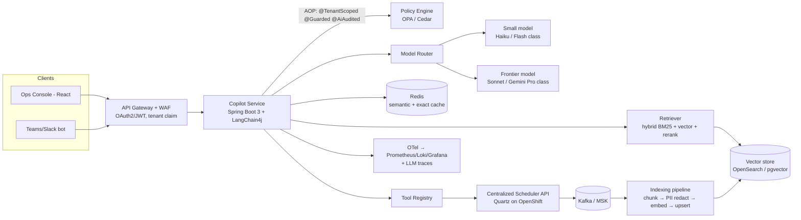

# Anchor Project: Centralized Job Scheduler + "Scheduler Copilot" (GenAI layer)

> **One-line pitch (say this when someone asks "tell me about your latest project"):**
> "I architected a centralized, multi-tenant job scheduler on OpenShift that runs about 1.2 million job executions a day for roughly 40 business tenants. On top of it I designed a GenAI copilot that does three things: RAG-based failure triage, natural-language job operations, and a guard-railed remediation agent. Together they took mean-time-to-resolve for failed jobs from about 47 minutes to about 12."

---

## 1. The base platform (your resume facts)

| Capability | What you built | Resume bullet |
|---|---|---|
| Job types | Fire-and-forget, recurring (cron), chained (DAG-lite) | Quartz-based scheduler on OpenShift |
| State machine | `SCHEDULED → RUNNING → PAUSED / STOPPED / FAILED / COMPLETED / DELETED` | Pessimistic locking on pause/resume/stop/delete |
| Latency | P99 of state-transition API went from **680 ms to 210 ms** | Pessimistic locks + cache-eviction TTL tuning |
| Resilience | Circuit breakers; **dual-channel HTTP + Kafka** with runtime switching | Circuit breakers, dual-channel |
| Security | OAuth2/JWT, RBAC, tenant-aware audit (`tenant_id`, `api_key_id`) | Kafka + OAuth2/JWT + RBAC; getConsenso audit |
| Observability | OpenTelemetry → Prometheus / Loki / Grafana | Skills + getConsenso |

### Why the scheduler is a good GenAI anchor
- It produces **rich, structured telemetry** (job definitions, run history, stack traces, retries). That is a perfect RAG corpus.
- Its operations are **side-effecting and dangerous** (stop, delete, re-run a payment batch). That makes it a strong place to show **agent permissioning, HITL and guardrails**.
- It is **multi-tenant**. Every tenant's jobs, logs and runbooks must never leak to another tenant, which lets you show isolation at the retrieval, prompt and telemetry layers.

---

## 2. The GenAI layer: "Scheduler Copilot"

Three capabilities, rolled out in this order (each phase was gated by evals):

| Phase | Capability | Pattern | Autonomy |
|---|---|---|---|
| 1 | **Failure Triage Assistant**: "Why did job `INV-RECON-0419` fail and what do I do?" | RAG over runbooks + incident history + the last N run logs | Read-only |
| 2 | **NL Job Operations**: "Pause all invoice jobs for tenant ACME until 6 pm" | LLM → typed tool call → policy check → existing scheduler API | Write, but with **preview + confirm** |
| 3 | **Remediation Agent**: auto-handles known failure classes (transient DB timeout, upstream 503, schema-drift retry) | LangGraph-style state machine + tool registry + HITL gates | Bounded autonomy (allow-list) |

### High-level architecture

### Request path (Triage query), with a latency budget of **P95 ≤ 2.5 s, TTFT ≤ 800 ms**

1. Gateway validates the JWT and extracts `tenant_id`, `roles` and `user_id` (≈ 15 ms).
2. `@TenantScoped` aspect binds the tenant into a `ScopedValue`/ThreadLocal. `@Guarded` runs input guardrails: prompt-injection classifier, PII scan and topic allow-list (≈ 60 ms).
3. Exact cache, then semantic cache lookup in Redis (cosine ≥ 0.95, scoped by tenant) (≈ 10 ms). **Hit rate ≈ 31%.**
4. Hybrid retrieval: BM25 top-40 + vector top-40 → RRF fusion → cross-encoder rerank → **top-6 chunks** (≈ 250 ms).
5. Router picks the model. ~70% of traffic goes to the small model. The frontier model is used only when there are multi-hop signals, low retrieval confidence, or a remediation plan is needed.
6. Generation streams back with a **structured output contract** (JSON: `rootCause`, `evidence[] with chunkIds`, `nextSteps[]`, `confidence`).
7. Output guardrails check schema validation, a citation check (every claim maps to a retrieved chunk), PII re-scan and a toxicity/policy check.
8. `@AiAudited` writes an audit event (tenant, user, model, prompt version, token counts, cost, trace ID). Prompt and response bodies are stored **hashed + encrypted**, not in plain text (the ZeroMem idea).

---

## 3. Where everything lives (AWS primary, GCP equivalent for the LTM interview)

| Data / component | AWS | GCP equivalent | Encryption at rest | In transit |
|---|---|---|---|---|
| Raw documents (runbooks, RCAs, SOPs) | **S3**, one prefix per tenant, Object Lock for audit copies | **GCS** + bucket-level IAM | SSE-KMS, **per-tenant CMK** for premium tenants | TLS 1.2+, VPC endpoint |
| Job logs (hot 14 d) | OpenSearch / CloudWatch Logs | Cloud Logging / Elastic | KMS | TLS |
| Job logs (cold, 13 mo) | S3 Glacier Instant Retrieval | GCS Archive/Coldline | KMS | TLS |
| Vector index | **OpenSearch Serverless (vector)** or **Aurora PostgreSQL + pgvector** | Vertex AI Vector Search or **AlloyDB + pgvector** | KMS | TLS, PrivateLink |
| Scheduler DB (Quartz tables, job defs) | Aurora PostgreSQL (Multi-AZ) | Cloud SQL / AlloyDB | KMS + RLS by tenant | TLS (require SSL) |
| Agent state / conversation | DynamoDB (TTL 30 d), PK = `tenant#session` | Firestore | KMS | TLS |
| Semantic cache | ElastiCache for Redis (encryption on) | Memorystore Redis | at-rest enc | in-transit TLS |
| Event backbone | **Amazon MSK** (Kafka) | Pub/Sub or Confluent on GCP | KMS | TLS + SASL/IAM |
| LLM inference | **Bedrock** (Claude, Llama, Titan/Cohere embeddings) via **PrivateLink** | **Vertex AI** (Gemini, Claude on Vertex) via PSC | Provider does not train on data; no retention | TLS, private endpoint |
| Secrets (API keys, DB creds) | Secrets Manager (rotation 30 d) | Secret Manager | KMS | — |
| Compute | **ROSA** (Red Hat OpenShift on AWS) / EKS | GKE / OpenShift on GCP | EBS enc | mTLS (service mesh) |
| Guardrails | Bedrock Guardrails + in-house rules | **Model Armor** + in-house rules | — | — |
| Audit trail | CloudTrail + S3 Object Lock (WORM) | Cloud Audit Logs + locked bucket | KMS | — |
| PII discovery | Macie on S3 + Comprehend/Presidio in pipeline | Sensitive Data Protection (DLP) | — | — |
| Perimeter | VPC, SG, WAF, **no public egress for LLM traffic** | VPC-SC, Cloud Armor | — | — |

### Data classification drives placement
- **C1 Public / C2 Internal** (runbooks): indexed normally.
- **C3 Confidential** (job payloads, customer IDs): **redacted before embedding**. Tokens are kept in a vault (reversible tokenization) and re-hydrated only at render time for authorized users.
- **C4 Restricted** (card data, credentials): **never leaves the source system**. The indexing pipeline drops it at the classifier step.

---

> AWS-only deep dive: [04_aws_specific_genai_architecture.md](04_aws_specific_genai_architecture.md). How this layer is attached to the scheduler (and other apps) as a governed **sidecar**, with Temporal / Spring Batch / OTel: [05_sidecar_pattern_ai_governance.md](05_sidecar_pattern_ai_governance.md).

## 4. Multi-tenancy model

| Tier | Isolation | Used for |
|---|---|---|
| Pooled (default) | Shared index + mandatory `tenant_id` metadata filter + Postgres RLS | ~34 standard tenants |
| Bridge | Separate index/collection per tenant, shared compute | ~5 regulated tenants |
| Silo | Separate account/project, dedicated CMK, dedicated model endpoint quota | 1 bank-grade tenant |

Enforcement is **defence in depth**. It is never left to "the prompt says only use tenant X":
1. JWT claim → `TenantContext` (AOP).
2. Repository layer: Postgres **RLS** using `SET app.tenant_id`.
3. Retriever: filter is **injected by the framework**, not by the caller. A query without a tenant filter throws an error.
4. Cache keys are prefixed with `tenant_id`.
5. Telemetry: `tenant_id` is a span attribute, and logs pass through a PII scrubber.
6. CI test: the **cross-tenant canary suite** seeds tenant A with a secret canary string, then queries as tenant B, and the test must return 0 hits.

---

## 5. Cost model (monthly, at ~75k copilot queries/month)

| Lever | Before | After |
|---|---|---|
| All traffic on frontier model | $0.021 / query | — |
| Router (70% small model) | — | −55% |
| Semantic + exact cache (31% hit) | — | −31% of remaining calls |
| Prompt caching of system prompt + tool schemas | — | −20–25% input tokens |
| Context trimming (top-6, not top-20; chunk 400 tokens) | ~9k input tokens | ~3.2k input tokens |
| **Result** | **≈ $1.6k/mo per 75k queries** | **≈ $450/mo (≈ $0.006 / query)** |

Embedding refresh is **event-driven and incremental**: only changed chunks are re-embedded, identified by content hash. That cut re-index cost by about 90% compared with the nightly full rebuild.

---

## 6. Headline metrics (keep these consistent everywhere)

| Metric | Value |
|---|---|
| Tenants / job definitions / executions per day | ~40 / ~18k / ~1.2M |
| State-transition P99 | 680 ms → **210 ms** |
| MTTR for failed jobs | ~47 min → **~12 min** |
| Failed jobs auto-remediated (allow-listed classes) | **~38%** |
| Retrieval Recall@10 | 0.71 (vector only) → **0.89** (hybrid + rerank) |
| Faithfulness / groundedness (offline eval) | **0.93** |
| Hallucinated-step rate (human-graded sample) | 6.1% → **1.4%** |
| Cost per query | $0.021 → **$0.006** |
| Copilot P95 latency / TTFT | **2.4 s / 0.7 s** |
| Cross-tenant leakage in canary suite | **0** across every release |
| Unauthorized agent actions | **0** (policy-denied attempts are logged and alerted) |
