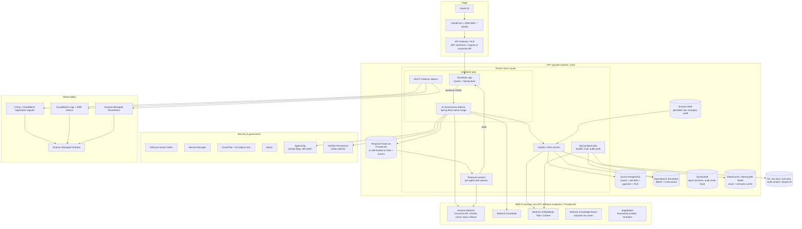

# AWS-Specific Edition: Scheduler Copilot on AWS + AWS Talking Points for All 24 Questions

> Use this file when the interviewer is **AWS-centric**, or when the LTM interviewer asks "and how would you do it on AWS?".
> Every service here is mapped to the same anchor system: **Centralized Job Scheduler + Scheduler Copilot** ([00](00_anchor_project_scheduler_copilot.md)).
> ⚠️ Bedrock model availability **differs by region**. Check the current model list for `ap-south-1` (Mumbai) or your target region before quoting a specific model.

---

## 1. AWS reference architecture



### Service-by-service: what, why, and why not

| Concern | AWS choice | Why | Why not the alternative |
|---|---|---|---|
| Compute | **ROSA** (OpenShift on AWS), or EKS | Scheduler already runs on OpenShift, so this is lift-and-shift with STS/IRSA | Lambda: Quartz needs long-lived, clustered JVMs. Fargate: possible, but native sidecars and DaemonSet-based tooling are easier on EKS/ROSA |
| LLM inference | **Bedrock Converse API** | One API across model families; IAM auth; PrivateLink; no training on customer data; guardrails built in | Direct vendor APIs: public egress, API-key sprawl, a separate DPA per vendor |
| Guardrails | **Bedrock Guardrails** (content filters, denied topics, PII masking, contextual grounding check, prompt-attack filter) + in-house rules | Managed, versioned, and usable standalone via `ApplyGuardrail` (also works for non-Bedrock models) | Only in-house regex: weak on prompt attacks and grounding |
| Embeddings | Titan Text Embeddings v2 / Cohere Embed on Bedrock (1024-d) | Same network path and IAM as generation | Self-hosted embedder on GPU: ops cost not justified at our volume |
| Vector + keyword | **OpenSearch Serverless** (BM25 + k-NN in one engine) | Hybrid search in one query path; scales without node management | Pinecone or other SaaS: data leaves the AWS account boundary. Kendra: strong enterprise search, but less control over chunking and scoring |
| Relational + small vector | **Aurora PostgreSQL + pgvector** | Row-level security, and the Quartz tables already live here | DynamoDB for vectors: no ANN search |
| Managed RAG | **Bedrock Knowledge Bases** | Used for the **long tail** of smaller use cases onboarded through the sidecar (metadata filters, hybrid search, custom chunking via Lambda) | For the core scheduler we kept a **custom pipeline**: content-hash incremental embedding, embedding-version guard, BM25 tuning for error codes, our own reranker, and tenant tiering |
| Agent orchestration | **Temporal** (Temporal Cloud via PrivateLink, or self-hosted on EKS with Aurora) | Durable workflows, signals for HITL, exact replay, per-agent task queues with separate IAM roles | Step Functions: good managed option, but HITL waits and complex retries are easier to express in code with Temporal, and its local testing is better. **Bedrock AgentCore**: a strong option for *hosting* agents and a tool gateway (MCP). Durable multi-hour workflows with HITL still sit best in Temporal. The two can be combined |
| Policy | **Amazon Verified Permissions** (Cedar) or OPA sidecar | Managed policy store, auditable decisions | Policy logic in Java `if`s: unauditable, scattered |
| Events | **Amazon MSK** (Kafka) | The existing scheduler uses Kafka (dual-channel); log compaction for replay | SQS/SNS: no replay or compaction. EventBridge: great for SaaS/AWS events, so we bridge selected topics to it |
| Agent state | **DynamoDB** (PK `tenant#session`, TTL) | Single-digit-ms, serverless, per-item TTL | ElastiCache: volatile, not a system of record |
| Cache | ElastiCache for Redis (or **MemoryDB** if we need durability and vector search) | Exact + semantic cache | Caching in app memory only: low hit rate across 20+ pods |
| Batch & backfill | **Spring Batch on EKS**, triggered by the scheduler | Restartable chunk processing, skip/retry, metadata in Aurora | AWS Batch: good for containers on Spot. Spring Batch keeps transactions and skip semantics in our Java code |
| Batch inference | **Bedrock batch inference** (S3 in → S3 out) | Roughly half the on-demand price for supported models; used for the nightly failure digest and offline eval | On-demand for non-interactive jobs: pays a premium for latency nobody needs |
| ML models | **SageMaker** (Pipelines, Model Registry, endpoints) | Forecasting MLOps (LTM Q6) and self-hosted cross-encoder reranker | — |
| Feature flags | **AWS AppConfig** | Prompt rollout %, model routing table, **AI kill switch**, with validators and automatic rollback on CloudWatch alarms | Hard-coded config: needs a redeploy to roll back |
| Secrets | **Secrets Manager** (rotation) | DB creds, third-party keys | Env vars / ConfigMaps: leakage risk |
| Keys | **KMS**, with a CMK per regulated tenant | Envelope encryption; crypto-shredding by key deletion | One shared key: no per-tenant erasure |
| Audit | **CloudTrail** (management + Bedrock data events) + app audit → MSK → **S3 Object Lock** (compliance mode) | Tamper-evident, WORM | CloudWatch Logs alone: mutable retention, expensive at scale |
| PII discovery | **Macie** on S3 sources; **Comprehend** PII detection or Presidio in the pipeline | Find PII before it gets embedded | Discovering PII after indexing means re-indexing |
| Observability | **ADOT** (AWS Distro for OpenTelemetry) → **X-Ray / CloudWatch Application Signals**, **AMP**, **AMG** | OTel standard; Micrometer metrics remote-written to AMP | Vendor agents per tool: lock-in, duplicate instrumentation |
| Perimeter | Private subnets, **VPC interface endpoints** for `bedrock-runtime`, `bedrock-agent-runtime`, S3/DynamoDB gateway endpoints, WAF, Shield | No public egress for model traffic | NAT to public endpoints: exfiltration path |
| Governance framework | **AWS Well-Architected Generative AI Lens** + internal AI use-case registry | Common language with AWS reviewers | — |

---

## 2. Data placement and encryption: AWS only

| Data | Service | At rest | In transit | Retention | Isolation |
|---|---|---|---|---|---|
| Raw runbooks / RCAs | S3 `kb-raw/{tenant}/` | SSE-KMS (tenant CMK for regulated tenants), Bucket Key on | TLS enforced by bucket policy (`aws:SecureTransport`) | Versioned; 13 months | Prefix + IAM condition `s3:prefix` |
| Redacted chunks | OpenSearch Serverless collection | KMS (per-collection key) | TLS, VPC endpoint | Until doc deleted | `tenant_id` filter (pooled) / collection per tenant (bridge) |
| Quartz + job definitions | Aurora PostgreSQL | KMS | TLS (`rds.force_ssl=1`) | Policy-based | RLS |
| Agent sessions | DynamoDB | KMS (customer managed key) | TLS | TTL 30 days | PK prefix + IAM `dynamodb:LeadingKeys` |
| Semantic cache | ElastiCache | At-rest encryption | In-transit TLS + AUTH/RBAC | TTL 6 h | Key prefix |
| Events | MSK | KMS | TLS + IAM auth | 7 days (compacted topics: forever) | Topic ACLs per service |
| Prompts/responses (audit) | S3 `audit-content/{tenant}/` | SSE-KMS **tenant CMK** (crypto-shred) | TLS | 7 years (Object Lock) | Tenant key |
| Eval datasets | S3 `evals/` (versioned) | SSE-KMS | TLS | Forever | Synthetic or redacted only |
| Logs (cold) | S3 Glacier Instant Retrieval | SSE-KMS | — | 13 months | Prefix |

```json
// S3 bucket policy: deny non-TLS and deny writes without the tenant KMS key
{
  "Version": "2012-10-17",
  "Statement": [
    { "Sid": "DenyInsecureTransport", "Effect": "Deny", "Principal": "*", "Action": "s3:*",
      "Resource": ["arn:aws:s3:::kb-raw", "arn:aws:s3:::kb-raw/*"],
      "Condition": { "Bool": { "aws:SecureTransport": "false" } } },
    { "Sid": "DenyWrongKms", "Effect": "Deny", "Principal": "*", "Action": "s3:PutObject",
      "Resource": "arn:aws:s3:::kb-raw/acme/*",
      "Condition": { "StringNotEquals": {
        "s3:x-amz-server-side-encryption-aws-kms-key-id": "arn:aws:kms:ap-south-1:111122223333:key/acme-cmk-id" } } }
  ]
}
```

```json
// IAM: only the sidecar role may invoke approved models, only through the VPC endpoint
{
  "Version": "2012-10-17",
  "Statement": [{
    "Effect": "Allow",
    "Action": ["bedrock:InvokeModel", "bedrock:InvokeModelWithResponseStream", "bedrock:ApplyGuardrail"],
    "Resource": [
      "arn:aws:bedrock:ap-south-1::foundation-model/anthropic.*",
      "arn:aws:bedrock:ap-south-1::foundation-model/amazon.titan-embed-text-v2:0",
      "arn:aws:bedrock:ap-south-1:111122223333:guardrail/*"
    ],
    "Condition": { "StringEquals": { "aws:SourceVpce": "vpce-0bedrock123" } }
  }]
}
```

> **Governance point:** the IAM `Resource` list is the **approved-model inventory**. A team can't use an unapproved model even if it changes code. Changing the list goes through the AI governance board and a Terraform PR.

---

## 3. AWS-specific code

### 3.1 Bedrock Converse with Guardrails + prompt caching (Java SDK v2)

```java
@Component
@RequiredArgsConstructor
public class BedrockGenerator {
    private final BedrockRuntimeClient bedrock;           // built with VPC endpoint override + IRSA creds
    @Value("${bedrock.guardrail.id}") String guardrailId;
    @Value("${bedrock.guardrail.version}") String guardrailVersion;

    public AiResult generate(String modelId, String systemPrompt, String userTurn) {
        ConverseResponse resp = bedrock.converse(r -> r
                .modelId(modelId)                         // or an inference-profile ARN
                .system(
                        SystemContentBlock.builder().text(systemPrompt).build(),
                        // everything above this point (system prompt + tool schemas) is cached
                        SystemContentBlock.builder().cachePoint(
                                CachePointBlock.builder().type(CachePointType.DEFAULT).build()).build())
                .messages(Message.builder()
                        .role(ConversationRole.USER)
                        .content(ContentBlock.fromText(userTurn))
                        .build())
                .inferenceConfig(c -> c.maxTokens(800).temperature(0.1f))
                .guardrailConfig(g -> g
                        .guardrailIdentifier(guardrailId)
                        .guardrailVersion(guardrailVersion)
                        .trace(GuardrailTrace.ENABLED)));

        boolean blocked = resp.stopReason() == StopReason.GUARDRAIL_INTERVENED;
        TokenUsage u = resp.usage();
        return new AiResult(
                resp.output().message().content().get(0).text(),
                modelId, u.inputTokens(), u.outputTokens(),
                u.cacheReadInputTokens() == null ? 0 : u.cacheReadInputTokens(),   // proves the caching saving
                blocked);
    }
}
```

### 3.2 Standalone guardrail check (works for any model, including self-hosted)

```java
public boolean inputAllowed(String text) {
    ApplyGuardrailResponse r = bedrock.applyGuardrail(req -> req
            .guardrailIdentifier(guardrailId)
            .guardrailVersion(guardrailVersion)
            .source(GuardrailContentSource.INPUT)
            .content(GuardrailContentBlock.builder()
                    .text(GuardrailTextBlock.builder().text(text).build()).build()));
    if (r.action() == GuardrailAction.GUARDRAIL_INTERVENED) {
        Metrics.counter("guardrail.intervened", "source", "input").increment();
        return false;
    }
    return true;
}
```

### 3.3 Bedrock Knowledge Base retrieval with a tenant filter (long-tail use cases)

```java
public List<KnowledgeBaseRetrievalResult> retrieve(String kbId, String tenant, String question) {
    return agentRuntime.retrieve(r -> r
            .knowledgeBaseId(kbId)
            .retrievalQuery(q -> q.text(question))
            .retrievalConfiguration(c -> c.vectorSearchConfiguration(v -> v
                    .numberOfResults(20)
                    .overrideSearchType(SearchType.HYBRID)
                    .filter(RetrievalFilter.builder()
                            .equalsValue(FilterAttribute.builder()
                                    .key("tenant_id")
                                    .value(Document.fromString(tenant))     // injected by framework, never by caller
                                    .build())
                            .build()))))
        .retrievalResults();
}
```

### 3.4 Terraform: guardrail as code (versioned, reviewed)

```hcl
resource "aws_bedrock_guardrail" "copilot" {
  name                      = "scheduler-copilot"
  blocked_input_messaging   = "This request isn't allowed by policy."
  blocked_outputs_messaging = "The response was withheld by policy."

  content_policy_config {
    filters_config { type = "PROMPT_ATTACK" input_strength = "HIGH" output_strength = "NONE" }
    filters_config { type = "MISCONDUCT"    input_strength = "HIGH" output_strength = "HIGH" }
  }
  sensitive_information_policy_config {
    pii_entities_config { type = "EMAIL"                    action = "ANONYMIZE" }
    pii_entities_config { type = "CREDIT_DEBIT_CARD_NUMBER" action = "BLOCK" }
    regexes_config { name = "acct" pattern = "ACC-[0-9]{10}" action = "ANONYMIZE" description = "internal account id" }
  }
  topic_policy_config {
    topics_config { name = "financial-advice" type = "DENY"
                    definition = "Investment or trading recommendations" examples = ["Should I buy this stock?"] }
  }
  contextual_grounding_policy_config {
    filters_config { type = "GROUNDING" threshold = 0.75 }
    filters_config { type = "RELEVANCE" threshold = 0.70 }
  }
}

resource "aws_bedrock_guardrail_version" "v" {
  guardrail_arn = aws_bedrock_guardrail.copilot.guardrail_arn
  description   = "Approved by AI governance board, ticket GOV-112"
}
```

---

## 4. Bedrock model selection on AWS

| Route (Scheduler Copilot) | Bedrock family to evaluate | Why | Why not the alternatives |
|---|---|---|---|
| Error explanation / runbook lookup (70%) | Claude Haiku-class, Amazon Nova Lite/Micro-class | Fast, cheap, good structured output | Frontier models: 3–5× cost with no eval gain |
| Remediation planning, multi-hop (30%) | Claude Sonnet-class | Best tool-use and structured reasoning on our eval | Opus-class: higher cost and latency; kept for offline judge or rare escalations |
| LLM-as-judge (offline) | A **different family** from the generator, e.g. Llama or Nova Pro-class judging Claude output | Reduces self-preference bias | Same model judging itself |
| Fallback / sovereignty | Llama / Mistral on Bedrock, or self-hosted on SageMaker | Second vendor in the chain (LTM Q12) | — |
| Embeddings | Titan Text Embeddings v2 (1024-d) / Cohere Embed | IAM + PrivateLink, normalized vectors | OpenAI embeddings: leaves AWS |

### Bedrock cost levers (AWS-specific)
| Lever | Saving | Our use |
|---|---|---|
| **Prompt caching** (`cachePoint`) | Cached input tokens billed at a large discount, with lower TTFT | ~1.8k-token static prefix |
| **Batch inference** | About half the on-demand price for supported models | Nightly digest, offline eval, re-summarization |
| **Model routing** (small vs frontier) | −55% | 70/30 split |
| **Provisioned Throughput** | Predictable latency at steady high volume | Not justified yet. Re-evaluate above a sustained token/min threshold |
| **Cross-region inference profiles** | Higher throughput and resilience | ⚠️ Use only **geography-scoped** profiles, and **never** for tenants with strict in-country residency |
| Per-tenant cost attribution | Showback | **Application inference profiles** tagged per tenant/use case → Cost Explorer + CUR |

---

## 5. AWS talking points for all 24 questions

> One AWS-specific sentence per question, to add to the spoken answer when the panel is AWS-focused.

### LTM set
| Q | AWS services to name | Sentence to add |
|---|---|---|
| 1 Incident + observability | ADOT, X-Ray, CloudWatch Application Signals, AMP/AMG | "Traces flowed through the ADOT collector into X-Ray, and the retrieval-similarity metric was remote-written to Amazon Managed Prometheus with an AMG burn-rate alert." |
| 2 RAG pipeline | OpenSearch Serverless (hybrid), Bedrock Titan embeddings, Bedrock Converse, MSK | "Hybrid search runs in a single OpenSearch Serverless collection, embeddings come from Titan v2 over PrivateLink, and generation uses the Converse API with a guardrail attached." |
| 3 GraphRAG | **Amazon Neptune** (openCypher) + Neptune Analytics for vector-on-graph | "On AWS the graph is in Neptune with IAM auth and KMS. Provenance lives on edge properties, and query templates run through openCypher." |
| 4 Principles | Well-Architected GenAI Lens, AppConfig, IAM approved-model list | "We reviewed against the Well-Architected Generative AI Lens, and the approved-model inventory is literally the IAM resource list." |
| 5 Safe agent tools | Verified Permissions (Cedar), Cognito/IdP token exchange, Bedrock AgentCore Identity/Gateway (option) | "Tool authorization is a Cedar policy in Verified Permissions, and tool calls carry the user's exchanged token, never a shared role." |
| 6 MLOps forecasting | SageMaker Pipelines, Model Registry, Model Monitor, endpoints with alias-style variants | "Promotion is a SageMaker Model Registry approval status change, and rollback shifts endpoint traffic back to the prior production variant." |
| 7 CI/CD AI gates | CodePipeline or GitHub Actions with OIDC → IAM role, Bedrock batch inference for evals | "CI assumes an IAM role via GitHub OIDC (no long-lived keys), and large eval runs use Bedrock batch inference at roughly half the price." |
| 8 Latency/cost/quality | Bedrock prompt caching, batch inference, application inference profiles | "Prompt caching on the Converse API cut prefill cost and TTFT. Per-tenant application inference profiles give us cost showback." |
| 9 Multi-agent | Temporal on EKS (or Temporal Cloud via PrivateLink), per-agent IRSA roles | "Each agent role runs on its own Temporal task queue whose worker has its own IRSA role. The Executor is the only role with scheduler write permissions." |
| 10 Enterprise integration | MSK, EventBridge, API Gateway, PrivateLink, Secrets Manager | "Selected MSK topics are bridged to EventBridge for SaaS consumers, and every cross-account call goes over PrivateLink." |
| 11 Tenant isolation | OpenSearch filters / collection-per-tenant, Aurora RLS, DynamoDB `LeadingKeys`, KMS per tenant | "DynamoDB uses the `dynamodb:LeadingKeys` IAM condition, so even a buggy service can't read another tenant's partition." |
| 12 Portability | See the AWS rewrite in §6 below | — |

### Cognizant set
| Q | AWS services | Sentence to add |
|---|---|---|
| C1 Routing / prompt versions / rollout | AppConfig (feature flags + CloudWatch-alarm rollback), S3-versioned prompt registry | "Canary percentages live in AppConfig, so a breached CloudWatch alarm automatically rolls the prompt flag back." |
| C2 Agent state + HITL | Temporal signals; DynamoDB; Teams/Slack approval via API Gateway + Lambda | "Approval clicks hit API Gateway, a Lambda verifies the plan hash and sends a Temporal signal to the waiting workflow." |
| C3 Long-running workflows | Temporal, Step Functions (alternative), Bedrock batch inference | "Fan-out summarization uses Bedrock batch inference from S3, while Temporal tracks completion and compensation." |
| C4 Observability | ADOT, X-Ray, CloudWatch EMF, AMP, AMG, CloudWatch alarms → PagerDuty/Incident Manager | "Burn-rate alarms page through AWS Systems Manager Incident Manager with the runbook attached." |
| C5 Framework choice | LangChain4j `BedrockChatModel`, Spring AI Bedrock Converse | "Both LangChain4j and Spring AI wrap the Bedrock Converse API, so the framework decision doesn't lock our provider choice." |
| C6 Kafka for RAG indexing | MSK + MSK Connect (Debezium), KEDA on EKS, OpenSearch Ingestion (alternative) | "Debezium runs as MSK Connect, and KEDA scales the embed stage on MSK consumer lag." |
| C7 Incident (429 storm) | Bedrock `ThrottlingException`, service quotas, cross-region inference profile as fallback | "Bedrock throttling surfaced as `ThrottlingException`. We raised service quotas and added a geography-scoped inference profile as a fallback route." |
| C8 Testing | LocalStack/Testcontainers for S3, DynamoDB, MSK; recorded Bedrock responses | "Integration tests run against Testcontainers for Postgres and Kafka and LocalStack for S3 and DynamoDB, with Bedrock replaced by a scripted fake at the client boundary." |
| C9 Low-latency RAG | OpenSearch Serverless vector collection, ElastiCache, Graviton nodes | "The hot vector index sits in OpenSearch Serverless, and the embedding cache is in-process plus ElastiCache." |
| C10 Resilience | Resilience4j + Bedrock retries disabled in SDK (`RetryMode`), ElastiCache, multi-AZ | "We set the AWS SDK retry policy to none so Resilience4j is the single retry owner. That was the lesson from the retry storm." |
| C11 Eval frameworks | S3 versioned datasets, Bedrock batch inference, **Bedrock Evaluations** (model + RAG evaluation jobs) as a complement | "We ran our own harness and cross-checked with Bedrock's RAG evaluation jobs. The judge model is a different family." |
| C12 Audit + isolation | CloudTrail data events for Bedrock, S3 Object Lock, KMS key deletion for crypto-shred, Macie | "Bedrock invocations are also captured as CloudTrail data events, so our app audit and AWS's audit can be reconciled." |

---

## 6. AWS rewrite of LTM Q12: "How would you architect GenAI workloads on **AWS** while keeping portability and provider abstraction?"

### 🎤 Spoken answer (~2 min)

> **Anchor:** "Use AWS-managed services for the operational heavy lifting, and keep your domain code behind ports, so AWS is a great home but never a cage."

"Our Scheduler Copilot runs on AWS end-to-end, and I'll walk through it by layer.

**Compute** is ROSA, OpenShift on AWS, because the scheduler was already on OpenShift. Pods get AWS permissions through IRSA, so there are no access keys anywhere. **Models** come through **Amazon Bedrock's Converse API** over a VPC interface endpoint. That gives us Claude, Llama, Nova and Mistral behind one API, IAM-scoped, with no public egress and no training on our data. **Guardrails** come from Bedrock Guardrails (prompt-attack filter, PII masking, denied topics, contextual grounding check), versioned in Terraform and approved by our governance board. **Retrieval** is OpenSearch Serverless for hybrid BM25-plus-vector, with Aurora PostgreSQL and pgvector for smaller, RLS-protected collections. **Events** are on MSK, **agent state** on DynamoDB, **caching** on ElastiCache. **Durable agent workflows** run on Temporal workers on EKS. **Security** is KMS per-tenant keys, Secrets Manager, CloudTrail with Bedrock data events, and S3 Object Lock for audit. **Observability** is ADOT into X-Ray, CloudWatch and Amazon Managed Prometheus, with dashboards in Managed Grafana.

For **portability** I keep three seams. First, a **GenAI port** in our own code: generate, embed, moderate. The Bedrock adapter is one implementation and a self-hosted vLLM adapter is another. Second, **retrieval behind our own retriever interface**, so OpenSearch could become pgvector without touching business logic. Third, **OpenTelemetry and Terraform**, which are cloud-neutral by design.

Two honest caveats. Bedrock already gives us *model* portability inside AWS, since switching from Claude to Llama is a model-ID change plus an eval run. But **prompts are model-family specific**, so the prompt registry is keyed by family. And **embeddings aren't portable**: changing embedding model means re-embedding, which is why every vector stores its model ID and re-indexing is blue-green.

We also use the abstraction for resilience. The fallback chain goes primary Claude-class, then a Llama-class model on Bedrock, then search-only mode, with each step behind its own circuit breaker."

### ⭐ STAR
| | |
|---|---|
| **S** | Business wanted AWS-native GenAI but the architecture board feared lock-in to one model vendor |
| **T** | Deliver AWS-managed operations with model and component portability |
| **A** | Bedrock Converse + Guardrails behind a GenAI port; retriever interface; OTel/ADOT; Terraform modules; per-family prompt registry; cross-family fallback chain |
| **R** | Switched the small-model route between two Bedrock families in **1 day** (config + eval run); **0** code changes in business services; fallback kept availability at **99.95%** |

### ⚖️ Why not…?
| Option | Why not |
|---|---|
| Bedrock Agents / AgentCore for everything | Great accelerators. For the regulated remediation agent we want orchestration in our code (Temporal) for replay, testing and portability. AgentCore stays an option for hosting simpler agents and as an MCP tool gateway |
| Bedrock Knowledge Bases for the core scheduler RAG | Used for the long tail. The core needs custom incremental hashing, error-code BM25 tuning and tenant tiers |
| SageMaker-hosted LLMs as primary | GPU ops and capacity planning. Bedrock serverless is cheaper below steady high volume |
| Multi-cloud active-active | Not justified. Portability is kept *possible* through seams, not *exercised* daily |
