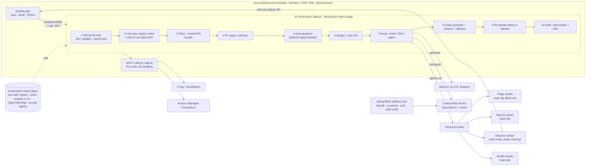

# Sidecar Pattern for GenAI: Retrofitting RAG, Multi-Agent AI & AI Governance into Existing Systems

> **The architect's question this answers:** "We have many existing services: a job scheduler, a ticketing platform, a CRM ingestion engine, an AML platform, a SaaS product. How do we add RAG and agents to all of them **without rewriting each one**, and **with consistent AI governance**?"
>
> **Short answer:** a thin **AI Governance Sidecar** in every pod enforces identity, policy, PII redaction, guardrails, budgets, telemetry and audit **locally**. A **central AI platform** provides the heavy capabilities: RAG retrieval, Temporal-orchestrated multi-agent workflows, Spring Batch backfills and evals. The application only ever calls `http://localhost:15000`.
>
> Stack: **Spring Boot 3 · Spring Security (OAuth2 resource server + token exchange) · Spring AOP · Temporal · Spring Batch · OpenTelemetry (ADOT) · Micrometer · Resilience4j · Amazon Bedrock · EKS/ROSA**

---

## 1. Why a sidecar for GenAI?

| Problem in a brownfield estate | How the sidecar solves it |
|---|---|
| Every team integrates LLMs differently (SDKs, keys, prompts in code) | One local API (`/v1/generate`, `/v1/rag/query`, `/v1/agents/run`) for every language: Java, Node, Python |
| Governance can't be enforced if each app calls Bedrock directly | Only the sidecar holds Bedrock credentials. Apps can't bypass it |
| PII must not leave the pod unredacted | Redaction happens **inside the pod** before any network hop |
| Legacy apps can't be modified much (scheduler is tier-0) | App change is a single HTTP call. The governance logic ships and versions **independently** |
| Telemetry is inconsistent | Sidecar emits standard OTel GenAI spans and Micrometer metrics for every AI call |
| Policies change faster than apps release | Sidecar pulls signed **policy bundles** (OPA/Cedar) and **AppConfig** flags at runtime, including the kill switch |

### Sidecar vs. library vs. central gateway: the trade-off (say this in interviews)

| Option | Pros | Cons | Verdict |
|---|---|---|---|
| **In-process library/SDK** | No extra hop; simple | One per language; upgrade means redeploying every app; can be bypassed | Fine for 1–2 Java services |
| **Central AI gateway** (shared service) | One deployment; easy to operate | Raw PII crosses the network to the gateway; single choke point; noisy-neighbour risk | Good for stateless model proxying |
| **Sidecar (thin)** | Language-agnostic; local redaction; per-pod isolation; independent releases | Per-pod resource overhead; fleet-wide rollout of sidecar versions | ✅ For **enforcement**: identity, policy, PII, guardrails, telemetry, egress |
| **Hybrid: thin sidecar + central AI platform** | Best of both | More moving parts | ✅✅ **Chosen**: the sidecar enforces, the platform provides RAG, agents and evals |

> **Soundbite:** "The sidecar is the *policy enforcement point*. The central platform is the *capability provider*. Governance travels with the workload; capabilities scale centrally."

---

## 2. Architecture



### The governance chain (order matters)

| # | Step | Technology | Fails closed? |
|---|---|---|---|
| 1 | Authenticate, bind tenant/user | **Spring Security** OAuth2 Resource Server; `@TenantScoped` aspect | Yes, 401 |
| 2 | Is this **use case** registered and approved for this app + tenant? | Use-case registry (signed bundle) | Yes, 403 `USE_CASE_NOT_APPROVED` |
| 3 | Policy (role, data classification, time windows) | Cedar (Verified Permissions) or OPA | Yes |
| 4 | PII redaction / reversible tokenization | Presidio/Comprehend + token vault | Yes, if the classifier is unavailable |
| 5 | Input guardrail | Bedrock `ApplyGuardrail` | Configurable per use-case risk tier |
| 6 | Budget + rate limit | Bucket4j (Redis) per tenant, per use case | Yes, 429 + `Retry-After` |
| 7 | Route | Model router / RAG / Temporal | — |
| 8 | Output guardrail, JSON schema, citation check | Guardrail + validators | Yes, degrades to safe response |
| 9 | Re-hydrate PII tokens only for authorized users | Token vault + Spring Security authority | — |
| 10 | Audit, metrics, traces | Hash-chained audit → MSK → S3 Object Lock; Micrometer; OTel | Audit write failure = request fails for high-risk use cases |

---

## 3. AI governance: what the sidecar actually enforces

### 3.1 Use-case registry (the governance board's output, as code)

```yaml
# governance/use-cases/scheduler-failure-triage.yaml  (signed, bundled to S3, pulled by sidecars)
id: scheduler-failure-triage
owner: platform-ops
apps: [centralized-scheduler]
riskTier: MEDIUM                 # LOW / MEDIUM / HIGH (HIGH requires HITL for any write)
status: APPROVED                 # DRAFT / APPROVED / SUSPENDED (kill switch)
approvedModels: [claude-haiku-class, claude-sonnet-class]
dataClasses:
  allowedInPrompt: [C1, C2, C3_REDACTED]
  forbidden: [C4]
capabilities: [rag.query, generate]          # NOT agents.run
humanOversight: { requiredFor: [] }
evaluation:
  evidence: s3://evals/reports/triage@7.2.0.json
  minFaithfulness: 0.90
budgets: { tokensPerDayPerTenant: 2_000_000, maxOutputTokens: 800 }
retention: { promptAudit: P7Y, contentEncryptedWith: TENANT_CMK }
reviewedAt: 2026-09-14
nextReview: 2027-03-14
---
id: scheduler-auto-remediation
riskTier: HIGH
status: APPROVED
capabilities: [agents.run]
agents: { workflow: RemediationWorkflow, maxSteps: 12, maxTokens: 20000 }
humanOversight: { requiredFor: [DESTRUCTIVE] }
tenants: { excluded: [bank-grade-tenant] }    # contractual: no autonomous actions
```

### 3.2 Governance pillars → enforcement point

| Pillar | Control | Where enforced |
|---|---|---|
| **Inventory** | Every AI use case registered with an owner, risk tier and review date | Use-case registry; sidecar rejects unregistered calls |
| **Approved models** | Model allow-list per use case | Sidecar router **+** IAM resource list (defence in depth) |
| **Data governance** | Classification ceiling, PII redaction, residency | Sidecar steps 3–4; region-pinned Bedrock |
| **Human oversight** | HITL for HIGH-risk writes | Temporal workflow waits on an approval signal |
| **Transparency** | Citations, model + prompt version in every response | Response envelope; audit |
| **Evaluation evidence** | Use case can't be APPROVED without an eval report above thresholds | CI gate + registry field |
| **Accountability / audit** | Who asked what, which model, which data, which action | Hash-chained audit, CloudTrail data events |
| **Kill switch** | Suspend a use case or model fleet-wide in seconds | **AWS AppConfig** flag polled by sidecars (30 s) |
| **Cost** | Per-tenant, per-use-case budgets | Sidecar step 6; Bedrock application inference profiles for showback |

---

## 4. Sidecar implementation (Spring Boot 3)

### 4.1 Local API contract (language-agnostic)

```bash
# From the scheduler (Java), the Node ticketing app, or a Python ETL: the same call
curl -s http://localhost:15000/v1/rag/query \
  -H "Authorization: Bearer $USER_JWT" \
  -H "X-Use-Case: scheduler-failure-triage" \
  -H "Content-Type: application/json" \
  -d '{"question":"Why did INV-RECON-0419 fail?","context":{"jobId":"INV-RECON-0419"}}'
```

```json
{
  "answer": { "rootCause": "...", "evidence": [{"chunkId": "rb-212#3"}], "nextSteps": ["..."], "confidence": 0.82 },
  "governance": { "useCase": "scheduler-failure-triage", "model": "claude-haiku-class",
                  "promptVersion": "triage@7.2.0", "guardrail": "NONE", "piiRedacted": 2,
                  "auditId": "aud-9f2c", "traceId": "4bf92f3577b34da6a3ce929d0e0e4736" }
}
```

### 4.2 Spring Security: validate the user JWT, derive tenant, and exchange the token for downstream calls

```java
@Configuration
@EnableMethodSecurity
class SidecarSecurityConfig {

    @Bean
    SecurityFilterChain api(HttpSecurity http) throws Exception {
        http
            .securityMatcher("/v1/**")
            .authorizeHttpRequests(a -> a
                .requestMatchers("/v1/agents/**").hasAuthority("SCOPE_copilot.agent")
                .requestMatchers("/v1/rag/**", "/v1/generate").hasAuthority("SCOPE_copilot.read")
                .anyRequest().denyAll())
            .oauth2ResourceServer(o -> o.jwt(j -> j.jwtAuthenticationConverter(tenantAwareConverter())))
            .sessionManagement(s -> s.sessionCreationPolicy(SessionCreationPolicy.STATELESS))
            .csrf(AbstractHttpConfigurer::disable);
        return http.build();
    }

    /** Maps scopes + roles and REQUIRES a tenant claim. No tenant, no AI. */
    @Bean
    Converter<Jwt, AbstractAuthenticationToken> tenantAwareConverter() {
        var scopes = new JwtGrantedAuthoritiesConverter();
        return jwt -> {
            String tenant = jwt.getClaimAsString("tenant_id");
            if (tenant == null) throw new BadJwtException("missing tenant_id");
            Collection<GrantedAuthority> auth = new ArrayList<>(scopes.convert(jwt));
            jwt.getClaimAsStringList("roles").forEach(r -> auth.add(new SimpleGrantedAuthority("ROLE_" + r)));
            return new JwtAuthenticationToken(jwt, auth, jwt.getSubject());
        };
    }

    /** RFC 8693 token exchange: agents/tools call downstream AS THE USER (no confused deputy). */
    @Bean
    OAuth2AuthorizedClientManager authorizedClientManager(ClientRegistrationRepository regs,
                                                          OAuth2AuthorizedClientService clients) {
        var provider = OAuth2AuthorizedClientProviderBuilder.builder()
                .provider(new TokenExchangeOAuth2AuthorizedClientProvider())   // Spring Security 6.3+
                .clientCredentials()
                .build();
        var manager = new AuthorizedClientServiceOAuth2AuthorizedClientManager(regs, clients);
        manager.setAuthorizedClientProvider(provider);
        return manager;
    }
}
```

Method security on agent tools, which runs inside Temporal activities:
```java
@PreAuthorize("hasAuthority('SCOPE_job:rerun') and @tenantGuard.ownsJob(#jobId)")
public RunRef rerunStep(String jobId, String step) { ... }
```

### 4.3 The governance chain as composable steps

```java
public interface GovernanceStep {
    int order();
    AiRequest apply(AiRequest req) throws GovernanceDenied;          // may transform (e.g. redact)
    default AiResponse after(AiRequest req, AiResponse res) { return res; }
}

@Component @Order(20)
@RequiredArgsConstructor
class UseCaseRegistryStep implements GovernanceStep {
    private final UseCaseRegistry registry;           // refreshed from signed S3 bundle
    private final FeatureFlags appConfig;             // AWS AppConfig: kill switch
    public int order() { return 20; }
    public AiRequest apply(AiRequest r) {
        UseCase uc = registry.find(r.useCaseId())
                .orElseThrow(() -> new GovernanceDenied("USE_CASE_NOT_REGISTERED"));
        if (uc.status() != Status.APPROVED || appConfig.isOn("killswitch." + uc.id()))
            throw new GovernanceDenied("USE_CASE_SUSPENDED");
        if (!uc.apps().contains(r.callerApp()) || uc.excludesTenant(r.tenantId()))
            throw new GovernanceDenied("USE_CASE_NOT_ALLOWED_FOR_CALLER");
        if (!uc.capabilities().contains(r.capability()))
            throw new GovernanceDenied("CAPABILITY_NOT_APPROVED");
        return r.withUseCase(uc);
    }
}

@Component @Order(40)
@RequiredArgsConstructor
class PiiRedactionStep implements GovernanceStep {
    private final PiiDetector detector;               // Presidio / Comprehend
    private final TokenVault vault;                   // reversible tokens, tenant-scoped, KMS-encrypted
    public int order() { return 40; }
    public AiRequest apply(AiRequest r) {
        var findings = detector.detect(r.text());
        if (findings.stream().anyMatch(f -> f.dataClass() == DataClass.C4))
            throw new GovernanceDenied("C4_DATA_FORBIDDEN");
        String redacted = vault.tokenize(r.tenantId(), r.text(), findings);   // "Card 4111..." → "<PII_7f3a>"
        Metrics.counter("ai.pii.redacted", "useCase", r.useCaseId()).increment(findings.size());
        return r.withText(redacted);
    }
    @Override public AiResponse after(AiRequest r, AiResponse res) {
        return r.principal().hasAuthority("PII_VIEW") ? res.map(t -> vault.detokenize(r.tenantId(), t)) : res;
    }
}

@Service
@RequiredArgsConstructor
class GovernedAiService {
    private final List<GovernanceStep> steps;          // Spring injects in @Order order
    private final CapabilityRouter router;            // generate | rag.query | agents.run
    private final ObservationRegistry observations;

    public AiResponse handle(AiRequest req) {
        return Observation.createNotStarted("gen_ai.governed_request", observations)
                .lowCardinalityKeyValue("use_case", req.useCaseId())
                .lowCardinalityKeyValue("capability", req.capability().name())
                .lowCardinalityKeyValue("caller_app", req.callerApp())
                .highCardinalityKeyValue("tenant.id", req.tenantId())
                .observe(() -> {
                    AiRequest r = req;
                    for (GovernanceStep s : steps) r = s.apply(r);
                    AiResponse res = router.route(r);
                    for (GovernanceStep s : steps.reversed()) res = s.after(r, res);  // Java 21
                    return res;
                });
    }
}
```

### 4.4 Kubernetes / ROSA deployment: native sidecars + credential isolation

```yaml
apiVersion: apps/v1
kind: Deployment
metadata: { name: centralized-scheduler }
spec:
  replicas: 6
  template:
    metadata:
      annotations:
        # IRSA: inject AWS web-identity creds ONLY into the sidecar, not the app container
        eks.amazonaws.com/skip-containers: "scheduler"
    spec:
      serviceAccountName: scheduler-ai-sidecar          # IRSA role: bedrock:InvokeModel via VPCE only
      initContainers:                                   # native sidecars (K8s 1.29+): start first, stop last
        - name: ai-governance-sidecar
          image: 111122223333.dkr.ecr.ap-south-1.amazonaws.com/ai-sidecar:1.8.0   # GraalVM native image
          restartPolicy: Always
          ports: [{ containerPort: 15000 }]
          env:
            - { name: SIDECAR_CALLER_APP, value: centralized-scheduler }
            - { name: POLICY_BUNDLE_URI,  value: s3://ai-governance/bundles/prod/latest.tar.gz }
            - { name: APPCONFIG_PROFILE,  value: ai-flags-prod }
            - { name: OTEL_EXPORTER_OTLP_ENDPOINT, value: http://localhost:4317 }
          resources: { requests: { cpu: 100m, memory: 96Mi }, limits: { memory: 192Mi } }
          readinessProbe: { httpGet: { path: /actuator/health/readiness, port: 15001 } }
          securityContext: { runAsNonRoot: true, readOnlyRootFilesystem: true, allowPrivilegeEscalation: false }
        - name: adot-collector
          image: public.ecr.aws/aws-observability/aws-otel-collector:latest
          restartPolicy: Always
          args: ["--config=/conf/otel.yaml"]
          volumeMounts: [{ name: otel-conf, mountPath: /conf }]
      containers:
        - name: scheduler
          image: 111122223333.dkr.ecr.ap-south-1.amazonaws.com/scheduler:5.4.2
          env:
            - { name: AI_SIDECAR_URL, value: http://localhost:15000 }
            - { name: JAVA_TOOL_OPTIONS, value: "-javaagent:/otel/opentelemetry-javaagent.jar" }
      volumes: [{ name: otel-conf, configMap: { name: adot-sidecar-config } }]
```

> **Nuance interviewers love:** Kubernetes `NetworkPolicy` is **pod-level**, so it can't stop the *app container* from calling Bedrock while allowing the *sidecar*. Enforcement is therefore by **credentials**: only the sidecar receives IRSA creds (`skip-containers`), and the Bedrock **VPC endpoint policy** only allows the sidecar role. Third-party AI APIs go through an egress proxy that requires an mTLS client cert mounted only into the sidecar.

> **Overhead:** a JVM sidecar costs ~300 MB per pod, which is too much across hundreds of pods. A **GraalVM native image** brings it to ~60–90 MB RSS with ~50 ms startup. The localhost hop adds **< 1 ms**.

---

## 5. Temporal: durable multi-agent workflows (where Temporal is used for GenAI)

### Division of labour
| Component | Owns | Why |
|---|---|---|
| **Quartz scheduler** (existing) | *When* things run: cron, fire-and-forget, chained batch jobs | Already proven at 1.2M executions/day |
| **Temporal** | *How long-running AI work survives*: multi-agent remediation, HITL waits (minutes to days), compensation, exact replay | Durable execution; LLM calls as retryable activities; signals for approvals |
| **Spring Batch** | *Bulk data* AI work: corpus backfill, re-embedding, offline eval, audit verification | Chunk-oriented, restartable, skip/retry reports |
| **Kafka (MSK)** | *Incremental, real-time* events: `job.failed`, `doc.changed` | Decoupling, replay |

Flow: `job.failed` (Kafka) → sidecar `/v1/agents/run` → **Temporal `RemediationWorkflow`** → per-role activities on separate task queues → tool calls back to the scheduler through its sidecar → HITL signal → verify → audit.

### Why Temporal for agents (and why not)
| Option | Verdict |
|---|---|
| **Temporal** ✅ | Workflow code *is* the state machine. Timers and approvals survive restarts. Activity retries with non-retryable error types. **Per-task-queue workers allow per-agent IAM roles**. Full event history = audit replay |
| LangGraph checkpointer | Great for in-process agent graphs (used for prototypes, LTM Q9). Temporal adds cross-service durability, multi-day timers and an operational UI |
| Step Functions | Managed, visual. HITL via task tokens works, but complex agent logic in JSON/ASL is harder to test than Java |
| DB-table FSM (Phase 1, C2) | Worked. We hand-rolled timers, retries and leases that Temporal provides |
| Bedrock AgentCore | Use for *hosting* simpler agents and the MCP tool gateway. Durable HITL workflows stay in Temporal |

> **Determinism rule:** LLM calls are non-deterministic, so they **must** be activities, never workflow code. Workflow code only decides; activities do.

### Code: Temporal multi-agent workflow (Java SDK)

```java
@WorkflowInterface
public interface RemediationWorkflow {
    @WorkflowMethod RemediationOutcome run(RemediationRequest req);
    @SignalMethod  void approve(Approval approval);       // from Teams card → API GW → Lambda → signal
    @QueryMethod   RunSnapshot snapshot();                 // live state for the ops UI
}

/** Each agent role = separate activity interface on its OWN task queue (own worker, own IRSA role). */
@ActivityInterface public interface TriageAgent   { Diagnosis diagnose(RemediationRequest r); }
@ActivityInterface public interface PlannerAgent  { Plan plan(Diagnosis d, List<String> triedPlanHashes); }
@ActivityInterface public interface ExecutorAgent { ExecutionResult execute(Plan p, String approvedHash); }
@ActivityInterface public interface VerifierAgent { Verdict verify(String jobId); }

public class RemediationWorkflowImpl implements RemediationWorkflow {

    private static ActivityOptions opts(String queue) {
        return ActivityOptions.newBuilder()
                .setTaskQueue(queue)
                .setStartToCloseTimeout(Duration.ofMinutes(2))
                .setRetryOptions(RetryOptions.newBuilder()
                        .setInitialInterval(Duration.ofSeconds(1))
                        .setBackoffCoefficient(2.0)
                        .setMaximumAttempts(4)
                        .setDoNotRetry(                                    // deterministic failures: don't burn tokens
                                "com.acme.ai.UngroundedAnswerException",
                                "com.acme.ai.PolicyDeniedException",
                                "com.acme.ai.GovernanceDenied")
                        .build())
                .build();
    }

    private final TriageAgent   triage   = Workflow.newActivityStub(TriageAgent.class,   opts("agent-triage"));
    private final PlannerAgent  planner  = Workflow.newActivityStub(PlannerAgent.class,  opts("agent-planner"));
    private final ExecutorAgent executor = Workflow.newActivityStub(ExecutorAgent.class, opts("agent-executor"));
    private final VerifierAgent verifier = Workflow.newActivityStub(VerifierAgent.class, opts("agent-verifier"));

    private Approval approval;
    private final RunSnapshot snap = new RunSnapshot();
    private static final int MAX_REPLANS = 2;

    @Override
    public RemediationOutcome run(RemediationRequest req) {
        snap.state = "DIAGNOSING";
        Diagnosis d = triage.diagnose(req);
        if (d.confidence() < 0.6) return RemediationOutcome.escalated("low confidence", d);

        List<String> tried = new ArrayList<>();
        for (int attempt = 0; attempt <= MAX_REPLANS; attempt++) {
            snap.state = "PLANNING";
            Plan plan = planner.plan(d, tried);
            if (tried.contains(plan.hash())) return RemediationOutcome.escalated("loop detected", d);
            tried.add(plan.hash());

            String approvedHash = null;
            if (plan.riskTier() == RiskTier.DESTRUCTIVE) {
                snap.state = "AWAITING_APPROVAL";
                approval = null;
                // Durable timer: survives pod restarts and deploys; no thread is held
                boolean got = Workflow.await(Duration.ofHours(4), () -> approval != null);
                if (!got) return RemediationOutcome.escalated("approval timeout", d);
                if (!approval.approved() || !approval.planHash().equals(plan.hash()))
                    return RemediationOutcome.escalated("rejected or plan mismatch", d);
                approvedHash = approval.planHash();
            }

            snap.state = "EXECUTING";
            executor.execute(plan, approvedHash);          // idempotency key = workflowId + plan hash

            snap.state = "VERIFYING";
            if (verifier.verify(req.jobId()).ok()) return RemediationOutcome.resolved(plan);
        }
        return RemediationOutcome.escalated("max replans", d);
    }

    @Override public void approve(Approval a) { this.approval = a; }
    @Override public RunSnapshot snapshot()   { return snap; }
}
```

Starting it from the sidecar (`/v1/agents/run`), idempotent per failed job:
```java
WorkflowOptions o = WorkflowOptions.newBuilder()
        .setTaskQueue("remediation-orchestrator")
        .setWorkflowId("remediate-" + tenantId + "-" + jobId + "-" + failureEventId)  // dedupe
        .setWorkflowIdReusePolicy(WorkflowIdReusePolicy.WORKFLOW_ID_REUSE_POLICY_REJECT_DUPLICATE)
        .setTypedSearchAttributes(SearchAttributes.newBuilder()
                .set(SearchAttributeKey.forKeyword("TenantId"), tenantId).build())     // ops UI filter per tenant
        .build();
WorkflowClient.start(client.newWorkflowStub(RemediationWorkflow.class, o)::run, request);
```

Executor activity: **the only place with write tools**, still policy-checked:
```java
@Component
@RequiredArgsConstructor
public class ExecutorAgentImpl implements ExecutorAgent {
    private final SchedulerToolsViaSidecar tools;      // calls the scheduler's sidecar with the exchanged user token

    @Override
    public ExecutionResult execute(Plan plan, String approvedHash) {
        String idem = Activity.getExecutionContext().getInfo().getWorkflowId() + ":" + plan.hash();
        return tools.apply(plan, approvedHash, idem);  // sidecar runs policy + audit on every tool call
    }
}
```

> **Least privilege per agent:** the `agent-executor` worker Deployment runs under a service account whose IRSA role and OAuth client are the **only** ones allowed `job:rerun`/`job:pause` scopes. Triage, Planner and Verifier workers physically cannot mutate anything.

---

## 6. Spring Batch: where it's used for GenAI

| Batch job | Trigger | What it does | Why Spring Batch |
|---|---|---|---|
| `tenant-corpus-onboarding` | Manual / new tenant | Reads a legacy corpus (S3 exports, DB tables) → classify → redact → chunk → embed → upsert | Restartable from the last committed chunk; skip report of poison docs |
| `reembed-corpus` | New embedding model approved | Re-embeds 420k chunks into a **new index**, then the alias is swapped after eval | Partitioned by tenant, parallel, resumable |
| `offline-eval-nightly` | Quartz cron 02:00 | Runs the golden set against current prompt/model, writes report to S3, publishes metrics | Deterministic, reproducible, audited runs |
| `audit-chain-verify` | Quartz cron 03:00 | Re-computes per-tenant hash chains over S3 audit objects; alerts on a break | Large sequential scan with checkpoints |
| `failure-digest-batch` | Quartz cron 01:30 | Builds JSONL → **Bedrock batch inference** → parses output → files tickets | Chunked I/O around an async batch API |

> **Kafka vs Spring Batch:** Kafka handles **incremental** changes (a runbook edit is re-embedded in < 2 min). Spring Batch handles **bulk** work where restartability, skip/retry accounting and a run report matter more than latency. The Quartz scheduler triggers the batch jobs, so we use our own platform for this.

### Code: partitioned, fault-tolerant re-embedding job

```java
@Configuration
@RequiredArgsConstructor
class ReembedJobConfig {

    private final JobRepository jobRepository;
    private final PlatformTransactionManager tx;

    @Bean
    Job reembedCorpusJob(Step reembedManager) {
        return new JobBuilder("reembed-corpus", jobRepository)
                .incrementer(new RunIdIncrementer())
                .listener(new EvalGateListener())               // afterJob: run recall eval → swap alias only if ≥ 0.85
                .start(reembedManager)
                .build();
    }

    /** One partition per tenant → parallel, and a failure in one tenant doesn't redo the others. */
    @Bean
    Step reembedManager(Step reembedWorker, TenantPartitioner partitioner, TaskExecutor batchExecutor) {
        return new StepBuilder("reembed-manager", jobRepository)
                .partitioner("reembed-worker", partitioner)
                .step(reembedWorker)
                .gridSize(8)
                .taskExecutor(batchExecutor)
                .build();
    }

    @Bean
    Step reembedWorker(JdbcPagingItemReader<SourceChunk> reader,
                       ItemProcessor<SourceChunk, RedactedChunk> redactor,
                       ItemWriter<RedactedChunk> embedWriter) {
        return new StepBuilder("reembed-worker", jobRepository)
                .<SourceChunk, RedactedChunk>chunk(64, tx)       // 64 = one Bedrock embedding micro-batch
                .reader(reader)
                .processor(redactor)                            // classify + PII redact per item; drop C4 (return null)
                .writer(embedWriter)                            // batch embed + idempotent upsert
                .faultTolerant()
                .retry(ThrottlingException.class)               // Bedrock throttling → retry with backoff
                .retryLimit(5)
                .backOffPolicy(exponentialBackoff())
                .skip(PoisonDocumentException.class)            // corrupt PDF → skip, recorded in step metadata
                .skipLimit(200)
                .listener(new SkipAuditListener())              // skipped items → S3 report + audit event
                .build();
    }

    @Bean @StepScope
    JdbcPagingItemReader<SourceChunk> reader(DataSource ds,
            @Value("#{stepExecutionContext['tenantId']}") String tenantId) {
        return new JdbcPagingItemReaderBuilder<SourceChunk>()
                .name("chunkReader").dataSource(ds).pageSize(256)
                .selectClause("SELECT chunk_id, tenant_id, doc_id, text, classification, content_hash")
                .fromClause("FROM rag_source_chunks")
                .whereClause("WHERE tenant_id = :tenantId")
                .parameterValues(Map.of("tenantId", tenantId))
                .sortKeys(Map.of("chunk_id", Order.ASCENDING))
                .rowMapper(new DataClassRowMapper<>(SourceChunk.class))
                .build();
    }

    private BackOffPolicy exponentialBackoff() {
        var p = new ExponentialRandomBackOffPolicy();
        p.setInitialInterval(500); p.setMultiplier(2.0); p.setMaxInterval(10_000);
        return p;
    }
}

@Component
@RequiredArgsConstructor
class EmbedWriter implements ItemWriter<RedactedChunk> {
    private final EmbeddingModel titan;                 // Bedrock Titan v2 via LangChain4j
    private final VectorUpsertClient vectors;
    @Value("${reembed.target-index}") String targetIndex;  // e.g. rag-chunks-v13 (not yet live)

    @Override
    public void write(Chunk<? extends RedactedChunk> chunk) {
        var items = chunk.getItems();
        var segments = items.stream().map(RedactedChunk::toSegment).toList();
        var embeddings = titan.embedAll(segments).content();          // one call for 64 chunks
        vectors.upsert(targetIndex, items, embeddings);               // idempotent by chunk_id
    }
}
```

---

## 7. OpenTelemetry + Micrometer: how they divide the work for GenAI

| Concern | Tool | GenAI usage |
|---|---|---|
| **Traces** (one request end-to-end) | **OpenTelemetry**: Java agent in the app, Micrometer Tracing bridge (`micrometer-tracing-bridge-otel`) in the sidecar, Temporal OTel interceptor | App → sidecar → guardrail → retrieval → Bedrock → Temporal workflow → activities → tool calls → scheduler, **one trace ID** |
| **Metrics** (aggregates, SLOs) | **Micrometer** → OTLP or Prometheus remote-write → **Amazon Managed Prometheus** | Tokens, cost, guardrail interventions, PII redactions, policy denials, cache hit rate, retrieval scores, agent steps |
| **Observation API** (write once, get both) | **Micrometer Observation** | One `Observation` produces a timer metric **and** a span |
| **Collection / processing** | **ADOT collector sidecar** | PII-scrub span attributes, tail sampling, export to X-Ray + CloudWatch + AMP |
| **Logs** | Logback JSON with trace/span IDs → CloudWatch Logs | Correlate log lines to the AI trace |

### Semantic conventions we standardised on
`gen_ai.system=aws.bedrock`, `gen_ai.request.model`, `gen_ai.usage.input_tokens`, `gen_ai.usage.output_tokens`, plus our own: `ai.use_case`, `ai.prompt.version`, `ai.guardrail.action`, `ai.pii.redacted_count`, `rag.retrieval.top1_score`, `agent.workflow_id`, `agent.role`, `tenant.id` (traces only; tenant **tier** on metrics to control cardinality).

### Code: Micrometer metrics with cardinality discipline

```java
@Component
@RequiredArgsConstructor
class GenAiMetrics {
    private final MeterRegistry registry;

    void record(AiRequest req, AiResult r) {
        // LOW cardinality only on metrics: use_case (~30), model (~4), tenant_tier (3), outcome (~6)
        Tags tags = Tags.of("use_case", req.useCaseId(), "model", r.modelTier(),
                            "tenant_tier", req.tenantTier(), "outcome", r.outcome());
        registry.counter("gen_ai.tokens.input",  tags).increment(r.inputTokens());
        registry.counter("gen_ai.tokens.output", tags).increment(r.outputTokens());
        registry.counter("gen_ai.tokens.cached", tags).increment(r.cachedInputTokens());
        registry.counter("gen_ai.cost.usd_micros", tags).increment(r.costMicros());
        if (r.guardrailIntervened())
            registry.counter("gen_ai.guardrail.intervened", tags.and("source", r.guardrailSource())).increment();
        DistributionSummary.builder("rag.retrieval.top1_score").tags(tags)
                .publishPercentiles(0.5, 0.95).register(registry).record(r.top1Score());
    }
}
```

```yaml
# Sidecar application.yaml
management:
  tracing.sampling.probability: 1.0            # sample everything at source; the collector tail-samples
  otlp:
    tracing.endpoint: http://localhost:4318/v1/traces
    metrics.export: { url: http://localhost:4318/v1/metrics, step: 30s }
  observations.key-values: { service.tier: tier2-ai }
```

### ADOT collector sidecar: scrub, sample, export to AWS

```yaml
receivers:
  otlp: { protocols: { grpc: { endpoint: 0.0.0.0:4317 }, http: { endpoint: 0.0.0.0:4318 } } }

processors:
  memory_limiter: { check_interval: 1s, limit_mib: 150 }
  attributes/scrub:                       # defence in depth: prompt/response text must never leave the pod
    actions:
      - { key: gen_ai.prompt,      action: delete }
      - { key: gen_ai.completion,  action: delete }
      - { key: http.request.body,  action: delete }
      - { key: enduser.id,         action: hash }
  tail_sampling:
    decision_wait: 10s
    policies:
      - { name: errors,     type: status_code, status_code: { status_codes: [ERROR] } }
      - { name: guardrail,  type: string_attribute, string_attribute: { key: ai.guardrail.action, values: [INTERVENED] } }
      - { name: agents,     type: string_attribute, string_attribute: { key: ai.capability, values: [agents.run] } }
      - { name: slow,       type: latency, latency: { threshold_ms: 3000 } }
      - { name: baseline,   type: probabilistic, probabilistic: { sampling_percentage: 5 } }
  batch: {}
  resourcedetection: { detectors: [env, eks, ec2] }

extensions:
  sigv4auth: { region: ap-south-1, service: aps }

exporters:
  awsxray: { region: ap-south-1 }
  awsemf: { region: ap-south-1, namespace: GenAI/Sidecar, log_group_name: /genai/metrics }
  prometheusremotewrite:
    endpoint: https://aps-workspaces.ap-south-1.amazonaws.com/workspaces/ws-123/api/v1/remote_write
    auth: { authenticator: sigv4auth }

service:
  extensions: [sigv4auth]
  pipelines:
    traces:  { receivers: [otlp], processors: [memory_limiter, attributes/scrub, tail_sampling, resourcedetection, batch], exporters: [awsxray] }
    metrics: { receivers: [otlp], processors: [memory_limiter, resourcedetection, batch], exporters: [prometheusremotewrite, awsemf] }
```

---

## 8. Re-working other projects with the sidecar (from your resume)

| Project | GenAI capability added | Sidecar use cases (risk tier) | Platform pieces used | Key governance concern |
|---|---|---|---|---|
| **Centralized Job Scheduler** (Quartz/OpenShift) | Failure triage RAG, NL job ops, remediation agents | `scheduler-failure-triage` (MED), `scheduler-nl-ops` (MED, preview + confirm), `scheduler-auto-remediation` (HIGH) | Custom RAG, Temporal multi-agent, Spring Batch eval | Write actions on payment/GL jobs → HITL + OBO tokens |
| **Train ticketing platform** (~1M users/day, Kafka Saga) | Customer-support RAG over fare/refund policies; refund-eligibility agent | `ticketing-policy-qa` (LOW), `ticketing-refund-assist` (HIGH: money) | **Bedrock Knowledge Base** (long-tail RAG), Temporal for refund saga with HITL above a threshold | PII (passenger names, phone), payment data = C4 never in prompt; multilingual guardrails |
| **Morgan Stanley-style CRM ingestion** (12M records, 7k/s) | Email/chat classification, summarization, auto-logging suggestions | `crm-interaction-classify` (MED), `crm-summary` (MED) | **Spring Batch + Bedrock batch inference** for backfill; Kafka for real-time | Capital-markets compliance: MNPI detection, retention, supervision review; no autonomous writes |
| **AML platform** (watchlist / scenario manager) | Adverse-media summarization, explainable alert narratives | `aml-adverse-media-summary` (HIGH), `aml-alert-narrative` (HIGH) | RAG over screening sources with citations; strict HITL | Regulated decisioning: AI **assists**, analyst **decides**; full audit replay; model risk management review |
| **Spark ELT lakehouse** (Kafka → Hive/HBase → AWS) | NL-to-SQL for ops analysts | `lakehouse-nl2sql` (MED) | Template-constrained SQL, Lake Formation row/column permissions | Query only via user's Lake Formation grants; cost caps on scans |
| **getConsenso** (API governance SaaS) | AI contract review: explain breaking changes, suggest fixes, generate migration notes | `consenso-contract-review` (LOW-MED) | Node.js app calls the same sidecar API, so no Java required | Customer source code confidentiality; tenant isolation (already `tenant_id`/`api_key_id` audit) |
| **OpenHands agent work** | Governed code agents | `code-agent` (HIGH) | Temporal for long agent runs; sidecar for egress + secret redaction | Secret leakage, supply chain: dependency scan gates (already on resume) |

### Phased retrofit plan (strangler-style, per application)

| Phase | Duration | What changes | Exit criteria |
|---|---|---|---|
| **0: Observe** | 2 wks | Deploy sidecar in **log-only mode**; discover existing direct LLM calls (VPC flow logs, CloudTrail Bedrock events, code scan) | Inventory of AI usage; use cases registered |
| **1: Enforce read-only** | 3–4 wks | Route existing calls through the sidecar; turn on PII redaction, guardrails, audit; ship RAG Q&A | 0 direct model calls (IAM denies them); eval report above thresholds |
| **2: Agents with HITL** | 4–6 wks | Temporal workflows for actions; every write needs approval | 0 unauthorized actions; approval latency SLO met |
| **3: Bounded autonomy** | ongoing | Allow-listed low-risk actions run without HITL, per use case, per tenant | Governance board sign-off with eval + incident evidence |

---

## 9. Interview Q&A: sidecar & AI governance (2-min spoken answers)

### S1. "How would you introduce AI governance into many existing applications without rewriting them?"

> **Anchor:** "Make the governed path the only path. A sidecar enforces it locally and IAM makes bypassing it impossible."

"We had five very different systems: a Quartz job scheduler, a Kafka-based ticketing platform, a CRM ingestion engine, a Node.js SaaS product and a Spark lakehouse. Teams were starting to call LLMs directly, each with their own keys and prompts and no redaction or audit.

I introduced an **AI Governance Sidecar**: a small Spring Boot native-image container deployed next to each app. The app makes one localhost HTTP call with the user's JWT and a use-case ID. Inside the sidecar, a fixed chain runs: Spring Security validates the token and binds the tenant; the **use-case registry** checks that this AI use case is approved for this app and tenant; a Cedar/OPA policy checks data classification; PII is tokenized **inside the pod**; Bedrock Guardrails screens the input; budgets are enforced; then the request is routed to a model, to the central RAG service, or to a Temporal agent workflow. On the way back we validate the schema and citations, re-hydrate PII only for authorized users, and write a hash-chained audit record plus OTel traces and Micrometer metrics.

The crucial part is that **bypassing is impossible**. Only the sidecar container gets IRSA credentials, and the Bedrock VPC endpoint policy only accepts the sidecar role. The governance board's decisions are code: a signed use-case bundle the sidecars pull, plus an AppConfig kill switch that suspends a use case fleet-wide in about 30 seconds.

We rolled it out in phases. First log-only discovery, then enforcement for read-only RAG, then agents with HITL. Within one quarter all AI traffic went through governance, with zero direct model calls, and onboarding a new AI use case dropped from weeks of security review to a few days, because the controls were already there."

| STAR | |
|---|---|
| S | 5 heterogeneous systems; ungoverned direct LLM calls emerging |
| T | Uniform governance without rewrites |
| A | Thin sidecar (enforcement) + central platform (capabilities) + IAM lock-down + use-case registry + AppConfig kill switch + phased rollout |
| R | **100%** of AI traffic governed in one quarter; **0** direct model calls; use-case onboarding **~4 weeks → ~4 days** |

### S2. "Sidecar vs a central AI gateway: why not just a gateway?"

> **Anchor:** "A gateway is fine for routing; it's the wrong place to *see raw PII*."

"I actually use both, with different responsibilities. A central gateway alone means raw prompts, with customer names, account numbers and log lines, travel across the network before anything is redacted. It also becomes a shared choke point where one tenant's spike hurts everyone. The sidecar does the **enforcement that must happen close to the data**: identity, redaction, guardrails, budgets, telemetry and egress control. The **central platform** does what benefits from pooling: retrieval indexes, Temporal workers, rerankers, eval jobs. The costs of the sidecar are memory per pod and fleet-wide version rollout. We solved the first with a GraalVM native image (about 80 MB) and the second with the same progressive delivery we use for apps. The localhost hop is under a millisecond, which is nothing next to an LLM call."

### S3. "Where does Temporal fit compared with your Quartz scheduler and Spring Batch?"

> **Anchor:** "Quartz decides *when*, Temporal makes long AI work *survive*, Spring Batch moves *bulk data*."

"Quartz stays the trigger engine: cron, fire-and-forget and chained batch jobs, 1.2 million a day. Temporal took over **long-running, stateful AI work**: the multi-agent remediation flow. That workflow can wait four hours for a human approval, must not re-execute a pause after a pod restart, and needs a complete history for auditors. In Temporal the workflow code *is* the state machine. LLM and tool calls are activities with retry policies that mark policy denials and ungrounded answers as non-retryable. Approvals arrive as signals, and a query exposes live state to the ops UI. Each agent role runs on its own task queue with its own IAM role, so only the Executor worker can mutate jobs. Spring Batch handles **bulk** AI data work: onboarding a tenant's legacy corpus, re-embedding 420k chunks when we change embedding model, nightly offline evals and audit-chain verification. Those need restartability and skip reports more than low latency. Kafka handles the incremental, real-time path."

### S4. "How do OpenTelemetry and Micrometer work together in your GenAI stack?"

> **Anchor:** "Micrometer Observation is where I instrument; OpenTelemetry is how it travels; ADOT is where it's cleaned and shipped."

"In the sidecar I instrument once with the **Micrometer Observation API**. One observation produces both a timer metric and a span through the OTel tracing bridge. Metrics carry only **low-cardinality** tags (use case, model tier, tenant tier, outcome), because tenant ID or user ID on metrics would explode Prometheus. High-cardinality data like tenant ID, workflow ID and prompt version go on **spans**. The scheduler itself uses the OTel Java agent, and Temporal has an OTel interceptor, so a single trace runs from the scheduler, through the sidecar, guardrail, retrieval and Bedrock, into the Temporal workflow and each agent activity, and back to the scheduler's tool endpoint. The **ADOT collector sidecar** deletes any prompt or completion attributes as defence in depth, tail-samples (keeping all errors, guardrail interventions, agent runs and slow requests, plus 5% of the rest), and exports traces to X-Ray and metrics to Amazon Managed Prometheus. Dashboards and burn-rate alerts live in Managed Grafana. That's how we caught the silent embedding-version drift within minutes."

### S5. "How does Spring Security carry the user's identity into agents and tools?"

> **Anchor:** "The agent borrows the user's authority; it never has its own superpowers."

"The app forwards the user's JWT to the sidecar. Spring Security's OAuth2 resource server validates it and our converter refuses tokens without a tenant claim. When a Temporal agent needs to call a tool, for example re-running a step on the scheduler, the sidecar performs an **RFC 8693 token exchange** using Spring Security's token-exchange client support. The resulting downstream token is audience-restricted to the scheduler and carries the **user's** scopes plus an `act` claim identifying the agent. The scheduler's own `@PreAuthorize` checks, such as `hasAuthority('SCOPE_job:rerun') and @tenantGuard.ownsJob(#jobId)`, run exactly as they would for a human click. So if the user can't delete jobs in the UI, the agent can't either, and the audit shows both identities: the user, and the agent acting on their behalf."

### S6. "What AI governance controls would you put in place on day one for a new client?"

> **Anchor:** "Inventory, approved models, data rules, human oversight, evaluation evidence, audit, kill switch: all enforced in code."

"Seven controls. **One, an inventory**: every AI use case registered with an owner, risk tier and review date. Unregistered calls are rejected by the sidecar. **Two, approved models**: a per-use-case allow-list, mirrored in the IAM resource policy so code can't drift. **Three, data rules**: a classification ceiling per use case, PII redaction before prompts, region pinning for residency. **Four, human oversight**: HIGH-risk writes require plan-hash-bound approval in a Temporal workflow. **Five, evaluation evidence**: a use case can't move to APPROVED without an eval report over its thresholds, produced by our nightly Spring Batch eval job. **Six, audit**: hash-chained records, encrypted content under tenant keys, Object Lock. **Seven, a kill switch** in AppConfig that suspends a use case or a model fleet-wide. I map these to the client's framework, whether that's internal model-risk policy, ISO/IEC 42001 or the EU AI Act risk tiers, but the enforcement is the same sidecar either way."

---

## 10. Quick reference: where each technology is used for GenAI

| Technology | Used for (GenAI) | Not used for |
|---|---|---|
| **Spring Security** | JWT validation, tenant binding, scopes per capability, RFC 8693 token exchange for agents, `@PreAuthorize` on tools | Model access control (that's IAM + use-case registry) |
| **Spring AOP** | `@TenantScoped`, `@AgentTool`, `@AiObserved`, `@AiAudited`, `@Guarded`, Resilience4j | Business logic |
| **Temporal** | Durable multi-agent workflows, HITL approvals (signals), compensation, per-agent task queues/IAM | Cron triggering (Quartz), bulk ETL (Spring Batch) |
| **Spring Batch** | Corpus onboarding, re-embedding, offline evals, audit verification, Bedrock batch inference wrapping | Real-time indexing (Kafka) |
| **Quartz scheduler** | Triggers batch/eval jobs, nightly digests; the system being made AI-enabled | Long-lived agent state |
| **OpenTelemetry / ADOT** | End-to-end traces across app → sidecar → Bedrock → Temporal; PII scrubbing; tail sampling; export to X-Ray | Business audit (separate, tamper-evident) |
| **Micrometer** | Token, cost, guardrail, PII, cache, retrieval-score metrics; Observation API for metrics + spans | High-cardinality IDs |
| **Resilience4j** | Bedrock/RAG circuit breakers, single-owner retries, bulkheads, rate limits | Retrying deterministic AI failures |
| **AWS AppConfig** | Prompt rollout %, routing table, kill switch | Secrets |
| **Bedrock Guardrails** | Prompt-attack, PII, denied topics, grounding checks (also standalone via `ApplyGuardrail`) | Authorization decisions |
