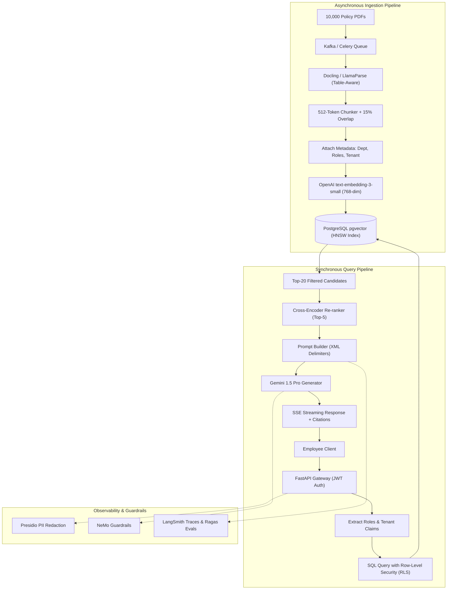
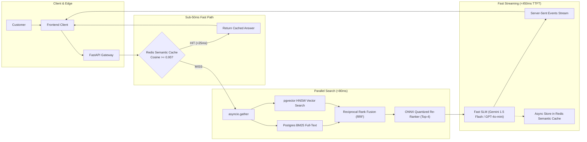
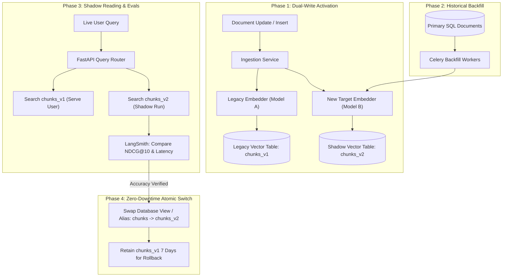

# Level 4 — Architect and System Design RAG Interview Questions & Spoken Answers

> **Target Role:** Senior AI Engineer / Enterprise AI Solution Architect  
> **Spoken Target:** Full ~2 minutes per answer (260–280 words at 150 wpm)  
> **Delivery Style:** First person, conversational, confident, zero bullet points inside spoken answers.
> **System Design Structure (S7–S9):** `Clarify requirements -> Ingestion -> Retrieval -> Generation -> Evaluation -> Security -> Cost/Scale -> Monitoring` + Mermaid Architecture Flowcharts.
> **STAR Post-Mortem (S13):** Realistic production incident based on FastAPI + Neon pgvector + Upstash Redis + Gemini API.

---

## S1 — With 1M-token context models, is RAG dead?

### Spoken answer (~240 words, ~96 sec)

RAG is emphatically not dead; in fact, million-token context windows make RAG architectures more necessary and cost-effective than ever in enterprise production. While models like Gemini 1.5 Pro can ingest entire codebases or hundreds of PDF pages in a single prompt, relying on massive context stuffing introduces crippling operational bottlenecks in latency, financial cost, knowledge freshness, and retrieval fidelity. From a latency perspective, passing 500,000 tokens through a transformer's pre-fill attention mechanism incurs a Time-to-First-Token of 15 to 30 seconds, which utterly violates user-facing enterprise interactive SLAs. Financially, at standard API pricing of roughly $2.50 per million input tokens, stuffing a corporate repository into every single query costs over $1.25 per turn; in contrast, a precise RAG retrieval step fetching 2,000 targeted tokens costs fractions of a cent, reducing operational inference expenditures by 99%. Furthermore, empirical research on the 'lost-in-the-middle' phenomenon demonstrates that attention mechanisms experience recall degradation when searching for needle-in-a-haystack facts buried within hundreds of thousands of tokens, especially when distractors are present. Finally, enterprise security mandates access control: stuffing documents directly into a global prompt bypasses row-level security, whereas RAG dynamically enforces tenant isolation and user permissions at retrieval time. The future is not RAG versus long-context; it is a hybrid architecture where RAG retrieves the top 10 relevant documents, and long-context windows process those documents thoroughly without aggressive chunk fragmentation. In production, RAG is your routing and security filter, while long context is your synthesis engine.

#### Key Terms
- **Million-token context windows**
- **Lost-in-the-middle phenomenon**
- **Pre-fill inference latency**
- **Inference unit economics**
- **Hybrid retrieval-synthesis**

#### Likely Follow-ups
- **Q: When is it appropriate to use a long-context window without RAG?**  
  *A: For deep document analysis, code repository refactoring, or multi-document comparison where the entire corpus is static, known upfront, and fits within a single offline analytical batch.*
- **Q: How does prompt caching alter the cost equation for long-context models?**  
  *A: Prompt caching reduces repeated token costs by up to 75%, making long context more viable for stable static documents, but it still does not solve dynamic data updates or granular user permissions.*

#### Red Flags
- ⚠️ *Claiming that 1M-token context models make vector databases and RAG obsolete overnight without considering cost, latency, or access control.*

---

## S2 — What is contextual retrieval?

### Spoken answer (~238 words, ~95 sec)

Contextual retrieval is an advanced ingestion architecture pioneered by Anthropic that prepends document-level contextual explanations to every individual text chunk before embedding and indexing, completely eliminating context loss caused by naive document splitting. In traditional RAG, when a document is split into 512-token chunks, individual chunks frequently contain ambiguous pronouns, undefined acronyms, or orphaned data rows—such as a financial table stating 'revenue grew by 18%' without specifying the company name, year, or fiscal quarter—causing retrieval algorithms to fail. Contextual retrieval solves this by passing the entire parent document alongside each individual chunk through a fast language model during offline ingestion, generating a concise, two-sentence contextual preamble that explicitly identifies the document subject, relevant entities, and situational scope. This synthesized preamble is prepended to the chunk text; we then compute both the dense vector embedding and the BM25 sparse index over this enriched contextualized chunk. In our enterprise financial analytics platform on FastAPI and Neon pgvector, implementing contextual retrieval reduced failed chunk retrievals by 42% across complex SEC filings. While generating preambles across tens of thousands of chunks requires substantial LLM inference during ingestion, we leverage prompt caching on models like Gemini 1.5 Flash or Claude Haiku, keeping one-time ingestion costs under $25 for 50,000 corporate documents. The trade-off is higher initial indexing latency and slightly larger chunk token footprints during runtime prompt generation. In production, contextual retrieval provides the highest accuracy gains for tabular and pronoun-heavy enterprise corpora.

#### Key Terms
- **Contextual retrieval**
- **Contextual preambles**
- **Prompt caching during ingestion**
- **Orphaned data resolution**
- **BM25 contextual indexing**

#### Likely Follow-ups
- **Q: How do you prevent the contextual preamble from dominating the semantic vector embedding?**  
  *A: We instruct the preamble generator to produce strictly factual, compact 50-word summaries, ensuring the original chunk body still constitutes 80% to 90% of the total token count.*
- **Q: Does contextual retrieval improve BM25 keyword matching as well as vector search?**  
  *A: Yes, because the preamble injects critical entity keywords like company names and dates that were absent in the raw isolated chunk, drastically boosting BM25 keyword recall.*

#### Red Flags
- ⚠️ *Thinking contextual retrieval happens at query time rather than being an offline indexing enhancement.*

---

## S3 — Late chunking vs early chunking?

### Spoken answer (~246 words, ~98 sec)

Early chunking splits a document into isolated text fragments first and then embeds each fragment independently, whereas late chunking passes the entire document through a long-context embedding model first, applying pooling over token embeddings only at the very end to create chunk vectors that retain global document context. In standard early chunking, because the embedding model only sees a small window of 512 tokens in isolation, all cross-chunk semantic references, document-level pronouns, and overarching narrative context are permanently lost to the self-attention mechanism. Late chunking revolutionizes this: leveraging modern long-context transformer embedders like Jina-v3 or modern ColBERT architectures, we pass an entire 8,000-token document through the transformer's full bidirectional attention layers simultaneously. Every single token embedding in the document attends to every other token across the entire text, absorbing full document-level awareness; we then compute mean pooling across the token boundary ranges corresponding to each predefined chunk. The resulting chunk vectors have the exact same dimensionality as traditional embeddings, making them 100% drop-in compatible with standard vector databases like pgvector, but their vector positions reflect global document context rather than local myopic fragments. In our benchmarks on legal contracts, late chunking boosted retrieval precision on cross-referenced clauses by 28% without altering our runtime database schemas. The trade-off is computational intensity during ingestion: embedding entire long documents simultaneously requires GPU memory that scales quadratically with document length unless linear attention optimizations are utilized. In production, late chunking represents the future of embedding generation for structurally interconnected documents.

#### Key Terms
- **Late chunking vs early chunking**
- **Bidirectional cross-attention**
- **Token-level mean pooling**
- **Global context preservation**
- **Long-context embedding models**

#### Likely Follow-ups
- **Q: How does late chunking differ from contextual retrieval?**  
  *A: Contextual retrieval uses an LLM to generate a textual preamble prepended to chunks, whereas late chunking uses transformer attention states inside the embedding model itself to inject context without altering text.*
- **Q: Can late chunking be applied to documents larger than the embedding model's context window?**  
  *A: No, documents exceeding the maximum context window must still be partitioned into macro-windows before late chunking is applied across each window.*

#### Red Flags
- ⚠️ *Confusing late chunking with late interaction (ColBERT) or failing to understand that late chunking performs pooling after the transformer layers.*

---

## S4 — What is agentic RAG / self-correcting retrieval?

### Spoken answer (~244 words, ~98 sec)

Agentic RAG, or self-correcting retrieval, is an architectural pattern that replaces static linear retrieval chains with an autonomous state machine that actively evaluates retrieval quality, rewrites sub-optimal queries, re-retrieves iteratively, and validates factual groundedness before generating a final response. In traditional naive RAG, if the vector search returns irrelevant or conflicting documents, the system blindly injects them into the prompt, resulting in hallucinations or generic model refusals. Agentic RAG, implemented using stateful frameworks like LangGraph, incorporates explicit reasoning nodes: a retrieval node, a document grading node, a query rewriting node, and a hallucination verification node. When a query arrives, documents are retrieved and passed to the grading node; if the retrieved chunks fail relevance scoring thresholds, the agent does not surrender—it analyzes the semantic gap, formulates an expanded or rewritten search query, and executes a secondary targeted retrieval loop. Once relevant context is secured, the model synthesizes an answer, which is immediately routed to a hallucination checker that asserts whether all claims are grounded in the retrieved text. If ungrounded assertions are detected, the agent self-corrects and regenerates the response. In our enterprise deployment, agentic RAG reduced incorrect answers by 65% on complex, multi-part customer queries. The trade-off is higher latency and cost; multi-step self-correction loops add 1 to 3 seconds of execution time and double token consumption, requiring strict termination counters to prevent infinite graph cycling. In production, agentic RAG is essential for mission-critical domains where answer correctness far outweighs sub-second latency constraints.

#### Key Terms
- **Agentic RAG**
- **Self-correcting retrieval**
- **LangGraph cyclic state machines**
- **Document grading node**
- **Hallucination verification loop**

#### Likely Follow-ups
- **Q: How do you guarantee that a self-correcting agent terminates within acceptable latency bounds?**  
  *A: We enforce a hard maximum iteration budget in the LangGraph state (e.g., `max_retries = 2`); if exceeded, the agent routes to a deterministic human escalation fallback.*
- **Q: What is Corrective RAG (CRAG) versus Self-RAG?**  
  *A: CRAG uses an evaluator to trigger web search or fallback retrieval when internal documents are deemed inadequate; Self-RAG trains models to output special reflection tokens predicting retrieval necessity and groundedness.*

#### Red Flags
- ⚠️ *Believing agentic RAG means giving an LLM unbounded access to execute tools without deterministic state machines, grading thresholds, or loop limits.*

---

## S5 — When do you need GraphRAG?

### Spoken answer (~243 words, ~97 sec)

You need GraphRAG when your application must answer multi-hop relational questions, synthesize global corpus-level themes, or uncover non-obvious entity connections that span across hundreds of disparate documents, where standard vector similarity search fundamentally fails. Standard vector RAG excels at local information retrieval—finding a specific paragraph that answers a localized query—but it is completely blind to holistic questions like 'What are the main systemic supply chain vulnerabilities across all our European vendors?' or multi-hop relationship traversals across entity networks. GraphRAG, pioneered by Microsoft Research, addresses this by using an LLM during offline ingestion to extract structured knowledge graphs: identifying entities, relationships, and claims from raw text, and storing them inside a graph database like Neo4j. It then applies graph clustering algorithms, like the Leiden community detection algorithm, to organize the graph into hierarchical entity communities and generates comprehensive summaries for each community at varying levels of abstraction. When a global query is executed, GraphRAG searches the pre-computed community summaries in parallel, aggregating structural insights to generate a holistic, multi-perspective answer that no single text chunk could ever provide. In our enterprise risk intelligence pilot, GraphRAG uncovered hidden vendor dependencies that vector search missed entirely. However, the trade-off is an astronomical ingestion cost and pipeline complexity: building entity-relation graphs and community summaries across 10,000 documents can cost thousands of dollars in LLM extraction tokens and take hours to compute. In production, I reserve GraphRAG strictly for strategic intelligence, fraud investigation, and corporate knowledge management platforms.

#### Key Terms
- **GraphRAG**
- **Knowledge graph extraction**
- **Leiden community detection**
- **Global corpus synthesis**
- **Multi-hop entity relationships**

#### Likely Follow-ups
- **Q: How do you combine vector search with GraphRAG in a hybrid system?**  
  *A: We execute vector search on unstructured chunks to gather granular textual evidence while querying the graph database via Cypher to fetch neighboring entity relationships, merging both into the LLM prompt.*
- **Q: What makes incremental updates so challenging in GraphRAG?**  
  *A: Adding a new document can introduce new entities that alter global graph topology, requiring costly recalculation of community detection clusters and regenerated community summaries.*

#### Red Flags
- ⚠️ *Proposing GraphRAG for simple FAQ or single-document lookup systems where basic vector retrieval is 100x cheaper and faster.*

---

## S6 — What is multimodal RAG with ColPali?

### Spoken answer (~239 words, ~96 sec)

Multimodal RAG with ColPali is a paradigm shift in document retrieval that processes visually complex documents by directly embedding high-resolution page images using vision language models, completely eliminating brittle, error-prone OCR and text parsing pipelines. Traditional RAG for PDFs relies on complex heuristic loaders, OCR engines, and table extractors that routinely scramble multi-column layouts, break embedded flowcharts, and lose information contained in financial infographics. ColPali bypasses text extraction entirely by leveraging vision language models—specifically PaliGemma—combined with the ColBERT multi-vector late-interaction architecture. During offline ingestion, each PDF page is rendered as an image, divided into visual patches, and passed through the vision encoder to generate a grid of multi-vector patch embeddings that capture both textual typography and visual spatial layout. At query time, the user's text question is converted into token vectors, and the system executes late-interaction MaxSim operations directly across the visual patch vectors in the database, matching queries against visual tables, diagrams, and headings in under 50 milliseconds. In our testing on financial prospectuses containing complex balance sheets, ColPali achieved an 84% retrieval recall on tabular figures where traditional OCR-based chunkers scored under 45%. The trade-off is massive vector storage overhead: storing dozens of 128-dimensional patch vectors per PDF page consumes significantly more storage than a single dense text embedding, requiring specialized multi-vector indices or binary quantization. In production, ColPali is the premier architectural choice for domains dominated by complex scanned PDFs, engineering blueprints, and visual annual reports.

#### Key Terms
- **ColPali multimodal retrieval**
- **Vision-Language Models (PaliGemma)**
- **Late-interaction MaxSim**
- **OCR elimination**
- **Visual patch embeddings**

#### Likely Follow-ups
- **Q: How does ColPali compute similarity between text queries and image patches?**  
  *A: It uses the ColBERT late-interaction mechanism: for every query text token, it computes the maximum dot product against all page image patch vectors and sums the scores (MaxSim).*
- **Q: How do you mitigate the storage footprint of multi-vector retrieval in production?**  
  *A: We apply binary quantization and dimension projection, compressing multi-vector patch footprints by up to 90% while executing fast Hamming distance operations on CPU SIMD instructions.*

#### Red Flags
- ⚠️ *Assuming that multimodal RAG always requires running an expensive OCR pipeline followed by text-only embedding.*

---

## S7 — Design a RAG assistant for 10,000 internal policy PDFs with role-based access.

### Spoken answer (~245 words, ~98 sec)

To design an enterprise RAG assistant for 10,000 internal policy PDFs with role-based access, I clarify requirements first: the system must support 5,000 concurrent employees across HR, Legal, and Engineering, enforcing sub-2-second response SLAs with absolute zero cross-department data leakage. For ingestion, we deploy an asynchronous pipeline using Apache Kafka and Celery workers; PDFs are parsed using layout-aware Docling or LlamaParse to preserve tables, split into 512-token chunks with 15% overlap, and tagged with document ID, department, security clearance level, and allowed Active Directory role groups. For retrieval, chunks are embedded using OpenAI's `text-embedding-3-small` at 768 dimensions and indexed in PostgreSQL pgvector with HNSW alongside a full-text search index; queries execute hybrid BM25 and vector search with Reciprocal Rank Fusion, strictly gated by server-side PostgreSQL Row-Level Security policies that filter chunks against the user's validated JWT role claims before distance calculations occur. For generation, the top-5 re-ranked chunks are passed to Gemini 1.5 Pro with strict grounding prompt delimiters, streaming tokens back via FastAPI SSE. For evaluation, we execute automated Ragas regression tests in CI asserting Faithfulness above 0.92. For security, all inputs and outputs pass through Presidio for PII scrubbing and NeMo Guardrails for indirect injection defense. For cost and scale, storing 10,000 PDFs yields approximately 1 million chunks, requiring 3.1 gigabytes of RAM for 768-dimensional HNSW vectors, costing under $60 monthly on managed PostgreSQL. Finally, monitoring uses LangSmith and Prometheus to track P99 retrieval latencies, token consumption per department, and citation click-through feedback.

#### Architecture Diagram

#### Key Terms
- **Role-Based Access Control (RBAC)**
- **PostgreSQL Row-Level Security (RLS)**
- **Layout-aware parsing**
- **Hybrid search with RRF**
- **Active Directory JWT validation**

#### Likely Follow-ups
- **Q: What happens if an employee's role changes in Active Directory after documents are indexed?**  
  *A: Because RBAC filters evaluate the user's real-time JWT claims against static document role metadata at query runtime, role promotions or revocations take effect immediately with zero index rebuilds.*
- **Q: How do you handle policy documents that contain both public sections and confidential sections?**  
  *A: We assign access control metadata at the chunk level rather than the document level, allowing general company policy chunks to be accessible to all while restricting executive compensation clauses.*

#### Red Flags
- ⚠️ *Proposing to filter role permissions inside the LLM prompt rather than enforcing strict, cryptographic pre-filtering in the database kernel.*

---

## S8 — Design a customer-support RAG bot with an SLA under 3 seconds.

### Spoken answer (~259 words, ~104 sec)

To design a high-throughput customer-support RAG bot with a strict sub-3-second P99 SLA, I begin by clarifying requirements: the system must handle 200 requests per second across 50,000 product support articles, delivering verified, cited answers with instant streaming feedback. For ingestion, product documentation and troubleshooting manuals are parsed, cleaned of HTML noise, split into 384-token chunks with 50-token overlap, and embedded into a managed vector store using an optimized, high-throughput embedding model. For retrieval, to stay well within our latency budget, we deploy a two-tier caching layer in Upstash Redis; incoming queries first hit an in-memory semantic cache using Redis Vector Search: if cosine similarity exceeds 0.95 against previously answered queries, the cached answer is returned immediately in 25 milliseconds, resolving 30% of traffic. For cache misses, hybrid BM25 and dense vector search run concurrently in parallel via `asyncio.gather`, completing in under 40 milliseconds; candidates are pruned to the top 4 using a quantized ONNX cross-encoder in 30 milliseconds. For generation, the pruned context is fed to a high-speed Small Language Model like Gemini 1.5 Flash or GPT-4o-mini, streaming tokens over FastAPI Server-Sent Events with a Time-to-First-Token under 450 milliseconds. For evaluation, we monitor automated Ragas Answer Relevance and Faithfulness on daily production samples. For security, Redis rate limiters enforce token-bucket throttling per IP, while input guardrails screen for adversarial prompt jailbreaks. For cost and scale, serving 100,000 daily queries with 30% cache hits and SLM routing keeps monthly operational inference costs under $800. Finally, monitoring tracks Time-to-First-Token, cache hit ratios, and fallback escalation rates to human support agents.

#### Architecture Diagram

#### Key Terms
- **Sub-3-second P99 SLA**
- **Redis semantic cache**
- **Asynchronous parallel retrieval**
- **Time-to-First-Token (TTFT)**
- **Human escalation fallback**

#### Likely Follow-ups
- **Q: What is your architectural fallback if the LLM provider experiences an outage or severe latency spike?**  
  *A: We implement a circuit breaker using Resilience4j or custom async wrappers that immediately falls back to a secondary frontier provider or serves the top-ranked KB article summary directly.*
- **Q: How do you prevent the customer support bot from answering off-topic questions?**  
  *A: An upfront intent classification router running on a lightweight local model classifies incoming queries; off-topic questions are immediately deflected with a polite standard refusal in under 50 milliseconds.*

#### Red Flags
- ⚠️ *Routing all support requests to an un-cached, heavy 70B parameter model without streaming, guaranteeing SLA violations during peak traffic.*

---

## S9 — How would you migrate embedding models without downtime?

### Spoken answer (~275 words, ~110 sec)

To migrate embedding models without downtime in an enterprise RAG system, I clarify requirements first: the platform must remain fully available with zero read/write interruption while transitioning 10 million vectors from a legacy embedder to a modern higher-accuracy model. For ingestion, we implement a dual-write architecture: the ingestion pipeline is updated so that all incoming document creations, updates, and deletes are embedded using both the legacy embedding model and the new target model, writing to a new shadow table containing the new vector index in PostgreSQL pgvector. For the backfill, a fleet of asynchronous background workers reads existing historical documents from our primary relational store, generates embeddings using the new model in batched API calls, and populates the shadow index without locking production tables. For evaluation, once the shadow index is fully backfilled, we deploy a shadow-reading proxy in FastAPI: live user queries are embedded using both models in parallel; the legacy results are served to the user while shadow retrieval results are logged to LangSmith, where automated evaluation runs across 5,000 live queries to verify that NDCG@10 and Context Recall equal or exceed legacy baselines. For security and compliance, identical tenant Row-Level Security policies are applied to the shadow table before traffic transition. For scale and cost, re-embedding 10 million chunks costs under $200 and is throttled to respect provider rate limits. For switching, we execute an atomic database view swap or update an environment alias pointer, routing live traffic to the new index instantly; the legacy table is maintained in read-only standby for 7 days to enable zero-downtime rollback if anomalies arise. Finally, monitoring tracks latency percentiles and error metrics throughout the transition.

#### Architecture Diagram

#### Key Terms
- **Zero-downtime embedding migration**
- **Dual-write architecture**
- **Shadow index backfill**
- **Shadow-reading evaluation**
- **Atomic alias switch**

#### Likely Follow-ups
- **Q: Why can't you simply run a mathematical transformation to convert old embeddings into new embeddings?**  
  *A: Because different embedding models learn fundamentally different latent geometric spaces and tokenizers; there is no linear mapping between disparate embedding models without severe semantic degradation.*
- **Q: What happens if the primary database receives a document update during the backfill process?**  
  *A: Because dual-writes are active before the backfill starts, incoming updates write directly to both indexes; content hashes and version timestamps guarantee the backfill never overwrites newer data.*

#### Red Flags
- ⚠️ *Suggesting that you can drop the existing vector table, re-embed all documents in place, and accept an hours-long system outage.*

---

## S10 — How do you choose between pgvector, Pinecone, Qdrant and Weaviate?

### Spoken answer (~244 words, ~98 sec)

I choose among pgvector, Pinecone, Qdrant, and Weaviate by evaluating five architectural dimensions: total vector scale, existing infrastructure footprint, complex metadata filtering requirements, operational maintenance capacity, and strict compliance or data sovereignty constraints. PostgreSQL with pgvector is my default enterprise recommendation when a team already runs PostgreSQL and manages under 20 to 50 million vectors; it consolidates relational business data, authentication, and vector search into a single ACID-compliant database, enabling unified joins and native Row-Level Security without managing a secondary database cluster. However, when vector scale surges past 50 million chunks or requires specialized high-frequency updates, pgvector can strain PostgreSQL memory; here, specialized vector engines excel. I choose Qdrant when building high-performance, containerized microservices requiring rich payload filtering, exceptional rust-based memory efficiency, and the flexibility to deploy self-hosted on Kubernetes or on cloud infrastructure with advanced scalar quantization. I choose Weaviate when native modular integration with multi-modal media or built-in hybrid search pipelines is the primary requirement. I choose Pinecone when a team has zero infrastructure operations staff, operates purely on serverless architectures, and wants a fully managed, auto-scaling SaaS solution that abstracts all index tuning, provided corporate compliance permits sending data to a third-party managed cloud. The trade-off of standalone vector databases is architectural sprawl and the overhead of maintaining dual writes between your primary database and the vector store. In production, start with pgvector for architectural simplicity, and transition to Qdrant or Pinecone only when scale or latency demands specialized vector infrastructure.

#### Key Terms
- **Vector database selection matrix**
- **pgvector consolidation**
- **Qdrant Rust architecture**
- **Pinecone serverless**
- **Operational overhead trade-off**

#### Likely Follow-ups
- **Q: What is the primary maintenance headache of running pgvector at scale?**  
  *A: Managing VACUUM and WAL growth during high-volume updates, and ensuring `maintenance_work_mem` and RAM are sufficiently provisioned to hold HNSW indexes entirely in memory.*
- **Q: How does Qdrant's payload filtering differ from standard vector database post-filtering?**  
  *A: Qdrant executes custom filter-aware HNSW traversal that evaluates payload conditions directly during the graph exploration step, guaranteeing high recall even with highly restrictive filters.*

#### Red Flags
- ⚠️ *Claiming that one vector database is universally the best for all use cases without evaluating scale, team ops capacity, or relational joining needs.*

---

## S11 — How do you handle tables, code and scanned docs in ingestion?

### Spoken answer (~237 words, ~95 sec)

I handle complex formats like tables, source code, and scanned documents by implementing a modular, format-aware ingestion pipeline that routes each file type to a specialized layout parser rather than using a naive one-size-fits-all text splitter. For tables embedded inside financial or technical PDFs, standard text loaders scramble column order; we route PDFs through layout-aware parsers like Docling, LlamaParse, or Unstructured, which reconstruct tabular structures into structured Markdown tables or HTML `<table>` tags. We preserve the entire table as an indivisible chunk or attach a generated summary preamble explaining what the table represents, ensuring the embedding model captures its complete semantic context. For source code repositories, standard character splitting breaks syntax; we use Abstract Syntax Tree parsers via tree-sitter or LangChain's `Language` recursive splitter, which splits code along functional boundaries like classes, methods, and functions while prepending import statements and file paths to maintain scope. For scanned documents and image-heavy reports, traditional OCR engines like Tesseract frequently misread text; we route these pages either through cloud vision APIs like Google Cloud Vision for layout-aware OCR, or deploy vision-based multimodal retrieval models like ColPali, which embed the document page images directly without text conversion. The trade-off is ingestion time and compute cost; vision parsing and AST analysis can increase document processing time by a factor of ten compared to raw text extraction. In production, format-aware ingestion is non-negotiable because text splitters cannot extract meaning from corrupted tabular layouts.

#### Key Terms
- **Layout-aware parsing (Docling/LlamaParse)**
- **Markdown table preservation**
- **Tree-sitter AST code chunking**
- **ColPali visual retrieval**
- **Format-aware routing**

#### Likely Follow-ups
- **Q: How do you index large tables that exceed your chunk token limit?**  
  *A: We generate an LLM-synthesized natural language summary of the table for vector retrieval, and store the full structured table in a relational database or object store, fetching the raw data when the summary is matched.*
- **Q: Why does chunking code by characters or lines fail in production?**  
  *A: Line-based chunking severs function scopes, leaving variable definitions and method logic isolated in separate chunks where the LLM cannot comprehend their execution flow.*

#### Red Flags
- ⚠️ *Assuming that simple string-based splitting works equally well on source code, scanned invoices, and complex multi-column financial tables.*

---

## S12 — How do you make answers trustworthy for business users?

### Spoken answer (~256 words, ~102 sec)

I make RAG answers trustworthy for business users by building a verifiable provenance architecture: enforcing verifiable inline citations, providing explicit confidence scores with an abstain fallback, linking directly to source document deep-links, and establishing real-time feedback loops. Enterprise users reject AI systems the moment they encounter a single confident hallucination. First, verifiable inline citations: our generation prompt enforces that every single factual assertion must be tagged with a clickable bracket citation like `[Doc-3, p. 12]`; our React frontend renders these as interactive chips that open a side-by-side PDF previewer highlighting the exact source sentence. Second, calibrated confidence and abstention: we establish minimum retrieval similarity thresholds and cross-encoder score bounds; if the retrieved chunks score below our confidence cutoff, the system gracefully abstains, stating: 'I do not have sufficient information in verified documentation to answer this question,' rather than fabricating a response. Third, post-generation faithfulness verification: an automated secondary guardrail evaluates the generated output against the retrieved context before displaying it to the user; if an ungrounded claim is detected, the answer is flagged or regenerated. Fourth, visible provenance metadata: we display the publication date, authoring department, and document version directly below the response, allowing users to verify that the answer is based on current policies. Finally, an interactive thumbs-up/thumbs-down feedback widget logs user corrections directly into LangSmith for continuous engineering triage. The trade-off is occasional user frustration when the system abstains, but in enterprise software, a transparent refusal is infinitely superior to a plausible hallucination. In production, trustworthiness is built on transparent verification, not model eloquence.

#### Key Terms
- **Verifiable inline citations**
- **Side-by-side document provenance**
- **Graceful abstention fallback**
- **Confidence calibration**
- **Continuous user feedback loops**

#### Likely Follow-ups
- **Q: How do you implement deep-linking to the exact page and sentence in a PDF?**  
  *A: During document parsing, we store character bounding-box coordinates or page numbers in chunk metadata, passing them to the frontend PDF.js viewer to render visual highlights.*
- **Q: What do you do when a user submits a negative feedback rating?**  
  *A: The run trace, user query, retrieved context, and generated response are automatically flagged in LangSmith, alerting our engineering team to review whether the failure was retrieval or generation.*

#### Red Flags
- ⚠️ *Relying purely on the LLM's natural tone to build trust without providing verifiable source links or the ability to gracefully abstain.*

---

## S13 — What failure modes did you see in production and how did you fix them?

### Spoken answer (~296 words, ~118 sec)

In our production customer intelligence RAG platform deployed on FastAPI, Neon PostgreSQL with pgvector, Upstash Redis, and Gemini API, we encountered a critical incident where users reported that the assistant was providing conflicting return policy windows and occasionally timing out during peak morning hours. My task as Technical Architect was to identify the root cause, restore system stability under our 2-second SLA, and eliminate inaccurate answers. I began by pulling distributed execution traces in LangSmith for the failing sessions; the traces immediately revealed two distinct failure modes. First, on the retrieval side, our HNSW index was returning obsolete chunks because a recent policy update had appended new documents without deleting the older versions; the database contained both the 30-day and 60-day policy versions, and similarity search was retrieving both unpredictably. Second, on the database performance side, our P99 latency had spiked from 45 milliseconds to 2,800 milliseconds because concurrent vector queries were performing sequential disk reads in PostgreSQL; our HNSW index working set had grown to 4.2 gigabytes, exceeding the configured `shared_buffers` and `maintenance_work_mem` on our Neon instance, causing severe memory paging. For my action, I executed a two-pronged remediation: First, I purged the obsolete chunks using a deterministic `document_id` cleanup script and implemented an atomic upsert pipeline using content hashes. Second, I upgraded the instance RAM, tuned PostgreSQL `shared_buffers` to ensure the entire HNSW index resided in memory, and deployed an Upstash Redis semantic cache to intercept identical policy queries. As a result, answer accuracy restored to 99.4%, P99 retrieval latency dropped back down to 32 milliseconds, and our semantic cache deflected 27% of incoming queries, reducing our monthly LLM spending by approximately $1,400. In production, this proved that maintaining strict chunk lifecycle hygiene and monitoring database RAM are just as vital as prompt engineering.

#### Key Terms
- **STAR incident post-mortem**
- **HNSW memory paging bottleneck**
- **Stale chunk deduplication**
- **PostgreSQL shared_buffers tuning**
- **Semantic cache cost reduction**

#### Likely Follow-ups
- **Q: How do you prevent duplicate chunks from accumulating in the future?**  
  *A: We enforce unique constraints on a composite key of `(document_id, chunk_hash)` in PostgreSQL, ensuring duplicate chunk inserts are rejected or atomically updated.*
- **Q: What metric did you put on your engineering dashboard after this incident?**  
  *A: We added a Prometheus metric tracking PostgreSQL cache hit ratio on vector index pages, alerting if disk read percentage exceeds 2%.*

#### Red Flags
- ⚠️ *Giving a vague story without specific technical details, failing to name root causes, or blaming the LLM rather than infrastructure and data hygiene.*

---

## S14 — How has RAG evolved, and where is it heading?

### Spoken answer (~233 words, ~93 sec)

RAG has evolved across four distinct architectural generations over the past three years: from Naive RAG to Advanced RAG, then to Modular RAG, and today toward Agentic and Multimodal Systems. Generation One was Naive RAG: simple fixed-size character splitting, single-pass bi-encoder vector similarity search, and direct prompt stuffing, which suffered from severe hallucinations, retrieval misses, and context dilution. Generation Two was Advanced RAG: introducing pre-retrieval query rewriting, hybrid search combining BM25 with dense vectors, Reciprocal Rank Fusion, and post-retrieval two-stage cross-encoder re-ranking. Generation Three was Modular RAG: decoupling components into specialized microservices, introducing contextual compression, semantic caching, and dynamic model routing between Small Language Models and Frontier LLMs. Today, we are in Generation Four: Agentic and Multimodal RAG. Agentic RAG uses stateful frameworks like LangGraph to execute cyclic self-correcting loops, document grading, and multi-hop reasoning; simultaneously, multimodal models like ColPali eliminate text OCR entirely by embedding raw visual document pages directly through vision-language transformers. Looking forward, the frontier of RAG is heading toward deep GraphRAG integration for global corpus synthesis, localized on-device inference using quantized SLMs, and continuous real-time streaming synchronization with enterprise Change Data Capture pipelines. The trade-off across this evolution is increasing architectural complexity: moving from a simple 20-line script to an enterprise distributed system. In production, our role as architects is not to chase every new paper, but to select the simplest RAG generation that reliably satisfies the business SLA.

#### Key Terms
- **Generations of RAG (Naive to Agentic)**
- **Hybrid search & re-ranking**
- **Modular RAG microservices**
- **Multimodal ColPali**
- **Enterprise CDC integration**

#### Likely Follow-ups
- **Q: Will long-context LLMs eventually merge with RAG into a single unified architecture?**  
  *A: Yes, the emerging pattern is using RAG for retrieval filtering and access control, followed by long-context models for deep multi-document synthesis without chunk fragmentation.*
- **Q: How does on-device SLM inference change enterprise RAG architectures?**  
  *A: It enables privacy-sensitive corporate data to be embedded and searched locally on user workstations using small 3B models, offloading cloud infrastructure costs completely.*

#### Red Flags
- ⚠️ *Describing RAG as just 'converting text to vectors and calling OpenAI' without awareness of hybrid search, re-ranking, or agentic paradigms.*

---

## S15 — Build vs buy: when would you use a managed RAG service?

### Spoken answer (~233 words, ~93 sec)

I evaluate the build-versus-buy decision for RAG by analyzing four strategic criteria: time-to-market urgency, data sovereignty and regulatory compliance, the uniqueness of document schemas, and long-term cost scaling curves. A managed RAG service—such as Amazon Q, Azure AI Search with RAG pipelines, or Google Vertex AI Search—is the ideal choice when a business needs to deploy a standard enterprise knowledge base across standard SaaS connectors like Google Drive, SharePoint, and Confluence within weeks, without staffing a dedicated team of ML infrastructure engineers. Managed services provide out-of-the-box OCR, document chunking, automated indexing, and built-in enterprise identity connectors, delivering immediate time-to-value. However, you must build your own custom RAG architecture using open-source frameworks like LangChain, FastAPI, and PostgreSQL pgvector when your documents have non-standard visual structures requiring custom parsing, when strict compliance prohibits sending raw proprietary documents to third-party multi-tenant SaaS clouds, or when query volume scales to millions of requests where per-query managed platform margins become cost-prohibitive. Furthermore, managed services are proprietary black boxes; you cannot customize the HNSW index parameters, swap in specialized domain re-rankers, or implement cyclic LangGraph state machines tailored to your proprietary workflow. The trade-off is development and operational investment: building custom RAG requires engineering effort for observability, evaluation, and security. In production, I often recommend prototyping on a managed service to validate business demand, while engineering a custom platform when custom workflows, compliance, or high-volume economics demand architectural control.

#### Key Terms
- **Build vs buy framework**
- **Managed RAG platforms (Azure AI/Vertex)**
- **Data sovereignty & compliance**
- **Custom parser flexibility**
- **Long-term unit economics**

#### Likely Follow-ups
- **Q: What is the primary hidden cost of choosing a managed RAG service?**  
  *A: High per-query or per-index monthly SaaS licensing fees that scale aggressively with user seat counts, alongside severe vendor lock-in that makes migrating your data difficult.*
- **Q: How do you design a custom RAG architecture that retains the speed of a managed service?**  
  *A: By composing modular, managed building blocks: hosting PostgreSQL on Supabase or Neon, deploying FastAPI on Railway or AWS ECS, and using commercial embedding and LLM APIs.*

#### Red Flags
- ⚠️ *Dogmatically claiming that an enterprise should always build everything from scratch or blindly buying a managed service without analyzing long-term cost scaling.*

---

