# 24 Master Interview Modules: DSA, Java Backend & System Design

**Candidate:** Balasubramanian Shanmugham  
**Scope:** 24 Essential Architectural & Coding Problems across Data Structures & Algorithms, Java Backend Internals, and Distributed System Design.  
**Format per Module:**
1. **The 1–2 Minute Interview Pitch / Spoken Response** (Senior, elegant, college-student accessible mental model)
2. **Architecture / Data Structure Diagram** (Mermaid and structured ASCII diagrams)
3. **Complete, Working Production-Grade Code** (Fully typed Java implementation)
4. **Complexity, Edge Cases & Interview Traps**

---

## Audit of Existing Project Coverage

| # | Topic | Existing Repo Coverage | Status in This Guide |
|---|---|---|---|
| **1** | Implement LRU/LFU Cache | Fragmented in Node.js/micro1 & general lists | Fully Implemented (Java LinkedHashMap & DoublyLinkedList) |
| **2** | Find Median from Data Stream | Mentioned in `08_heaps/README.md` | Fully Implemented (Dual-Heap Two-Queue Java) |
| **3** | Word Ladder problem | Mentioned in general list | Fully Implemented (Bidirectional BFS & Graph Transformation) |
| **4** | Merge K Sorted Lists | Mentioned in list indexes | Fully Implemented (Min-Heap PriorityQueue O(N log K)) |
| **5** | Detect Cycle in Directed Graph | Mentioned in `10_graphs/README.md` | Fully Implemented (3-State DFS Coloring & Kahn's Algorithm) |
| **6** | Maximum Subarray Sum (Kadane's) | Brief code in `11_senior_algorithms` | Fully Implemented (Kadane's DP with Index Tracking) |
| **7** | Kth Largest Element in a Stream | Brief snippet in `16_senior_live_coding` | Fully Implemented (Min-Heap PriorityQueue) |
| **8** | Task Scheduler (Cooling Period) | High-level Quartz schedulers (not LeetCode 621) | Fully Implemented (Greedy Frequency Math Scheduling) |
| **9** | HashMap vs ConcurrentHashMap vs Hashtable | High-level comparison in `ALL_JAVA_QUESTIONS` | Fully Deep-Dived (CAS, TreeBin, Synchronized bin head) |
| **10** | JVM Memory Model (Heap, Stack, GC) | Covered in `02_jvm_internals` | Fully Deep-Dived (Metaspace, Stack Frames, G1GC/ZGC) |
| **11** | ExecutorService, Callable, and Future | Missing dedicated module | Fully Implemented (ThreadPoolExecutor, CompletableFuture) |
| **12** | How Spring Boot DI Works | Partial mentions in scenarios | Fully Deep-Dived (ApplicationContext, BeanPostProcessor, CGLIB) |
| **13** | REST vs Kafka/RabbitMQ | Fragmented in microservice docs | Fully Deep-Dived (Temporal Coupling, Backpressure, Retries) |
| **14** | Transactions in Spring Boot | Dispersed in `staff_interview_100` | Fully Deep-Dived (AOP Proxy, Rollback Rules, Propagation) |
| **15** | SQL vs NoSQL | High-level summary in system-design | Fully Deep-Dived (ACID vs BASE, Access Patterns, Polyglot) |
| **16** | Designing Scalable REST APIs | Missing dedicated checklist module | Fully Deep-Dived (ETag, Keyset Pagination, Idempotency) |
| **17** | Design a Chat Application | Fragments in Python/Node files | Complete End-to-End System Design (WebSockets, Presence, Cassandra) |
| **18** | Design a URL Shortener | Covered in `01_url_shortener_service.md` | Consolidated Master Architecture (Base62, Range Generator, Redis) |
| **19** | Design a Notification System | Mentioned in general streaming volume | Complete End-to-End System Design (Priority Queues, Fan-out, FCM) |
| **20** | Scale a Video Streaming Platform | High-level mentions | Complete End-to-End System Design (HLS/DASH, CDN, Transcoding) |
| **21** | Design a Payment System | Fragments in `volume_08_payments` | Complete End-to-End System Design (Idempotency, Double-Entry, Reconciliation) |
| **22** | Design an API Rate Limiter | Code in Node.js/micro1 | Complete End-to-End System Design (Redis Lua, Token Bucket, Gateway) |
| **23** | Design an E-Commerce Checkout | Mentioned in pattern notes | Complete End-to-End System Design (Redis Holds, Saga, Inventory) |
| **24** | Design a Ride-Hailing App | High-level mentions across notes | Complete End-to-End System Design (Geohash/H3, Driver Pings, Matching) |

---

# PART I: DATA STRUCTURES & ALGORITHMS (DSA)

---

### 1. Implement LRU / LFU Cache

#### (a) The 1–2 Minute Spoken Response
> "A **Least Recently Used (LRU) Cache** evicts the item that has not been accessed for the longest time. To achieve strict **$O(1)$ time complexity for both `get` and `put`**, we combine two data structures: a **Hash Map** for $O(1)$ key lookup and a **Doubly Linked List (DLL)** to maintain access recency.
> 
> The mental model is a queue of people: when someone is served or arrives, they immediately step to the very front of the line (**Head**). The person waiting at the very back of the line (**Tail**) is the least recently accessed. When cache capacity is reached, we simply evict the node right before the tail in $O(1)$ time.
> 
> For **Least Frequently Used (LFU)**, the eviction policy is based on access frequency counts rather than just time. We maintain a hash map of keys to nodes, a map of frequency counts to separate Doubly Linked Lists, and track a `minFrequency` pointer. When evicting, we pluck the oldest item from the list at `minFrequency` in $O(1)$ time."

#### (b) Data Structure Diagram
```text
           [HashMap: Key -> Node Pointer]
                 |            |
                 v            v
[HEAD Dummy] <-> [Node: K1,V1] <-> [Node: K2,V2] <-> [TAIL Dummy]
  (Most Recent)                                     (Least Recent - Evict)
```

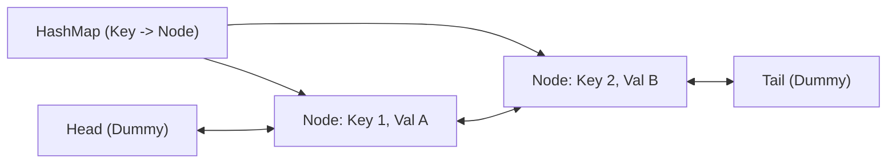

#### (c) Working Production-Grade Java Code
```java
package interview_prep.dsa;

import java.util.HashMap;
import java.util.Map;

/**
 * Production-grade O(1) LRU Cache implementation using a custom Doubly Linked List.
 */
public class LRUCache<K, V> {
    private static class Node<K, V> {
        K key;
        V value;
        Node<K, V> prev;
        Node<K, V> next;

        Node(K key, V value) {
            this.key = key;
            this.value = value;
        }
    }

    private final int capacity;
    private final Map<K, Node<K, V>> map;
    private final Node<K, V> head;
    private final Node<K, V> tail;

    public LRUCache(int capacity) {
        if (capacity <= 0) throw new IllegalArgumentException("Capacity must be > 0");
        this.capacity = capacity;
        this.map = new HashMap<>();
        this.head = new Node<>(null, null);
        this.tail = new Node<>(null, null);
        head.next = tail;
        tail.prev = head;
    }

    public synchronized V get(K key) {
        Node<K, V> node = map.get(key);
        if (node == null) return null;
        moveToHead(node);
        return node.value;
    }

    public synchronized void put(K key, V value) {
        Node<K, V> node = map.get(key);
        if (node != null) {
            node.value = value;
            moveToHead(node);
        } else {
            if (map.size() >= capacity) {
                Node<K, V> lru = removeTail();
                map.remove(lru.key);
            }
            Node<K, V> newNode = new Node<>(key, value);
            map.put(key, newNode);
            addToHead(newNode);
        }
    }

    private void addToHead(Node<K, V> node) {
        node.next = head.next;
        node.next.prev = node;
        node.prev = head;
        head.next = node;
    }

    private void removeNode(Node<K, V> node) {
        node.prev.next = node.next;
        node.next.prev = node.prev;
    }

    private void moveToHead(Node<K, V> node) {
        removeNode(node);
        addToHead(node);
    }

    private Node<K, V> removeTail() {
        Node<K, V> res = tail.prev;
        removeNode(res);
        return res;
    }
}
```

#### (d) Complexity & Interview Pitfalls
* **Time Complexity:** $O(1)$ for both `get` and `put`.
* **Space Complexity:** $O(C)$ where $C$ is cache capacity.
* **Pitfall:** Forgetting to update the previous and next pointers of both dummy nodes; failing to remove the evicted entry from the backing HashMap.

---

### 2. Find Median from Data Stream

#### (a) The 1–2 Minute Spoken Response
> "To find the median of a continuously incoming data stream in $O(1)$ time, we divide our numbers into two equal halves using **Two Heaps**:
> 1. A **Max-Heap (`smallHalf`)** that stores the smaller half of the numbers.
> 2. A **Min-Heap (`largeHalf`)** that stores the larger half of the numbers.
> 
> The mental model is a balanced see-saw. Every element in the `smallHalf` is $\le$ every element in the `largeHalf`. 
> 
> When a new number arrives, we insert it into `smallHalf`, move the maximum of `smallHalf` over to `largeHalf`, and then balance sizes: `smallHalf` is allowed to hold at most one more element than `largeHalf`.
> If total elements are odd, the median is the root of `smallHalf`. If even, it is the mathematical average of the roots of both heaps. This delivers **$O(\log N)$ insertion and instantaneous $O(1)$ median lookups**."

#### (b) Data Structure Diagram
```text
           Incoming Data Stream: [5, 2, 8, 1, 9]
                     |
         +-----------+-----------+
         |                       |
         v                       v
  [ MAX-HEAP: smallHalf ]  [ MIN-HEAP: largeHalf ]
  Stores: {5, 2, 1}        Stores: {8, 9}
  Root: [5] (Max of lower) Root: [8] (Min of upper)
         \                       /
          +---- Median: 5 ------+  (odd count -> smallHalf.peek())
```

#### (c) Working Production-Grade Java Code
```java
package interview_prep.dsa;

import java.util.Collections;
import java.util.PriorityQueue;

public class MedianFinder {
    // Stores smaller half; root is largest of small numbers
    private final PriorityQueue<Integer> smallHalf;
    // Stores larger half; root is smallest of large numbers
    private final PriorityQueue<Integer> largeHalf;

    public MedianFinder() {
        this.smallHalf = new PriorityQueue<>(Collections.reverseOrder());
        this.largeHalf = new PriorityQueue<>();
    }

    public void addNum(int num) {
        smallHalf.offer(num);
        // Ensure every element in smallHalf <= every element in largeHalf
        largeHalf.offer(smallHalf.poll());

        // Balance heaps: smallHalf can have at most 1 more element than largeHalf
        if (smallHalf.size() < largeHalf.size()) {
            smallHalf.offer(largeHalf.poll());
        }
    }

    public double findMedian() {
        if (smallHalf.size() > largeHalf.size()) {
            return smallHalf.peek();
        } else {
            return (smallHalf.peek() + largeHalf.peek()) / 2.0;
        }
    }
}
```

#### (d) Complexity & Interview Pitfalls
* **Time Complexity:** `addNum` is $O(\log N)$; `findMedian` is $O(1)$.
* **Space Complexity:** $O(N)$ total elements stored.
* **Pitfall:** Integer overflow when calculating `(a + b) / 2.0` if numbers are large; use `a + (b - a) / 2.0` or cast to `double` first.

---

### 3. Word Ladder Problem

#### (a) The 1–2 Minute Spoken Response
> "Word Ladder is fundamentally a **Shortest Path problem on an unweighted graph**, solved using **Breadth-First Search (BFS)**.
> 
> The words in the dictionary represent vertices. An edge exists between two words if and only if they differ by exactly one single character (e.g., `hit` $	o$ `hot`).
> 
> The mental model is navigating concentric ripples in water. We start from `beginWord` at level 1. At each step, we iterate through all 26 lowercase letters for each character position in the current word. If a generated word exists in our dictionary `Set`, we add it to the queue and immediately remove it from the dictionary to prevent revisiting (cycle elimination).
> 
> For enterprise scale, we optimize from standard BFS to **Bidirectional BFS**, which searches simultaneously from `beginWord` and `endWord`. This cuts the search space from $O(b^d)$ to $O(b^{d/2})$, where $b$ is the branching factor."

#### (b) Graph State Diagram
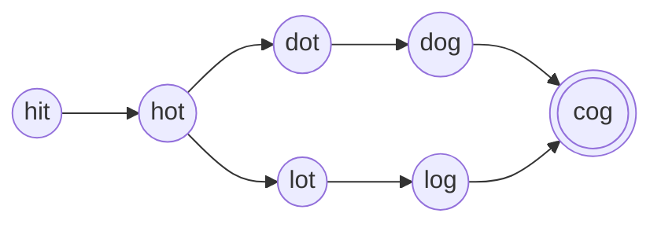

#### (c) Working Production-Grade Java Code
```java
package interview_prep.dsa;

import java.util.*;

public class WordLadder {
    public int ladderLength(String beginWord, String endWord, List<String> wordList) {
        Set<String> dict = new HashSet<>(wordList);
        if (!dict.contains(endWord)) return 0;

        Queue<String> queue = new LinkedList<>();
        queue.offer(beginWord);
        int steps = 1;

        while (!queue.isEmpty()) {
            int size = queue.size();
            for (int i = 0; i < size; i++) {
                String current = queue.poll();
                if (current.equals(endWord)) return steps;

                char[] chars = current.toCharArray();
                for (int j = 0; j < chars.length; j++) {
                    char originalChar = chars[j];
                    for (char c = 'a'; c <= 'z'; c++) {
                        if (c == originalChar) continue;
                        chars[j] = c;
                        String nextWord = new String(chars);

                        if (dict.contains(nextWord)) {
                            queue.offer(nextWord);
                            dict.remove(nextWord); // mark visited
                        }
                    }
                    chars[j] = originalChar; // backtrack character
                }
            }
            steps++;
        }
        return 0; // target unreachable
    }
}
```

#### (d) Complexity & Interview Pitfalls
* **Time Complexity:** $O(M^2 	imes N)$ where $M$ is the word length and $N$ is the number of words in the dictionary.
* **Space Complexity:** $O(M 	imes N)$ for the dictionary and queue.
* **Pitfall:** Modifying the string via concatenation inside the loop instead of using a `char[]` array causes massive GC allocation overhead.

---

### 4. Merge K Sorted Lists

#### (a) The 1–2 Minute Spoken Response
> "To merge $K$ sorted linked lists into one consolidated sorted list, comparing elements one by one across all lists takes $O(K 	imes N)$, which is unacceptable.
> 
> We solve this using a **Min-Heap (PriorityQueue) of size $K$**.
> 
> The mental model is a horse race with $K$ lanes. We place the first horse (head node) from each of the $K$ lists into the starting gate (the Min-Heap). The heap continuously pops the absolute smallest horse in $O(\log K)$ time. Whenever a horse exits the heap, we immediately pull the next horse from *that specific list* into the heap.
> 
> Alternatively, we can use **Divide-and-Conquer** pairwise merging (like Merge Sort), pairing lists and merging them up. Both approaches achieve an optimal **$O(N \log K)$ runtime**, where $N$ is the total number of nodes across all lists."

#### (b) Divide-and-Conquer vs Min-Heap Diagram
```text
           [List 1]    [List 2]    [List 3]    [List 4]
              \          /            \          /
             Merge(1, 2)               Merge(3, 4)
                  \                        /
                   +----- Merge All ------+
                             |
                     [Sorted Final List]
```

#### (c) Working Production-Grade Java Code
```java
package interview_prep.dsa;

import java.util.Comparator;
import java.util.PriorityQueue;

public class MergeKSortedLists {
    public static class ListNode {
        public int val;
        public ListNode next;
        public ListNode(int val) { this.val = val; }
    }

    public ListNode mergeKLists(ListNode[] lists) {
        if (lists == null || lists.length == 0) return null;

        // Min-heap sorted by node value
        PriorityQueue<ListNode> minHeap = new PriorityQueue<>(
            lists.length, Comparator.comparingInt(a -> a.val)
        );

        // Add the head of each list
        for (ListNode node : lists) {
            if (node != null) {
                minHeap.offer(node);
            }
        }

        ListNode dummy = new ListNode(0);
        ListNode current = dummy;

        while (!minHeap.isEmpty()) {
            ListNode smallest = minHeap.poll();
            current.next = smallest;
            current = current.next;

            if (smallest.next != null) {
                minHeap.offer(smallest.next);
            }
        }

        return dummy.next;
    }
}
```

#### (d) Complexity & Interview Pitfalls
* **Time Complexity:** $O(N \log K)$ where $N$ is total nodes and $K$ is number of lists.
* **Space Complexity:** $O(K)$ for the Min-Heap.
* **Pitfall:** Not handling null entries within the initial `lists` array; using an unbounded heap that stores all $N$ elements at once instead of keeping heap size bounded to $K$.

---

### 5. Detect Cycle in a Directed Graph

#### (a) The 1–2 Minute Spoken Response
> "Detecting a cycle in a directed graph is different from an undirected graph because cycles require following directed edges in a single continuous direction.
> 
> The gold standard is **DFS with 3-State Coloring (White-Gray-Black)**:
> 1. **State 0 (WHITE):** Unvisited node.
> 2. **State 1 (GRAY):** Currently being visited; node is active on the current recursive call stack.
> 3. **State 2 (BLACK):** Completely processed; all descendants have been visited with no cycles.
> 
> The mental model is dropping breadcrumbs on a hiking trail. If while hiking down a forward path you encounter a gray breadcrumb, you have looped back into your own active footsteps (**Back-Edge**), proving a directed cycle exists.
> 
> Alternatively, **Kahn's Algorithm (BFS topological sort)** tracks in-degrees: if the count of visited nodes in topological order is less than total vertices $V$, a cycle exists."

#### (b) Directed Cycle State Diagram
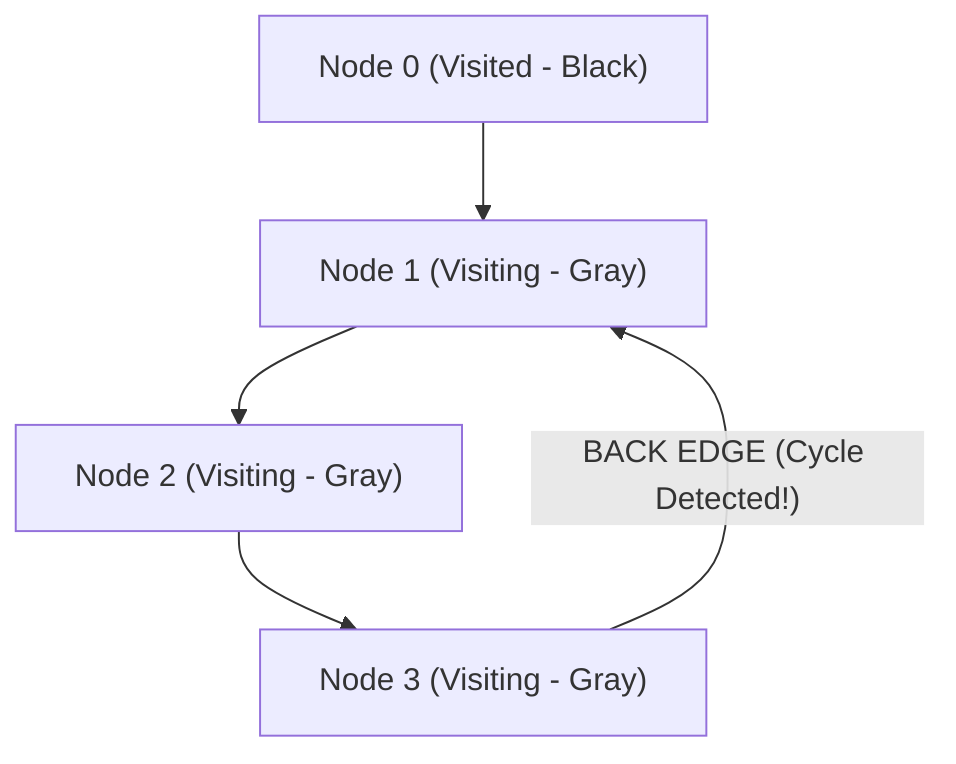

#### (c) Working Production-Grade Java Code
```java
package interview_prep.dsa;

import java.util.*;

public class DirectedGraphCycle {
    private static final int UNVISITED = 0;
    private static final int VISITING = 1;
    private static final int VISITED = 2;

    public boolean hasCycle(int numCourses, int[][] prerequisites) {
        List<List<Integer>> adj = new ArrayList<>();
        for (int i = 0; i < numCourses; i++) {
            adj.add(new ArrayList<>());
        }
        for (int[] edge : prerequisites) {
            adj.get(edge[1]).add(edge[0]); // edge[1] -> edge[0]
        }

        int[] state = new int[numCourses];

        for (int i = 0; i < numCourses; i++) {
            if (state[i] == UNVISITED) {
                if (dfsHasCycle(i, adj, state)) {
                    return true;
                }
            }
        }
        return false;
    }

    private boolean dfsHasCycle(int node, List<List<Integer>> adj, int[] state) {
        state[node] = VISITING; // Mark Gray (on active recursion stack)

        for (int neighbor : adj.get(node)) {
            if (state[neighbor] == VISITING) {
                return true; // Found back-edge!
            }
            if (state[neighbor] == UNVISITED) {
                if (dfsHasCycle(neighbor, adj, state)) {
                    return true;
                }
            }
        }

        state[node] = VISITED; // Mark Black (safe, fully explored)
        return false;
    }
}
```

#### (d) Complexity & Interview Pitfalls
* **Time Complexity:** $O(V + E)$ where $V$ is vertices and $E$ is edges.
* **Space Complexity:** $O(V + E)$ for adjacency list and recursion stack.
* **Pitfall:** Using a simple boolean `visited[]` array without tracking the active recursion stack: in a directed graph, hitting a previously visited node is *not* a cycle unless it is currently in the active recursion call stack.

---

### 6. Maximum Subarray Sum (Kadane's Algorithm)

#### (a) The 1–2 Minute Spoken Response
> "The Maximum Subarray Sum problem asks for the contiguous subarray with the largest sum. Brute force takes $O(N^2)$, but **Kadane's Algorithm** solves it in a single pass in **$O(N)$ time and $O(1)$ space**.
> 
> The core dynamic programming insight is local decision-making: at each index $i$, we ask:
> *'Is it better to append the current element `nums[i]` to our existing running sum, or should we throw away the previous sum and start fresh at `nums[i]`?'*
> 
> Mathematically: `currentMax = Math.max(nums[i], currentMax + nums[i])`.
> If our running sum drops below the current single number, past numbers are a drag on our sum; we reset and start a new subarray right there. We track the `globalMax` seen throughout the pass."

#### (b) Array Window Walkthrough
```text
Array:        [-2,  1, -3,  4, -1,  2,  1, -5,  4]
CurrentMax:   [-2,  1, -2,  4,  3,  5,  6,  1,  5]
GlobalMax:    [-2,  1,  1,  4,  4,  5,  6,  6,  6]
                                       ^^^
Result: Maximum Subarray is [4, -1, 2, 1] with Sum = 6
```

#### (c) Working Production-Grade Java Code
```java
package interview_prep.dsa;

public class MaximumSubarray {
    public static class SubarrayResult {
        public final int maxSum;
        public final int startIndex;
        public final int endIndex;

        public SubarrayResult(int maxSum, int startIndex, int endIndex) {
            this.maxSum = maxSum;
            this.startIndex = startIndex;
            this.endIndex = endIndex;
        }
    }

    public static SubarrayResult findMaxSubarray(int[] nums) {
        if (nums == null || nums.length == 0) {
            throw new IllegalArgumentException("Array cannot be empty");
        }

        int globalMax = nums[0];
        int currentMax = nums[0];
        int start = 0, end = 0, tempStart = 0;

        for (int i = 1; i < nums.length; i++) {
            if (nums[i] > currentMax + nums[i]) {
                currentMax = nums[i];
                tempStart = i;
            } else {
                currentMax += nums[i];
            }

            if (currentMax > globalMax) {
                globalMax = currentMax;
                start = tempStart;
                end = i;
            }
        }

        return new SubarrayResult(globalMax, start, end);
    }
}
```

#### (d) Complexity & Interview Pitfalls
* **Time Complexity:** $O(N)$ single pass.
* **Space Complexity:** $O(1)$ constant auxiliary memory.
* **Pitfall:** Initializing `maxSum = 0` fails when all numbers in the array are negative (e.g., `[-5, -2, -8]`); `maxSum` must be initialized to `nums[0]`.

---

### 7. Kth Largest Element in a Stream

#### (a) The 1–2 Minute Spoken Response
> "To find the Kth largest element in a continuously growing stream without re-sorting the collection every time, we use a **Min-Heap of fixed size $K$**.
> 
> The mental model is an exclusive leaderboard of size $K$. 
> The root of this Min-Heap is the gatekeeper—it represents the smallest score currently on the leaderboard.
> 
> When a new score arrives:
> 1. If the heap has fewer than $K$ elements, we insert it.
> 2. If the heap has $K$ elements and the new score is smaller than the root, it has no chance of being in the top $K$, so we ignore it.
> 3. If it is greater than the root, we evict the root and insert the new element in $O(\log K)$ time.
> 
> The root of the heap is always the $K$th largest element, retrieved in **$O(1)$ time**."

#### (b) Fixed-Size Min-Heap Leaderboard
```text
Finding 3rd Largest (K = 3) on Stream [4, 5, 8, 2, 3, 9]

Heap holds Top 3:
           [ 5 ]  <-- Root (peek() -> 3rd Largest!)
          /            [ 8 ]   [ 9 ]

Incoming '10': 10 > 5 -> pop 5, insert 10 -> Root is now 8!
```

#### (c) Working Production-Grade Java Code
```java
package interview_prep.dsa;

import java.util.PriorityQueue;

public class KthLargest {
    private final int k;
    private final PriorityQueue<Integer> minHeap;

    public KthLargest(int k, int[] nums) {
        this.k = k;
        this.minHeap = new PriorityQueue<>(k);
        for (int num : nums) {
            add(num);
        }
    }

    public int add(int val) {
        if (minHeap.size() < k) {
            minHeap.offer(val);
        } else if (val > minHeap.peek()) {
            minHeap.poll();
            minHeap.offer(val);
        }
        return minHeap.peek();
    }
}
```

#### (d) Complexity & Interview Pitfalls
* **Time Complexity:** $O(N \log K)$ initialization; $O(\log K)$ per `add()`.
* **Space Complexity:** $O(K)$ bounded memory.
* **Pitfall:** Using a Max-Heap instead of a Min-Heap; a Max-Heap would require storing all $N$ stream elements, consuming $O(N)$ memory and $O(K \log N)$ per query.

---

### 8. Task Scheduler / Priority-Based Scheduling (Cooling Period)

#### (a) The 1–2 Minute Spoken Response
> "In CPU task scheduling with identical cooling intervals $N$ between identical tasks (LeetCode 621), the bottleneck is dictated strictly by the **task with the highest frequency**.
> 
> The mental model is packing slots in a calendar. If task `A` appears 3 times with cooling interval $N = 2$, task `A` must appear as: `A _ _ A _ _ A`.
> 
> This creates `maxFreq - 1` blocks of size `(N + 1)`. 
> The final block contains only the tasks that share this same maximum frequency.
> 
> Thus, the minimum intervals required is calculated as:
> `idleSlots = (maxFreq - 1) * (N + 1) + countOfMaxFreqTasks`.
> 
> The answer is simply `Math.max(tasks.length, idleSlots)`. If there are enough diverse tasks to fill all idle slots naturally, total time is just the number of tasks. This formula solves the problem in **$O(M)$ time and $O(1)$ auxiliary space**, where $M$ is the number of tasks."

#### (b) Task Grid Alignment
```text
Tasks = [A, A, A, B, B, B], N = 2
maxFreq = 3 (A and B both have freq 3)

Frame 1:  A  B  idle
Frame 2:  A  B  idle
Frame 3:  A  B  (Done)

Total Units = (3 - 1) * (2 + 1) + 2 = 2 * 3 + 2 = 8 intervals
```

#### (c) Working Production-Grade Java Code
```java
package interview_prep.dsa;

public class TaskScheduler {
    public int leastInterval(char[] tasks, int n) {
        if (tasks == null || tasks.length == 0) return 0;
        if (n == 0) return tasks.length;

        int[] frequencies = new int[26];
        int maxFreq = 0;

        for (char task : tasks) {
            frequencies[task - 'A']++;
            maxFreq = Math.max(maxFreq, frequencies[task - 'A']);
        }

        // Count how many tasks share the maximum frequency
        int maxFreqCount = 0;
        for (int freq : frequencies) {
            if (freq == maxFreq) {
                maxFreqCount++;
            }
        }

        // Total slots required by the most frequent task
        int requiredSlots = (maxFreq - 1) * (n + 1) + maxFreqCount;

        return Math.max(tasks.length, requiredSlots);
    }
}
```

#### (d) Complexity & Interview Pitfalls
* **Time Complexity:** $O(M)$ where $M$ is total tasks (passes over the array once; frequency array is constant size 26).
* **Space Complexity:** $O(1)$ fixed 26-element array.
* **Pitfall:** Forgetting `Math.max(tasks.length, requiredSlots)`: when cooling interval $N$ is small and there are many distinct tasks, no idle slots are required, and the answer is simply the task count.

# PART II: JAVA BACKEND & INTERNALS

---

### 9. HashMap vs ConcurrentHashMap vs Hashtable

#### (a) The 1–2 Minute Spoken Response
> "The evolution from `Hashtable` to `HashMap` to `ConcurrentHashMap` reflects Java's journey in concurrency engineering:
> 
> 1. **`Hashtable` (Legacy):** Every public method (`get`, `put`) is decorated with a monolithic `synchronized` lock. Even concurrent reads block each other, creating terrible thread contention. It does not allow null keys or values.
> 2. **`HashMap` (Single-Threaded):** Highly optimized, completely non-synchronized, allows one `null` key and multiple `null` values. In multi-threaded environments, concurrent writes cause race conditions, corrupt internal node linkages, and in Java 7 caused infinite resize loops.
> 3. **`ConcurrentHashMap` (Modern Enterprise Concurrency):** Delivers thread safety without a global lock. In Java 8+, it uses **lock-free Compare-And-Swap (CAS)** for inserting empty bucket heads, and **fine-grained `synchronized` locking on only the head node of that specific bucket** during updates. Reads (`get()`) are completely lock-free, reading through `volatile` node references. 
> 
> Furthermore, when a bucket exceeds 8 nodes and the table has $\ge 64$ bins, it converts from a linked list to a Red-Black Tree (`TreeBin`), guaranteeing $O(\log N)$ worst-case lookup."

#### (b) Locking Granularity Architecture
```text
Hashtable: [ LOCK ON ENTIRE TABLE ] -> Only 1 thread in the entire map

ConcurrentHashMap (Java 8+):
Bucket 0: [CAS write if null]
Bucket 1: [synchronized(head)] --> NodeA -> NodeB (Other buckets completely unlocked!)
Bucket 2: [Lock-free Reads]     --> Volatile value lookups
Bucket 3: [TreeBin (Red-Black)] --> O(log N) worst case
```

#### (c) Working Production-Grade Java Code
```java
package interview_prep.backend;

import java.util.concurrent.ConcurrentHashMap;
import java.util.concurrent.atomic.LongAdder;

/**
 * Production pattern for concurrent frequency counting using ConcurrentHashMap.
 */
public class ConcurrentCounterService {
    // ConcurrentHashMap combined with LongAdder avoids thread contention on hot keys
    private final ConcurrentHashMap<String, LongAdder> metrics = new ConcurrentHashMap<>();

    public void recordEvent(String eventType) {
        // computeIfAbsent is atomic: only one LongAdder instance is created per key
        metrics.computeIfAbsent(eventType, k -> new LongAdder()).increment();
    }

    public long getCount(String eventType) {
        LongAdder adder = metrics.get(eventType);
        return adder != null ? adder.sum() : 0L;
    }
}
```

#### (d) Complexity & Interview Pitfalls
* **Operations:** $O(1)$ average; $O(\log N)$ worst case under severe hash collisions.
* **Pitfall:** Using compound operations without atomicity: `if (!map.containsKey(k)) map.put(k, v);` is NOT thread-safe on a ConcurrentHashMap; always use atomic `putIfAbsent()`, `compute()`, or `merge()`.

---

### 10. JVM Memory Model: Heap, Stack, and Garbage Collection

#### (a) The 1–2 Minute Spoken Response
> "The JVM runtime data area is partitioned into two primary functional categories:
> 
> 1. **Thread-Local Stacks:** Each thread receives its own call stack containing Stack Frames. Each frame stores local primitive variables, method execution state, and object references pointing to the heap. Memory is allocated and reclaimed instantaneously as methods push and pop.
> 2. **Shared Heap:** The memory space where all Java objects and arrays reside, managed automatically by the Garbage Collector. It is divided into:
>    * **Young Generation (Eden + Survivor S0/S1):** Where new objects are allocated. Most objects die young (Weak Generational Hypothesis) and are collected via fast Minor GCs.
>    * **Old Generation (Tenured):** Long-lived objects that survived multiple GC promotion cycles.
>    * **Metaspace (Off-Heap native memory):** Stores class metadata and bytecode, replacing the old PermGen.
> 
> Modern garbage collectors:
> * **G1GC (Garbage-First):** Partitions the heap into equal virtual regions, collecting the regions with the most garbage first to meet user-configured `-XX:MaxGCPauseMillis` pause targets.
> * **ZGC (Z Garbage Collector):** Uses colored pointers and concurrent load barriers to perform all compaction concurrently, delivering **sub-millisecond pause times** regardless of heap size (from 16GB to 16TB)."

#### (b) JVM Architecture Diagram
```text
+---------------------------------------------------------------+
|                      JVM Runtime Memory                       |
+---------------------------------------------------------------+
| [Thread 1 Stack] [Thread 2 Stack] ...  [ Metaspace (Native) ] |
| (Frames, Prims)  (Frames, Prims)       (Class Metadata)       |
+---------------------------------------------------------------+
|                       SHARED HEAP                             |
|  +----------------------------+   +------------------------+  |
|  |     Young Generation       |   |    Old Generation      |  |
|  | [ Eden ] [ S0 ] [ S1 ]     |   | (Tenured Long-Lived)   |  |
|  +----------------------------+   +------------------------+  |
+---------------------------------------------------------------+
```

#### (c) Working Production-Grade Java Code
```java
package interview_prep.backend;

import java.lang.management.GarbageCollectorMXBean;
import java.lang.management.ManagementFactory;
import java.lang.management.MemoryMXBean;

public class JvmDiagnostics {
    public static void printMemoryStats() {
        MemoryMXBean mem = ManagementFactory.getMemoryMXBean();
        long heapUsed = mem.getHeapMemoryUsage().getUsed() / (1024 * 1024);
        long heapMax = mem.getHeapMemoryUsage().getMax() / (1024 * 1024);
        System.out.printf("Heap Memory: Used %d MB / Max %d MB%n", heapUsed, heapMax);

        for (GarbageCollectorMXBean gc : ManagementFactory.getGarbageCollectorMXBeans()) {
            System.out.printf("Collector: %s | Collections: %d | Time: %d ms%n",
                gc.getName(), gc.getCollectionCount(), gc.getCollectionTime());
        }
    }
}
```

#### (d) Complexity & Interview Pitfalls
* **Pitfall:** `OutOfMemoryError: Java heap space` (heap exhaustion) vs `OutOfMemoryError: Metaspace` (classloader memory leak); `StackOverflowError` is caused by deep unbounded recursion, not heap exhaustion.

---

### 11. ExecutorService, Callable, and Future

#### (a) The 1–2 Minute Spoken Response
> "In Java concurrency, manually creating `new Thread()` in request paths is an anti-pattern because threads are heavyweight OS resources costing ~1MB of stack memory each.
> 
> The **`ExecutorService` framework decouples task submission from execution**:
> * **`Runnable`:** An executable unit that returns `void` and cannot throw checked exceptions.
> * **`Callable<V>`:** An executable unit that returns a typed value `V` and can throw checked exceptions.
> * **`Future<V>`:** A handle representing the pending asynchronous result of a computation. Calling `future.get()` is a blocking operation.
> 
> In modern architectures, we prefer **`CompletableFuture<V>`**, which implements reactive functional chaining (`thenApply`, `thenCompose`, `exceptionally`). This allows asynchronous pipeline execution without blocking worker threads."

#### (b) ThreadPoolExecutor Architecture
```text
Task Submission --> [ Blocking Queue ]
                           |
             +-------------+-------------+
             |                           |
             v                           v
     [ Worker Thread 1 ]         [ Worker Thread 2 ] ... [ Max Pool Size ]
             |
   (If Queue Full & Pool Max -> RejectedExecutionHandler)
```

#### (c) Working Production-Grade Java Code
```java
package interview_prep.backend;

import java.util.concurrent.*;

public class OrderAggregationService {
    private final ExecutorService executor = new ThreadPoolExecutor(
        8,                                // Core pool size
        16,                               // Max pool size
        60L, TimeUnit.SECONDS,            // Keep-alive time
        new ArrayBlockingQueue<>(1000),   // Bounded queue prevents OOM
        new ThreadPoolExecutor.CallerRunsPolicy() // Backpressure handler
    );

    public CompletableFuture<String> fetchUserData(String userId) {
        return CompletableFuture.supplyAsync(() -> {
            // Simulate network call
            return "UserData:" + userId;
        }, executor);
    }

    public CompletableFuture<String> fetchOrderHistory(String userId) {
        return CompletableFuture.supplyAsync(() -> {
            return "OrderHistory:" + userId;
        }, executor);
    }

    public CompletableFuture<String> aggregateUserProfile(String userId) {
        return fetchUserData(userId).thenCombine(fetchOrderHistory(userId),
            (user, orders) -> user + " | " + orders
        ).exceptionally(ex -> "Fallback: User profile temporarily unavailable");
    }
}
```

#### (d) Complexity & Interview Pitfalls
* **Pitfall:** Using `Executors.newCachedThreadPool()` (unbounded threads create risk of crash) or `Executors.newFixedThreadPool()` (unbounded `LinkedBlockingQueue` risks `OutOfMemoryError`); always use custom `ThreadPoolExecutor` with a bounded queue and explicit rejection policy.

---

### 12. How Spring Boot Dependency Injection Works Under the Hood

#### (a) The 1–2 Minute Spoken Response
> "Spring Boot Dependency Injection (DI) is built on the **Inversion of Control (IoC)** principle managed by the `ApplicationContext`.
> 
> The process follows four distinct phases:
> 1. **Classpath Scanning & BeanDefinition Registration:** Spring scans classes annotated with `@Component`, `@Service`, or `@Configuration`. It generates `BeanDefinition` metadata describing class type, scope (Singleton, Prototype), and dependencies.
> 2. **Instantiation:** Spring resolves the dependency graph and instantiates beans via reflection, strongly preferring **Constructor Injection** because it guarantees immutability and simplifies unit testing with mocks.
> 3. **BeanPostProcessor Interception:** Spring passes every bean through `BeanPostProcessor` implementations. Annotations like `@Autowired`, `@Value`, and `@PostConstruct` are processed here.
> 4. **AOP Proxy Wrapping:** If a bean has `@Transactional`, `@Async`, or `@Cacheable`, Spring wraps the target instance inside a **CGLIB dynamic subclass proxy**. The proxy intercepts incoming calls, handles the cross-cutting concern, and delegates to the real instance."

#### (b) Spring Bean Lifecycle Flow
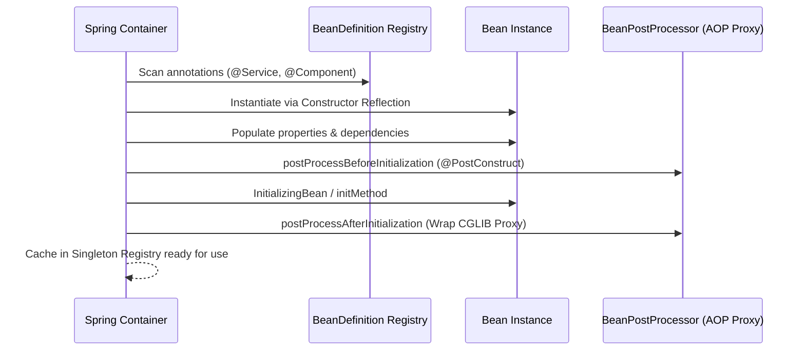

#### (c) Working Production-Grade Java Code
```java
package interview_prep.backend;

import org.springframework.stereotype.Service;
import java.util.Objects;

@Service
public class PaymentProcessingService {
    private final PaymentGatewayClient gatewayClient;
    private final LedgerRepository ledgerRepository;

    // Production Best Practice: Constructor Injection (no @Autowired needed)
    public PaymentProcessingService(PaymentGatewayClient gatewayClient,
                                    LedgerRepository ledgerRepository) {
        this.gatewayClient = Objects.requireNonNull(gatewayClient);
        this.ledgerRepository = Objects.requireNonNull(ledgerRepository);
    }

    public void processPayment(String transactionId, double amount) {
        gatewayClient.charge(transactionId, amount);
        ledgerRepository.record(transactionId, amount);
    }
}

interface PaymentGatewayClient { void charge(String id, double amt); }
interface LedgerRepository { void record(String id, double amt); }
```

#### (d) Complexity & Interview Pitfalls
* **Pitfall:** Field Injection (`@Autowired private Service s;`) hides circular dependencies, breaks immutability (`final` forbidden), and requires reflection to mock in unit tests. Constructor injection is the universal enterprise standard.

---

### 13. REST vs Kafka / RabbitMQ in Microservices

#### (a) The 1–2 Minute Spoken Response
> "Choosing between synchronous REST and asynchronous messaging is a fundamental architectural trade-off between **immediacy and resilience**:
> 
> 1. **REST (Synchronous Request-Response):** The caller thread blocks waiting for downstream response. It provides immediate consistency and direct client feedback. However, it tightly couples system availability—if a downstream service is slow or down, latency cascades upstream, risking thread exhaustion across the entire cluster.
> 2. **RabbitMQ (Message Queue):** Designed for point-to-point task distribution, flexible routing (fan-out, topic exchanges), and immediate message consumption. Messages are acknowledged and deleted from the queue.
> 3. **Apache Kafka (Distributed Event Log):** An append-only, partitioned distributed commit log. Messages are durably retained on disk based on time/size retention policies, allowing multiple independent consumer groups to replay history at their own pace.
> 
> **Rule of Thumb:** Use REST for client-facing edge queries; use Kafka for asynchronous state changes, multi-system event fan-out, and high-throughput streaming."

#### (b) Protocol Comparison Architecture
```text
Synchronous REST (Tight Coupling):
[Client] ---- HTTP POST ----> [Order Service] ---- HTTP POST ----> [Payment Service]
   |                                                                        |
   +<==================== (Blocks waiting for entire chain) <===============+

Asynchronous Kafka (Decoupled Buffering):
[Order Service] --- Emit OrderCreated ---> [ KAFKA TOPIC ]
       |                                          |
   (Returns 202 Accepted)            +------------+------------+
                                     |                         |
                                     v                         v
                           [Payment Consumer]        [Inventory Consumer]
```

#### (c) Working Production-Grade Java Code
```java
package interview_prep.backend;

import org.springframework.kafka.core.KafkaTemplate;
import org.springframework.web.bind.annotation.*;
import java.util.UUID;

@RestController
@RequestMapping("/api/v1/orders")
public class OrderApiController {
    private final KafkaTemplate<String, OrderEvent> kafkaTemplate;

    public OrderApiController(KafkaTemplate<String, OrderEvent> kafkaTemplate) {
        this.kafkaTemplate = kafkaTemplate;
    }

    @PostMapping
    public OrderResponse createOrder(@RequestBody CreateOrderRequest request) {
        String orderId = UUID.randomUUID().toString();
        OrderEvent event = new OrderEvent(orderId, request.customerId(), request.amount());

        // Asynchronous non-blocking emit: partition key = customerId for ordering
        kafkaTemplate.send("orders-topic", request.customerId(), event);

        // Immediate acknowledgment with tracking ID
        return new OrderResponse(orderId, "ACCEPTED");
    }
}

record CreateOrderRequest(String customerId, double amount) {}
record OrderEvent(String orderId, String customerId, double amount) {}
record OrderResponse(String orderId, String status) {}
```

#### (d) Complexity & Interview Pitfalls
* **Pitfall:** Treating Kafka as a task queue; unlike RabbitMQ where messages vanish upon ack, Kafka offsets are incremented on immutable partitions. Kafka consumers must be designed to be strictly idempotent.

---

### 14. Transactions in Spring Boot (`@Transactional`)

#### (a) The 1–2 Minute Spoken Response
> "Spring's `@Transactional` manages database transactions declaratively using an **AOP interceptor**.
> 
> When a client invokes a transactional method, the proxy opens a database connection, binds it to the current thread via `TransactionSynchronizationManager`, disables `auto-commit`, executes the method, and calls `commit()` if successful.
> 
> Three critical production pitfalls to master:
> 1. **Internal Self-Invocation:** Calling `this.saveData()` from within the same class bypasses the Spring AOP proxy; `@Transactional` is completely ignored.
> 2. **Checked Exception Rollback:** By default, Spring rolls back *only* for unchecked exceptions (`RuntimeException` and `Error`). Checked exceptions (`SQLException`, `IOException`) will commit the transaction unless explicitly configured with `@Transactional(rollbackFor = Exception.class)`.
> 3. **Propagation Traps:** `Propagation.REQUIRED` (default) joins existing transactions. `Propagation.REQUIRES_NEW` suspends the outer transaction and opens a second physical database connection, risking connection pool exhaustion under high concurrency."

#### (b) Spring AOP Transaction Interceptor
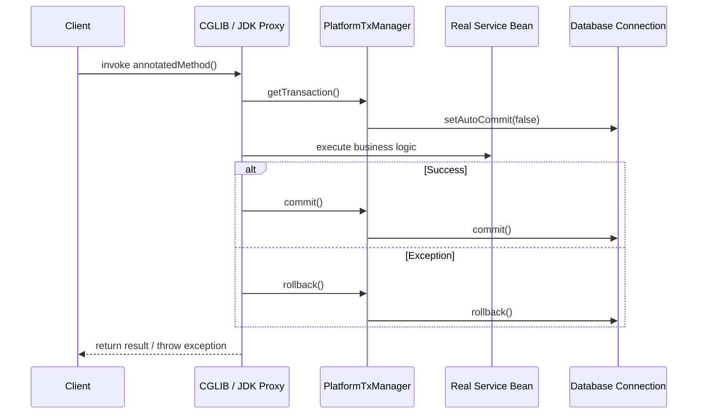

#### (c) Working Production-Grade Java Code
```java
package interview_prep.backend;

import org.springframework.stereotype.Service;
import org.springframework.transaction.annotation.Propagation;
import org.springframework.transaction.annotation.Transactional;

@Service
public class BankTransferService {
    private final AccountRepository accountRepo;
    private final AuditService auditService;

    public BankTransferService(AccountRepository accountRepo, AuditService auditService) {
        this.accountRepo = accountRepo;
        this.auditService = auditService;
    }

    // Explicit rollbackFor ensures checked exceptions trigger database rollback
    @Transactional(rollbackFor = Exception.class)
    public void transferMoney(Long fromId, Long toId, double amount) {
        accountRepo.debit(fromId, amount);
        accountRepo.credit(toId, amount);

        // Audit log must commit even if outer transaction later fails
        auditService.recordAuditLog(fromId, toId, amount);
    }
}

@Service
class AuditService {
    // REQUIRES_NEW runs in an independent transaction that commits independently
    @Transactional(propagation = Propagation.REQUIRES_NEW)
    public void recordAuditLog(Long fromId, Long toId, double amount) {
        // writes to audit table
    }
}

interface AccountRepository {
    void debit(Long id, double amt);
    void credit(Long id, double amt);
}
```

#### (d) Complexity & Interview Pitfalls
* **Pitfall:** Putting long-running REST calls or file uploads inside `@Transactional`; this holds physical database connections open during network I/O, rapidly exhausting connection pools like HikariCP.

---

### 15. SQL vs NoSQL: Selection Matrix and Polyglot Persistence

#### (a) The 1–2 Minute Spoken Response
> "The choice between SQL and NoSQL is governed by **access patterns, data relationships, and consistency requirements**:
> 
> 1. **Relational SQL (PostgreSQL, MySQL):** Structured tabular data, strict schema enforcement, multi-table `JOIN`s, and **ACID transactions**. Ideal for financial ledgers, inventory counts, and relational business domains where data consistency is non-negotiable.
> 2. **Document NoSQL (MongoDB):** Flexible JSON-like hierarchical documents. Ideal for catalogs, dynamic schemas, and read-heavy workloads where all child data is co-located with the parent document.
> 3. **Key-Value (Redis):** In-memory data store for sub-millisecond lookups, session caches, and rate-limiting buckets.
> 4. **Wide-Column (Cassandra, ScyllaDB):** Highly distributed, masterless architecture optimized for high-velocity writes and time-series data.
> 
> Modern enterprise platforms practice **Polyglot Persistence**: using PostgreSQL for core transactional orders, Redis for caching hot data, and Cassandra for append-only audit telemetry."

#### (b) Decision Matrix Diagram
```text
           Data Model & Access Pattern
                       |
       +---------------+---------------+
       |                               |
Complex Relationships & ACID?    High-Velocity Writes / Flexible?
       |                               |
       v                               v
[ SQL: PostgreSQL / MySQL ]    [ NoSQL Family ]
                                       |
                  +--------------------+--------------------+
                  |                    |                    |
             Key-Value              Document            Wide-Column
             (Redis)               (MongoDB)            (Cassandra)
```

#### (c) Working Production-Grade Java Code
```java
package interview_prep.backend;

import org.springframework.data.redis.core.StringRedisTemplate;
import org.springframework.stereotype.Service;
import java.time.Duration;

/**
 * Polyglot Persistence Pattern: Fast Cache-Aside with Redis backing Relational DB.
 */
@Service
public class ProductCatalogService {
    private final StringRedisTemplate redis;
    private final ProductSqlRepository sqlRepo;

    public ProductCatalogService(StringRedisTemplate redis, ProductSqlRepository sqlRepo) {
        this.redis = redis;
        this.sqlRepo = sqlRepo;
    }

    public String getProductDetails(String productId) {
        String cacheKey = "product:" + productId;
        String cachedJson = redis.opsForValue().get(cacheKey);

        if (cachedJson != null) {
            return cachedJson; // Sub-millisecond hit
        }

        // Cache miss: read from relational SQL database
        String dbResult = sqlRepo.findProductJsonById(productId);
        if (dbResult != null) {
            redis.opsForValue().set(cacheKey, dbResult, Duration.ofMinutes(15));
        }
        return dbResult;
    }
}

interface ProductSqlRepository { String findProductJsonById(String id); }
```

#### (d) Complexity & Interview Pitfalls
* **Pitfall:** Choosing NoSQL to 'avoid designing a schema'; unmanaged NoSQL schemas simply shift data validation bugs into application runtime code without database constraints.

---

### 16. Designing Scalable REST APIs

#### (a) The 1–2 Minute Spoken Response
> "A production-grade, scalable REST API must be designed around **statelessness, caching, idempotent safety, and predictable resource modeling**:
> 
> Key architectural pillars:
> 1. **Idempotency:** Safe operations (`GET`, `PUT`, `DELETE`) must produce the same result regardless of execution count. For non-idempotent `POST` transactions, we enforce unique `Idempotency-Key` headers stored in Redis.
> 2. **Efficient Pagination:** Never use offset-based pagination (`OFFSET 100000`) for large datasets; use **Keyset / Cursor Pagination** (`WHERE id > :lastSeenId LIMIT 20`) to utilize indexes and prevent memory-heavy database scans.
> 3. **HTTP Semantics & Conditional Requests:** Use proper HTTP verbs, return standard status codes (`201 Created`, `409 Conflict`, `429 Too Many Requests`), and leverage `ETag` and `If-None-Match` headers for HTTP caching to prevent re-transmitting unmodified payloads.
> 4. **API Versioning:** URI path versioning (`/api/v1/`) with strict contract-first OpenAPI schemas."

#### (b) Scalable API Gateway Architecture
```text
[Client] --> [ API Gateway (Rate Limiting, JWT Auth) ]
                     |
                     v
             [ Microservice ]
               |          |
     (ETag Validation)  (Keyset DB Query: WHERE id > cursor)
               |          |
               v          v
          [ Redis ]   [ PostgreSQL ]
```

#### (c) Working Production-Grade Java Code
```java
package interview_prep.backend;

import org.springframework.http.HttpHeaders;
import org.springframework.http.ResponseEntity;
import org.springframework.web.bind.annotation.*;
import java.util.List;

@RestController
@RequestMapping("/api/v1/transactions")
public class TransactionApiController {
    private final TransactionQueryService queryService;

    public TransactionApiController(TransactionQueryService queryService) {
        this.queryService = queryService;
    }

    // Keyset / Cursor Pagination with ETag Caching
    @GetMapping
    public ResponseEntity<List<TransactionDto>> getTransactions(
            @RequestParam(required = false) Long cursor,
            @RequestParam(defaultValue = "20") int limit,
            @RequestHeader(value = HttpHeaders.IF_NONE_MATCH, required = false) String ifNoneMatch) {

        List<TransactionDto> results = queryService.fetchAfterCursor(cursor, limit);
        String currentEtag = """ + Integer.toHexString(results.hashCode()) + """;

        if (currentEtag.equals(ifNoneMatch)) {
            return ResponseEntity.status(304).build(); // 304 Not Modified
        }

        return ResponseEntity.ok()
                .eTag(currentEtag)
                .header(HttpHeaders.CACHE_CONTROL, "public, max-age=60")
                .body(results);
    }
}

record TransactionDto(Long id, String type, double amount) {}
interface TransactionQueryService { List<TransactionDto> fetchAfterCursor(Long cursor, int limit); }
```

#### (d) Complexity & Interview Pitfalls
* **Pitfall:** Offset pagination forces the database to read and discard thousands of rows (`OFFSET 500000 LIMIT 20` scans 500,020 rows); keyset pagination executes in constant $O(1)$ index lookup time.

# PART III: SYSTEM DESIGN ARCHITECTURE

---

### 17. Design a Chat Application (WhatsApp / Slack)

#### (a) The 1–2 Minute Spoken Response
> "Designing an enterprise real-time chat application requires handling three core capabilities: **persistent connection management, sub-100ms message delivery, and durable offline history**.
> 
> At the edge, mobile and web clients establish persistent, bi-directional **WebSocket connections terminated at a Chat Gateway cluster**. 
> 
> To route messages between users connected to different gateway servers, we use a distributed **Redis Pub/Sub or Kafka routing mesh**. When User A sends a message to User B, Gateway 1 checks a distributed **Presence Service** backed by Redis to find which gateway server holds User B's active WebSocket connection.
> 
> If User B is online, the message is pushed down their active WebSocket. 
> If User B is offline, a message is routed to an **Apple/Google Push Notification Service (APNs/FCM)** queue.
> 
> For message persistence, chat workloads are write-heavy, time-ordered, and queried by conversation ID. We use a **wide-column database like Apache Cassandra or ScyllaDB** partitioned by `conversation_id` with a clustering key on `message_timestamp`, enabling fast range scans for message history without slow table joins."

#### (b) System Architecture Diagram
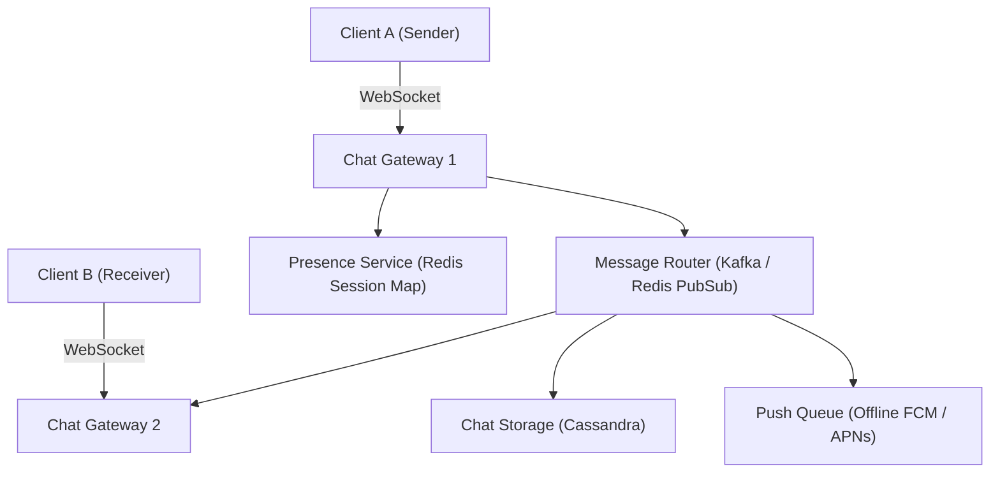

#### (c) Working Production-Grade Java Code
```java
package interview_prep.sysdesign.chat;

import java.time.Instant;
import java.util.UUID;

public record ChatMessage(
    String messageId,
    String conversationId,
    String senderId,
    String recipientId,
    String payload,
    Instant timestamp
) {
    public static ChatMessage create(String convId, String from, String to, String text) {
        return new ChatMessage(UUID.randomUUID().toString(), convId, from, to, text, Instant.now());
    }
}
```

```java
package interview_prep.sysdesign.chat;

import java.util.Map;
import java.util.concurrent.ConcurrentHashMap;

/**
 * Gateway Connection Router managing active client WebSocket sessions.
 */
public class ChatGatewayRouter {
    // Local memory map of active socket channels on this pod
    private final Map<String, ClientSession> localSessions = new ConcurrentHashMap<>();

    public void registerSession(String userId, ClientSession session) {
        localSessions.put(userId, session);
    }

    public void unregisterSession(String userId) {
        localSessions.remove(userId);
    }

    public boolean routeLocally(ChatMessage msg) {
        ClientSession session = localSessions.get(msg.recipientId());
        if (session != null && session.isOpen()) {
            session.send(msg);
            return true;
        }
        return false; // Route to Redis Pub/Sub or Push Notification queue
    }
}

interface ClientSession { boolean isOpen(); void send(ChatMessage msg); }
```

#### (d) Scalability & Trade-offs
* **Storage Sizing:** 100M daily users $	imes$ 50 messages/day $	imes$ 200 bytes = 1 TB/day. Cassandra easily scales horizontally.
* **Connection Footprint:** Each open WebSocket socket consumes ~10KB memory; 1M concurrent connections require ~10GB RAM across a 10-node gateway cluster.

---

### 18. Design a URL Shortener (TinyURL)

#### (a) The 1–2 Minute Spoken Response
> "A URL shortener converts long URLs into 7-character short codes and redirects incoming requests with sub-10ms latency.
> 
> With 62 alphanumeric characters `[a-z, A-Z, 0-9]`, a 7-character string yields $62^7 pprox 3.5 	ext{ trillion}$ unique combinations, easily satisfying decades of scale.
> 
> The core problem is **generating unique short IDs without collision under high distributed concurrency**:
> 1. Hashing the long URL (MD5/SHA) causes collisions and requires appending salt.
> 2. The optimal enterprise solution is a **Centralized Distributed Range Generator (using Apache ZooKeeper or Redis)**. Each application server is allocated a unique numerical range (e.g., Server 1 gets 1,000,000 to 2,000,000). The server increments its local counter and converts the 64-bit integer into a **Base62 encoded string** locally in $O(1)$ time with zero network coordination.
> 
> Reads heavily dominate writes (100:1 ratio). We place a **Redis Cache cluster** in front of PostgreSQL/DynamoDB. Redirection uses **HTTP 302 Found** (temporary redirect) if click analytics are required, or **HTTP 301 Moved Permanently** to allow browser caching and minimize server load."

#### (b) System Architecture Diagram
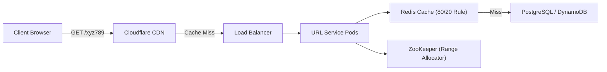

#### (c) Working Production-Grade Java Code
```java
package interview_prep.sysdesign.urlshortener;

public class Base62Encoder {
    private static final String ALPHABET = "0123456789abcdefghijklmnopqrstuvwxyzABCDEFGHIJKLMNOPQRSTUVWXYZ";
    private static final int BASE = ALPHABET.length(); // 62

    public static String encode(long id) {
        if (id <= 0) return "0";
        StringBuilder sb = new StringBuilder();
        while (id > 0) {
            int remainder = (int) (id % BASE);
            sb.append(ALPHABET.charAt(remainder));
            id /= BASE;
        }
        return sb.reverse().toString();
    }

    public static long decode(String shortUrl) {
        long id = 0;
        for (int i = 0; i < shortUrl.length(); i++) {
            char c = shortUrl.charAt(i);
            id = id * BASE + ALPHABET.indexOf(c);
        }
        return id;
    }
}
```

#### (d) Scalability & Trade-offs
* **Traffic:** 1,000 writes/sec $	o$ 100,000 reads/sec. Redis absorbs 95% of reads.
* **HTTP 301 vs 302:** 301 reduces server load via browser caching; 302 forces client requests through the server to record analytics (referrer, geographic location, device type).

---

### 19. Design a Distributed Notification System

#### (a) The 1–2 Minute Spoken Response
> "A distributed notification system must reliably deliver millions of messages across multiple channels (**Email, SMS, Mobile Push**) while honoring user notification preferences, rate limits, and priority levels.
> 
> The architecture consists of four distinct stages:
> 1. **Ingestion & Validation:** Microservices submit notification requests via REST or Kafka. An ingestion worker verifies schema, validates recipient details, and checks user preferences stored in a distributed cache.
> 2. **Deduplication & Rate Limiting:** We enforce a sliding window in Redis to prevent spamming users (e.g., maximum 3 promotional SMS per day) and generate an idempotency hash `md5(userId + eventType + day)` to eliminate accidental duplicate sends.
> 3. **Prioritized Message Queuing:** We partition traffic into independent Kafka topics based on priority:
>    * `High-Priority (OTP, Fraud Alerts)` $	o$ Dedicated consumer pool, sub-second SLA.
>    * `Low-Priority (Promotions, Weekly digests)` $	o$ Throttled consumer pool.
> 4. **Third-Party Dispatchers:** Specialized workers integrate with vendor gateways (Twilio for SMS, SendGrid for Email, FCM/APNs for Push), configured with Resilience4j circuit breakers and exponential backoff retry DLQs."

#### (b) Multi-Channel Notification Pipeline
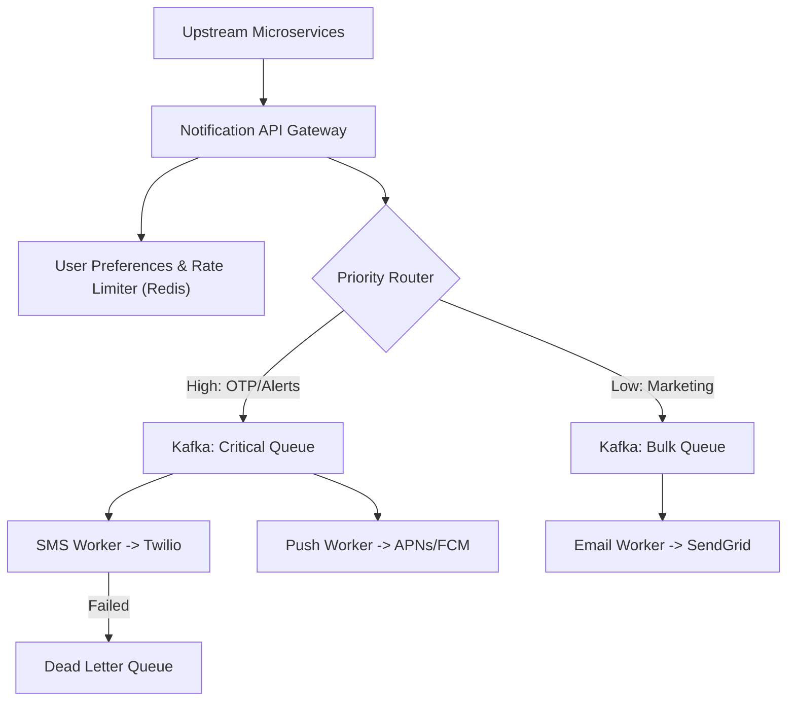

#### (c) Working Production-Grade Java Code
```java
package interview_prep.sysdesign.notification;

public record NotificationRequest(
    String notificationId,
    String userId,
    NotificationChannel channel,
    NotificationPriority priority,
    String templateId,
    String payload
) {}

enum NotificationChannel { SMS, EMAIL, PUSH }
enum NotificationPriority { CRITICAL_OTP, MARKETING_BULK }
```

```java
package interview_prep.sysdesign.notification;

import org.springframework.kafka.core.KafkaTemplate;
import org.springframework.stereotype.Service;

@Service
public class NotificationDispatcher {
    private final KafkaTemplate<String, NotificationRequest> kafkaTemplate;

    public NotificationDispatcher(KafkaTemplate<String, NotificationRequest> kafkaTemplate) {
        this.kafkaTemplate = kafkaTemplate;
    }

    public void dispatch(NotificationRequest request) {
        String topic = (request.priority() == NotificationPriority.CRITICAL_OTP)
            ? "notifications-critical"
            : "notifications-bulk";

        // Route by userId for per-user delivery ordering
        kafkaTemplate.send(topic, request.userId(), request);
    }
}
```

#### (d) Scalability & Trade-offs
* **Channel Throttling:** Third-party vendors enforce strict rate limits (e.g., Twilio 100 SMS/sec); queue-backed workers prevent flooding external APIs.

---

### 20. Scale a Video Streaming Platform (YouTube / Netflix)

#### (a) The 1–2 Minute Spoken Response
> "Scaling a global video streaming platform requires solving two distinct problems: **video ingestion and transcoding**, and **low-latency edge playback**.
> 
> 1. **Ingestion & Transcoding Pipeline:**
> When a creator uploads an 8K raw video, it is stored in an Object Store (Amazon S3). A video preprocessing service chunks the video into 2-to-6 second segments and dispatches transcoding tasks across a distributed worker cluster. Segments are transcoded into multiple bitrates (1080p, 720p, 480p) and formatted into **HLS (HTTP Live Streaming) and DASH manifests**.
> 
> 2. **Edge Delivery & Playback:**
> Videos are static binary chunks, making them perfect for caching. We serve 95% of video chunks directly through a **Global Content Delivery Network (CDN)** with points of presence (PoPs) close to end users.
> 
> 3. **Adaptive Bitrate Streaming (ABR):**
> The client video player dynamically monitors available device bandwidth. If network bandwidth drops on a mobile device, the player seamlessly requests the next 4-second chunk at 480p instead of 1080p without buffering or playback interruption."

#### (b) Video Transcoding and CDN Edge Streaming
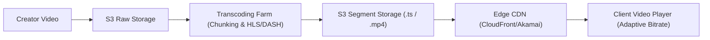

#### (c) Working Production-Grade Java Code
```java
package interview_prep.sysdesign.streaming;

import org.springframework.core.io.Resource;
import org.springframework.core.io.support.ResourceRegion;
import org.springframework.http.*;
import org.springframework.web.bind.annotation.*;
import java.io.IOException;

/**
 * Spring Controller supporting HTTP 206 Partial Content Video Byte-Range Streaming.
 */
@RestController
@RequestMapping("/api/v1/videos")
public class VideoStreamingController {

    @GetMapping(value = "/{videoId}/stream", produces = "video/mp4")
    public ResponseEntity<ResourceRegion> streamVideo(
            @PathVariable String videoId,
            @RequestHeader HttpHeaders headers) throws IOException {

        Resource videoResource = loadVideoResource(videoId);
        long contentLength = videoResource.contentLength();
        HttpRange range = headers.getRange().isEmpty() ? null : headers.getRange().get(0);

        long chunkSize = 1024 * 1024; // 1 MB byte range chunk
        ResourceRegion region;

        if (range != null) {
            long start = range.getRangeStart(contentLength);
            long end = range.getRangeEnd(contentLength);
            long rangeLength = Math.min(chunkSize, end - start + 1);
            region = new ResourceRegion(videoResource, start, rangeLength);
        } else {
            long rangeLength = Math.min(chunkSize, contentLength);
            region = new ResourceRegion(videoResource, 0, rangeLength);
        }

        return ResponseEntity.status(HttpStatus.PARTIAL_CONTENT)
                .contentType(MediaType.parseMediaType("video/mp4"))
                .body(region);
    }

    private Resource loadVideoResource(String id) {
        // Loads video segment file from local disk or cloud bucket
        return new org.springframework.core.io.FileSystemResource("/data/videos/" + id + ".mp4");
    }
}
```

#### (d) Scalability & Trade-offs
* **Bandwidth Optimization:** Byte-range requests ensure users only download the video seconds they actually watch, saving petabytes of bandwidth when users abandon videos early.

---

### 21. Design a Payment System (Stripe / PayPal)

#### (a) The 1–2 Minute Spoken Response
> "A payment platform demands absolute data correctness, zero financial loss, and high availability.
> 
> Five non-negotiable architectural requirements:
> 1. **Idempotency Keys:** To prevent double-charging when network timeouts cause client retries, every payment request requires a unique `Idempotency-Key` header. The gateway executes an atomic check-and-insert in Redis/PostgreSQL; subsequent identical requests return the cached original response.
> 2. **Double-Entry Bookkeeping:** Money is never created or destroyed; every financial event requires at least one Debit and one Credit entry that sum to exactly zero (`Debit + Credit = 0`).
> 3. **State Machine & Saga Orchestration:** Payments move through explicit states: `INITIATED`, `AUTHORIZED`, `SETTLED`, `FAILED`. Transitions are coordinated via an event-driven Saga pattern on Kafka.
> 4. **Asynchronous Settlement:** Authorizations happen synchronously within 500ms; settlement and bank clearing happen asynchronously in batches.
> 5. **Automated Reconciliation:** A nightly batch job reconciles internal ledger entries against bank settlement clearing files to catch and flag discrepancies."

#### (b) Payment State Machine & Ledger Flow
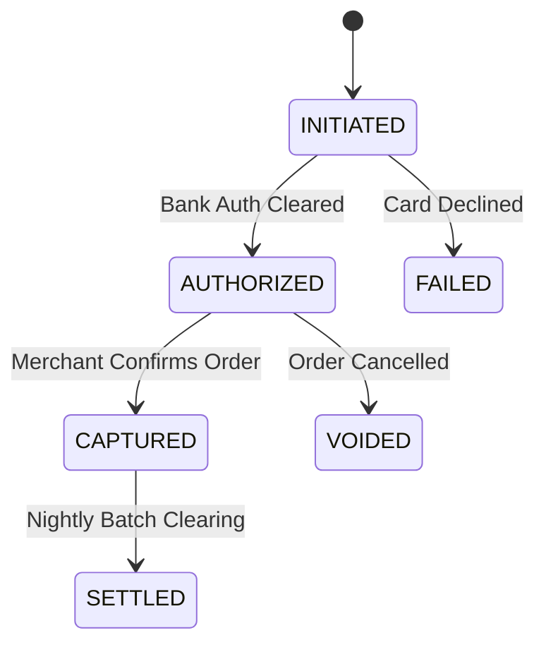

#### (c) Working Production-Grade Java Code
```java
package interview_prep.sysdesign.payment;

import java.math.BigDecimal;
import java.time.Instant;
import java.util.UUID;

public record LedgerEntry(
    String entryId,
    String transactionId,
    String accountId,
    EntryType type,
    BigDecimal amount,
    Instant createdAt
) {
    public enum EntryType { DEBIT, CREDIT }

    public static LedgerEntry debit(String txId, String accId, BigDecimal amt) {
        return new LedgerEntry(UUID.randomUUID().toString(), txId, accId, EntryType.DEBIT, amt, Instant.now());
    }

    public static LedgerEntry credit(String txId, String accId, BigDecimal amt) {
        return new LedgerEntry(UUID.randomUUID().toString(), txId, accId, EntryType.CREDIT, amt, Instant.now());
    }
}
```

#### (d) Scalability & Trade-offs
* **Consistency Model:** Strong Consistency (CP) is strictly enforced for ledger writes; asynchronous eventual consistency is accepted for notifications and analytics.

---

### 22. Design a Distributed API Rate Limiter

#### (a) The 1–2 Minute Spoken Response
> "A distributed rate limiter prevents Denial-of-Service attacks, protects backend microservices from resource starvation, and enforces API pricing tiers.
> 
> We evaluate four classic algorithms:
> 1. **Fixed Window Counter:** Simple, but allows twice the allowed traffic at window boundary edges.
> 2. **Sliding Window Log:** Precise, but memory-intensive because it stores every request timestamp in a Redis sorted set.
> 3. **Leaky Bucket:** Smooths out bursts to a fixed steady output rate, but delays incoming bursty requests.
> 4. **Token Bucket (Industry Standard):** Allows configurable bursts while enforcing a steady refill rate, with low memory overhead.
> 
> In a distributed cloud environment with 20 Spring Boot pods, local in-memory counters fail because pods cannot coordinate counts. We implement the **Token Bucket algorithm in Redis using an atomic Lua script**. This executes token calculations and state decrements atomically on Redis's single-threaded event loop in sub-millisecond time."

#### (b) Distributed Rate Limiter Architecture
```text
[Incoming Request] --> [ API Gateway (Spring Cloud Gateway) ]
                                   |
                       (Execute Atomic Lua Script)
                                   |
                                   v
                        [ Redis Cluster ]
                        Key: rate_limit:{clientId}
                        Hash: {tokens: 42, last_refill: 1715000000}
                                   |
                 +-----------------+-----------------+
                 |                                   |
       (Tokens Available >= 1)              (Tokens == 0)
                 |                                   |
                 v                                   v
         Forward to Backend                 Return HTTP 429
                                            Retry-After: 5s
```

#### (c) Working Production-Grade Java Code
```java
package interview_prep.sysdesign.ratelimiter;

import org.springframework.data.redis.core.StringRedisTemplate;
import org.springframework.data.redis.core.script.DefaultRedisScript;
import org.springframework.stereotype.Component;
import java.util.Collections;

@Component
public class DistributedRateLimiter {
    private final StringRedisTemplate redis;
    private final DefaultRedisScript<Long> script;

    private static final String LUA_SCRIPT =
        "local key = KEYS[1] " +
        "local capacity = tonumber(ARGV[1]) " +
        "local refillRate = tonumber(ARGV[2]) " +
        "local now = tonumber(ARGV[3]) " +
        "local data = redis.call('HMGET', key, 'tokens', 'lastRefill') " +
        "local tokens = tonumber(data[1]) " +
        "local lastRefill = tonumber(data[2]) " +
        "if not tokens then " +
        "  tokens = capacity " +
        "  lastRefill = now " +
        "else " +
        "  local delta = math.max(0, now - lastRefill) " +
        "  tokens = math.min(capacity, tokens + delta * refillRate) " +
        "  lastRefill = now " +
        "end " +
        "if tokens >= 1 then " +
        "  tokens = tokens - 1 " +
        "  redis.call('HMSET', key, 'tokens', tokens, 'lastRefill', lastRefill) " +
        "  redis.call('EXPIRE', key, 3600) " +
        "  return 1 " + // Allowed
        "else " +
        "  return 0 " + // Rejected
        "end";

    public DistributedRateLimiter(StringRedisTemplate redis) {
        this.redis = redis;
        this.script = new DefaultRedisScript<>(LUA_SCRIPT, Long.class);
    }

    public boolean isAllowed(String clientId, int capacity, int refillRatePerSec) {
        String key = "rate:" + clientId;
        long now = System.currentTimeMillis() / 1000;
        Long result = redis.execute(script, Collections.singletonList(key),
            String.valueOf(capacity), String.valueOf(refillRatePerSec), String.valueOf(now));
        return result != null && result == 1L;
    }
}
```

#### (d) Scalability & Trade-offs
* **Latency Overhead:** < 2ms Redis round-trip.
* **Failure Mode:** If Redis fails, rate limiter can be configured to 'fail open' to preserve user availability rather than blocking all traffic.

---

### 23. Design an E-Commerce Checkout System (Amazon / Shopify)

#### (a) The 1–2 Minute Spoken Response
> "An e-commerce checkout platform must guarantee that an item is never sold to two buyers simultaneously while providing a fast, non-blocking customer checkout experience.
> 
> The core design pattern is **Provisional Inventory Hold with Asynchronous Saga Orchestration**:
> 
> 1. **Provisional Hold (Redis + TTL):** When a user clicks 'Proceed to Checkout', the Inventory Service acquires a temporary hold on the items in Redis with a strict 10-minute TTL. This avoids locking database tables.
> 2. **Saga Coordinator:** A central Saga Orchestrator manages the multi-step transaction:
>    * Step 1: Reserve Inventory (Provisional hold).
>    * Step 2: Authorize Payment with payment gateway.
>    * Step 3: Deduct inventory permanently from database and create Order record.
>    * Step 4: Dispatch confirmation email and invoice.
> 3. **Compensating Actions:** If payment fails or the 10-minute timer expires, the Saga triggers compensating transactions: the Redis hold is deleted, returning the item to the available stock pool without human intervention."

#### (b) Checkout Saga Orchestration Flow
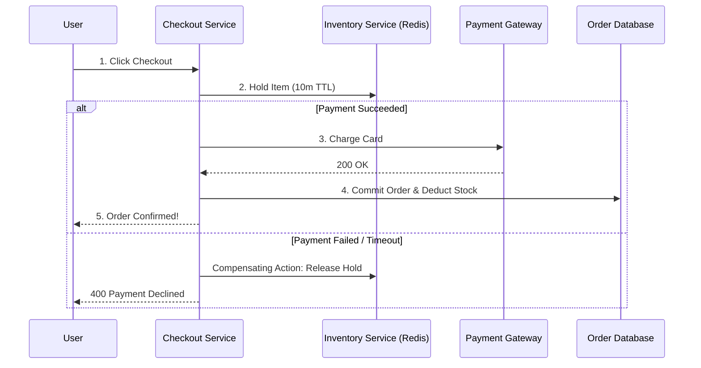

#### (c) Working Production-Grade Java Code
```java
package interview_prep.sysdesign.checkout;

public record CheckoutSession(
    String sessionId,
    String customerId,
    String sku,
    int quantity,
    CheckoutState state
) {
    public enum CheckoutState {
        INITIATED, INVENTORY_HELD, PAYMENT_AUTHORIZED, COMPLETED, CANCELLED
    }
}
```

#### (d) Scalability & Trade-offs
* **Flash Sales:** During Black Friday surges, decoupling checkout via Kafka queues smooths incoming write spikes, allowing consumers to process orders at a stable database write pace.

---

### 24. Design a Ride-Hailing App (Uber / Lyft)

#### (a) The 1–2 Minute Spoken Response
> "A ride-hailing architecture must solve two massive distributed challenges: **real-time ingestion of millions of moving driver GPS coordinates**, and **sub-second geospatial matching of riders to the closest available drivers**.
> 
> 1. **Location Ingestion Pipeline:**
> Active drivers emit their GPS coordinates every 3 to 4 seconds via WebSockets. An ingestion gateway batches these location pings and streams them into Kafka.
> 
> 2. **Geospatial Indexing (Uber H3 / Google S2):**
> Querying a SQL database using `ST_DWithin` across 1 million moving drivers causes table lock contention. Instead, we divide the world into hierarchical geospatial hexagons using **Uber H3 or Google S2 cells**. The driver's latitude and longitude are converted into a discrete cell ID (e.g., H3 resolution 8 $pprox 460$ meters).
> 
> 3. **In-Memory Geospatial Store (Redis GEO):**
> Driver IDs are indexed in Redis using `GEOADD`. When a rider requests a ride, the Dispatch Service queries `GEORADIUS` for available drivers in the rider's cell and immediate neighboring hex cells, returning candidate drivers in sub-10 milliseconds.
> 
> 4. **Dispatch Match Engine:**
> The match engine scores drivers based on distance, ETA, rating, and acceptance rate, sending the ride offer sequentially to the optimal driver."

#### (b) Geospatial Hexagonal Sharding & Match Engine
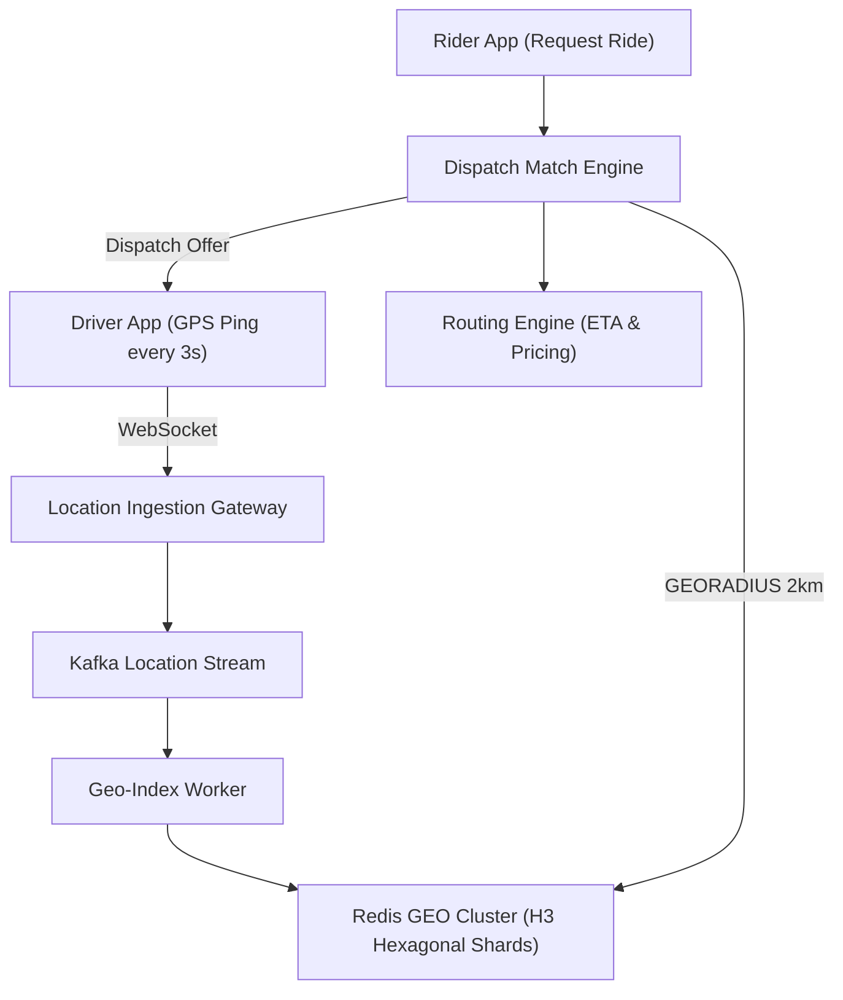

#### (c) Working Production-Grade Java Code
```java
package interview_prep.sysdesign.ridehailing;

import org.springframework.data.geo.*;
import org.springframework.data.redis.connection.RedisGeoCommands;
import org.springframework.data.redis.core.RedisTemplate;
import org.springframework.stereotype.Service;
import java.util.List;

@Service
public class DriverDispatchService {
    private final RedisTemplate<String, String> redis;
    private static final String DRIVER_GEO_KEY = "drivers:available";

    public DriverDispatchService(RedisTemplate<String, String> redis) {
        this.redis = redis;
    }

    public void updateDriverLocation(String driverId, double longitude, double latitude) {
        redis.opsForGeo().add(DRIVER_GEO_KEY, new Point(longitude, latitude), driverId);
    }

    public List<String> findNearbyDrivers(double riderLng, double riderLat, double radiusKm) {
        Circle searchArea = new Circle(new Point(riderLng, riderLat), new Distance(radiusKm, Metrics.KILOMETERS));
        RedisGeoCommands.GeoRadiusCommandArgs args = RedisGeoCommands.GeoRadiusCommandArgs
                .newGeoRadiusArgs()
                .includeDistance()
                .sortAscending()
                .limit(10);

        GeoResults<RedisGeoCommands.GeoLocation<String>> results =
                redis.opsForGeo().radius(DRIVER_GEO_KEY, searchArea, args);

        if (results == null) return List.of();

        return results.getContent().stream()
                .map(GeoResult::getContent)
                .map(RedisGeoCommands.GeoLocation::getName)
                .toList();
    }
}
```

#### (d) Scalability & Trade-offs
* **Write Volume:** 1M active drivers emitting every 3 seconds = ~330,000 writes/sec. Memory-only Redis clusters sharded by city ID handle this easily with sub-millisecond latencies.
