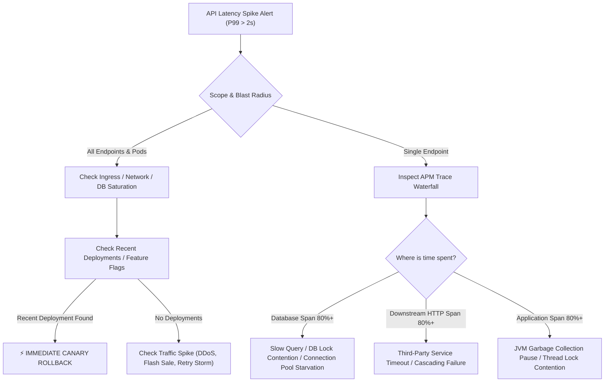
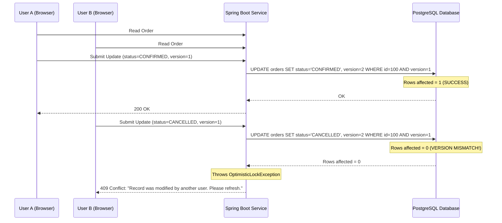
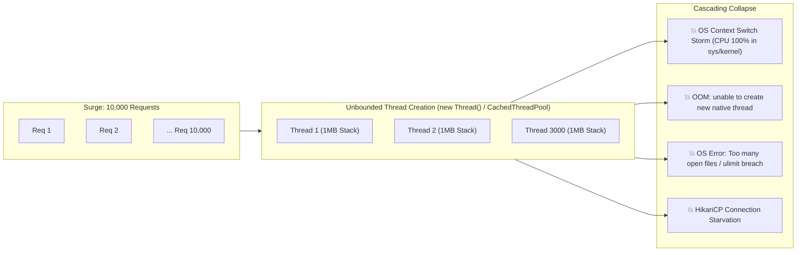
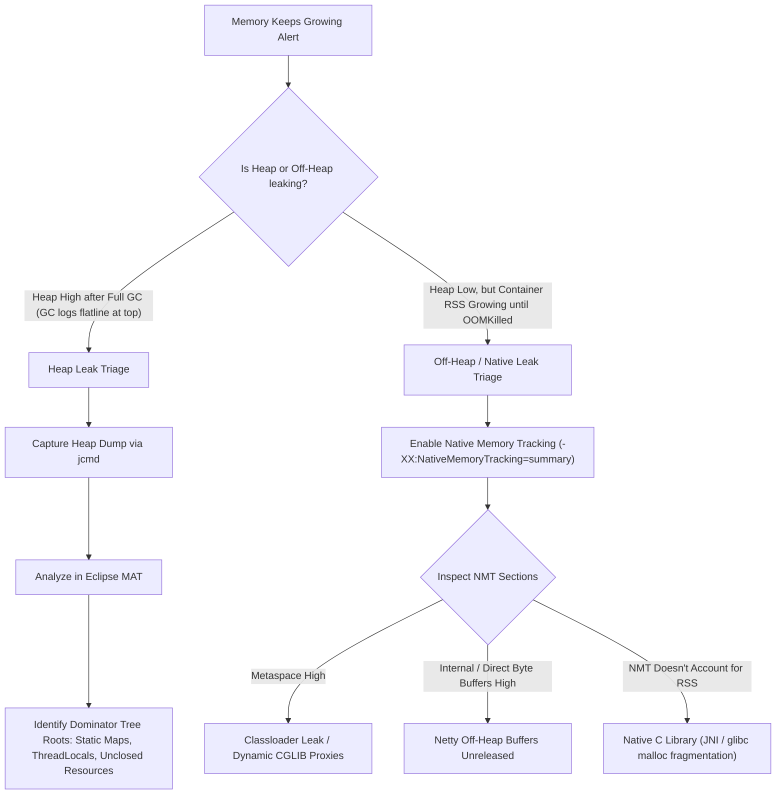
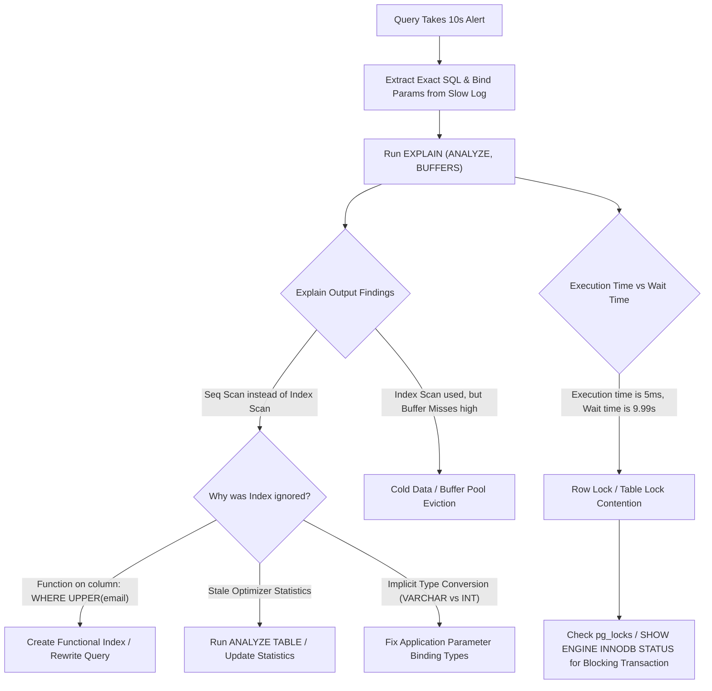
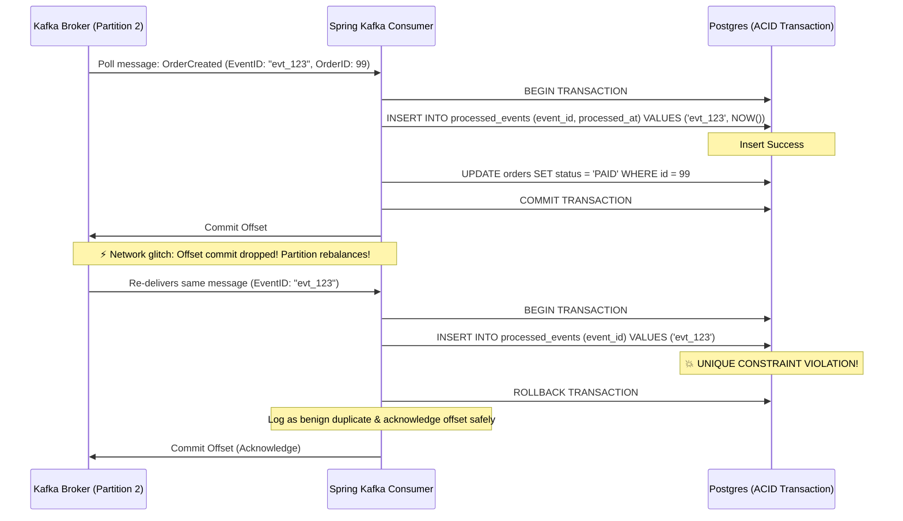
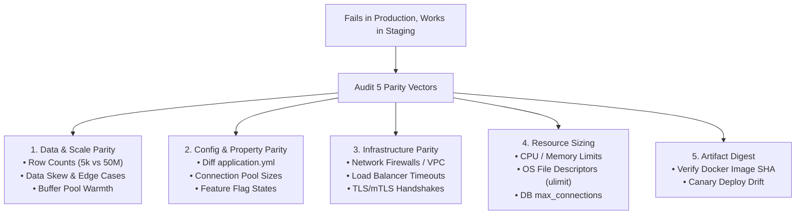
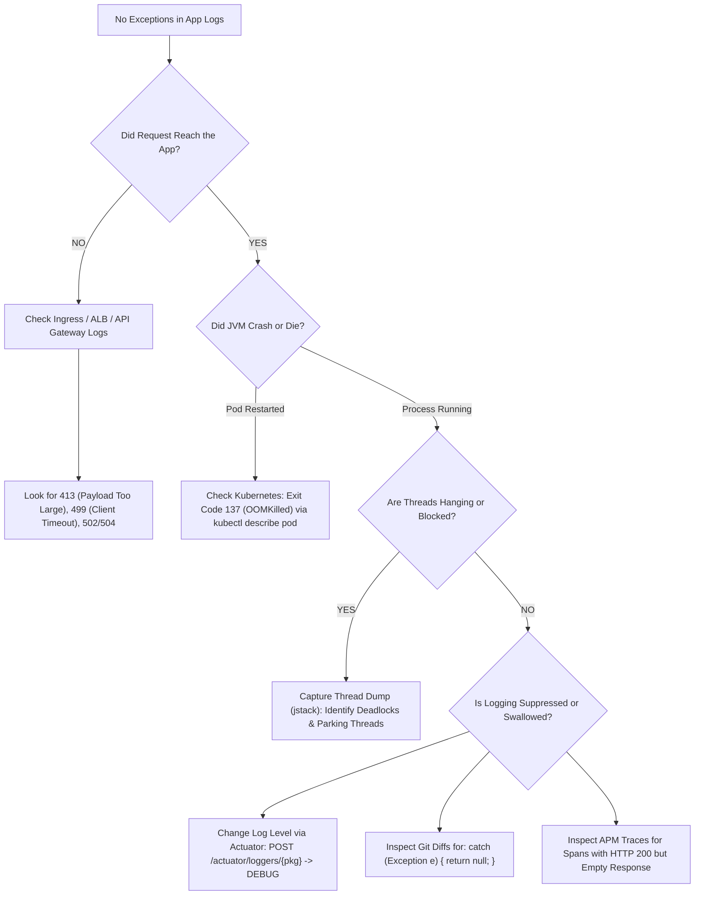

# 🚨 Module 12 - Part 4: Real-World Java Production Scenarios & Incident Triage
### The 10 "What Would You Do?" Senior & Staff Backend Interview Scenarios

> **Why Candidates Fail**: Knowing *what* a concept is (definitions of GC, threads, locks, Kafka, indexes) gets you past junior screenings. Senior and Staff interviewers evaluate **what you would actually do** when production is burning, latency spikes, data corrupts, or threads lock up. 
> 
> Every scenario below provides:
> 1. **🎯 60–90 Second Verbal Delivery**: The exact spoken answer that conveys battle-tested production leadership.
> 2. **🏗️ Architecture / Triage Flow Diagram**: Mermaid visual representing the system failure mode.
> 3. **🔍 Deep-Dive Diagnostic Runbook**: Exact CLI commands (`jstack`, `jcmd`, `top -H`, `EXPLAIN ANALYZE`), APM metrics, and log queries.
> 4. **💻 Production-Grade Code & Config Remediations**: Spring Boot, Java 21, HikariCP, Kafka, Resilience4j, and SQL fixes.
> 5. **🚩 Red Flags vs. Senior Green Flags**: What gets candidates rejected vs. hired.

---

## 🧭 Navigation Matrix

| # | Production Scenario | Primary Bottleneck Domain | Key Tools & Patterns |
|---|---|---|---|
| **1** | [API Suddenly Becomes Slow](#scenario-1-your-api-suddenly-becomes-slow-what-do-you-check-first) | Traffic / Latency / Downstream | Golden Signals, APM Trace Waterfall, HikariCP, GC |
| **2** | [CPU Normal, Response Time High](#scenario-2-cpu-is-normal-but-response-time-is-high-where-could-the-bottleneck-be) | Off-CPU Blocking / Thread Contention | `jstack`, Socket I/O, DB Pool Exhaustion, Thread States |
| **3** | [Two Users Update Same Record](#scenario-3-two-users-update-the-same-record-simultaneously-how-do-you-prevent-data-loss) | Concurrency & Data Consistency | Optimistic Locking (`@Version`), Pessimistic Write, Redisson |
| **4** | [Too Many Threads Under Heavy Traffic](#scenario-4-your-application-creates-too-many-threads-under-heavy-traffic-what-happens) | OS / JVM Resource Saturation | Context Switch Thrashing, Native OOM, Virtual Threads |
| **5** | [Memory Growth Even After GC](#scenario-5-a-java-service-keeps-consuming-memory-even-after-gc-what-would-you-investigate) | Heap Leaks & Off-Heap Native Memory | Heap Dumps, Eclipse MAT, NMT (`-XX:NativeMemoryTracking`) |
| **6** | [DB Query Suddenly Takes 10 Seconds](#scenario-6-one-database-query-suddenly-takes-10-seconds-in-production-whats-your-debugging-approach) | Database Indexing / Locks / Skew | `EXPLAIN ANALYZE`, Parameter Sniffing, Lock Contention, Stats |
| **7** | [Kafka Consumer Processes Duplicate Message](#scenario-7-your-kafka-consumer-processes-the-same-message-twice-how-do-you-handle-it) | Distributed Systems Messaging | Idempotent Consumer, DB Unique Constraint, Poll Tuning |
| **8** | [Third-Party API Degradation](#scenario-8-a-third-party-api-becomes-slow-how-do-you-stop-it-from-affecting-your-service) | Cascading Failures & Timeouts | Resilience4j Circuit Breaker, Bulkhead, Strict Timeouts |
| **9** | [Works in Staging, Fails in Production](#scenario-9-your-application-works-perfectly-in-staging-but-fails-in-production-what-do-you-compare) | Environment & Scale Parity | Data Cardinality, Config Drift, Connection Pools, Topology |
| **10** | [Production Issue with No Exceptions](#scenario-10-a-production-issue-has-no-obvious-exception-in-the-logs-what-do-you-check-next) | Silent Failures & Infrastructure | Actuator Loggers, APM Spans, Ingress/ALB, OOMKilled Pods |

---

## Scenario 1: Your API suddenly becomes slow. What do you check first?

### 🎯 1-Minute Verbal Pitch for Interviews
> *"When an API suddenly degrades, I never guess or restart blindly. I immediately apply Google’s **Four Golden Signals** framework: **Latency, Traffic, Errors, and Saturation**.*
>
> *First, I isolate the blast radius: Is this degradation affecting all endpoints or a single route? Is it isolated to a single pod, availability zone, or tenant?*
>
> *Second, I open our **APM distributed tracing** (Datadog/Jaeger) and inspect the **trace waterfall** for the P99 requests. That instantly tells me where the latency is spent: inside application business logic, waiting on a database query, or blocked on an external downstream service.*
>
> *Third, I cross-reference host saturation: host CPU/memory, JVM GC pause frequency (Stop-the-World storms), and our **HikariCP connection pool metrics** (`hikaricp.connections.pending`). If pending DB connections are spiking, downstream contention is queuing incoming Tomcat threads.*
>
> *Finally, I check our deployment timeline: did a new deployment, canary rollout, or feature flag toggle occur in the last 30 minutes? If so, my immediate triage action is roll back first, investigate in staging second."*

### 🏗️ Diagnostic Waterfall Diagram


### 🔍 Systematic Triage Runbook
1. **Scope and Blast Radius**:
   - Check API Gateway / ALB access metrics: did incoming RPS spike 5x (traffic surge/retry storm)?
   - Compare pod-to-pod metrics: is only pod-3 failing while pod-1 and pod-2 are healthy (bad node/memory leak)?
2. **APM Trace Waterfall**:
   - Trace P99 latency: Look at span breakdowns. 
   - `HTTP POST /checkout` (2,400ms) $\to$ `HikariPool.getConnection()` (1,800ms) $\to$ indicates connection pool exhaustion!
3. **JVM Runtime Metrics (Actuator & Prometheus)**:
   - `jvm.gc.pause`: Are G1GC mixed collections stalling for 800ms?
   - `jvm.threads.live`: Are active threads hitting Tomcat's `max-threads` (200)?
   - `hikaricp.connections.active` vs `hikaricp.connections.pending`: If pending $> 0$, threads are queued waiting for DB connections.
4. **Fast Mitigation**:
   - If a deployment coincided: **Rollback immediately**.
   - If traffic surge: Enable rate limiting / load shedding at the API gateway.

---

## Scenario 2: CPU is normal, but response time is high. Where could the bottleneck be?

### 🎯 1-Minute Verbal Pitch for Interviews
> *"Normal CPU combined with high response time is the classic signature of an **Off-CPU bottleneck**. The threads are not actively executing code on the processor; they are **blocked or parked waiting for a resource or I/O**.*
>
> *I immediately look for four culprits:*
> 1. *Database Connection Pool Exhaustion: Tomcat worker threads are blocked inside `HikariPool.getConnection()` because all 10 connections are in use, waiting up to the 30-second `connectionTimeout`.*
> 2. *Synchronous Downstream Network I/O: Outgoing HTTP or gRPC calls waiting on slow third-party responses without adequate read timeouts.*
> 3. *Java Lock Contention: Multiple worker threads queuing behind a shared `synchronized` block, a Java `ReentrantLock`, or a database row lock (`SELECT ... FOR UPDATE`).*
> 4. *Thread Pool Queue Saturation: Incoming requests are queued in the OS backlog or Tomcat executor queue before ever reaching an application thread.*
>
> *My immediate action is to capture **three thread dumps 5 seconds apart** using `jstack` or `jcmd`. If I see 150 threads in `WAITING (parking)` inside `HikariPool.getConnection()` or `SocketInputStream.socketRead0`, I have found the exact bottleneck without touching production code."*

### 🏗️ Thread State Off-CPU Visualization

```mermaid
sequenceDiagram
    participant Client
    participant TomcatThread as Tomcat Worker Thread
    participant Pool as HikariCP Connection Pool (Max=10)
    participant Database as PostgreSQL
    
    Client->>TomcatThread: HTTP GET /orders/summary
    Note over TomcatThread: CPU active (0.5ms) - Parse request
    TomcatThread->>Pool: getConnection()
    Note over Pool: All 10 connections in use by long queries!
    Note over TomcatThread: 🛑 THREAD BLOCKED (Off-CPU) State: WAITING (parking)
    Note over TomcatThread: Waits 10,000ms until timeout or release
    Pool-->>TomcatThread: Connection granted after 8,500ms
    TomcatThread->>Database: Execute query (15ms)
    Database-->>TomcatThread: Return result
    TomcatThread-->>Client: 200 OK (Total Latency: 8,515ms, CPU used: < 1%)
```


### 🔍 Diagnostic Commands & Thread Dump Inspection
```bash
# Capture 3 thread dumps spaced 5 seconds apart
jcmd <PID> Thread.print > threaddump_1.txt
sleep 5
jcmd <PID> Thread.print > threaddump_2.txt
sleep 5
jcmd <PID> Thread.print > threaddump_3.txt

# Search for threads parked on HikariCP pool
grep -A 5 "HikariPool.getConnection" threaddump_1.txt

# Search for threads blocked on network socket read
grep -A 5 "java.net.SocketInputStream.socketRead0" threaddump_1.txt
```

#### Typical Thread Dump Finding:
```text
"http-nio-8080-exec-42" #128 daemon prio=5 os_prio=0 cpu=12.4ms elapsed=420s tid=0x00007f nid=0x4a12 waiting on condition [0x00007f]
   java.lang.Thread.State: TIMED_WAITING (parking)
	at jdk.internal.misc.Unsafe.park(java.base@21.0.1/Native Method)
	- parking to wait for  <0x0000000712345678> (a java.util.concurrent.locks.AbstractQueuedSynchronizer$ConditionObject)
	at com.zaxxer.hikari.pool.HikariPool.getConnection(HikariPool.java:188)
```
**Interpretation**: The thread consumed barely 12ms of CPU time over 420 seconds of lifetime, but was parked waiting on HikariCP. 

### 💻 Code Fix: Asynchronous I/O and Sized Pools
```properties
# Fix: Tune HikariCP connection timeout from 30s default to 3s fail-fast
spring.datasource.hikari.connection-timeout=3000
spring.datasource.hikari.maximum-pool-size=30
spring.datasource.hikari.leak-detection-threshold=4000
```

---

## Scenario 3: Two users update the same record simultaneously. How do you prevent data loss?

### 🎯 1-Minute Verbal Pitch for Interviews
> *"This is the classic **Lost Update Anomaly** in concurrent systems. The right solution depends on our read-to-write ratio and contention profile.*
>
> *In 90% of web scenarios with high read concurrency and moderate write contention, I use **Optimistic Locking with a Version column** (`@Version` in JPA). The SQL update verifies the version in the `WHERE` clause: `UPDATE account SET balance = ?, version = version + 1 WHERE id = ? AND version = ?`. If another transaction already committed, the row count is zero, throwing an `OptimisticLockException`. We can then either notify the user or execute an automatic retry with exponential backoff.*
>
> *However, for **high-contention financial systems** (like inventory decrements during flash sales), optimistic locking causes retry storms. There, I prefer **Atomic In-Database Operations** (`UPDATE inventory SET stock = stock - 1 WHERE id = ? AND stock > 0`), which leverages the database row-level latch with zero application-level locking overhead.*
>
> *If cross-service orchestration is involved, I use a **Redis Distributed Lock (Redisson)** with a lease TTL to ensure single-writer exclusivity across distributed instances."*

### 🏗️ Optimistic vs. Pessimistic Locking Flow


### 💻 Production Implementation Patterns

#### Pattern 1: JPA Optimistic Locking with `@Retryable`
```java
@Entity
@Table(name = "accounts")
public class Account {
    @Id
    private Long id;
    private BigDecimal balance;

    @Version
    private Long version; // Managed automatically by Hibernate
}

@Service
public class AccountService {
    @Autowired
    private AccountRepository accountRepo;

    @Retryable(
        retryFor = {OptimisticLockException.class, ObjectOptimisticLockingFailureException.class},
        maxAttempts = 3,
        backoff = @Backoff(delay = 100, multiplier = 2.0, random = true)
    )
    @Transactional
    public void deposit(Long accountId, BigDecimal amount) {
        Account account = accountRepo.findById(accountId)
            .orElseThrow(() -> new EntityNotFoundException("Account not found"));
        account.setBalance(account.getBalance().add(amount));
        accountRepo.save(account);
    }
}
```

#### Pattern 2: Atomic SQL Update (Zero Retry Overhead)
```java
@Repository
public interface InventoryRepository extends JpaRepository<Inventory, Long> {

    @Modifying
    @Query("UPDATE Inventory i SET i.stock = i.stock - :quantity " +
           "WHERE i.id = :id AND i.stock >= :quantity")
    int decrementStockAtomic(@Param("id") Long id, @Param("quantity") int quantity);
}
// Service checks: if (rowsUpdated == 0) throw new InsufficientStockException();
```

---

## Scenario 4: Your application creates too many threads under heavy traffic. What happens?

### 🎯 1-Minute Verbal Pitch for Interviews
> *"When a Java application spawns unconstrained threads under heavy load, it triggers catastrophic performance collapse across three distinct layers:*
>
> 1. *First, **CPU Context Switching Thrashing**: The CPU cores spend more cycles swapping register states, flushing caches, and executing OS kernel scheduler code than running business logic. CPU reaches 100%, but throughput drops to zero.*
> 2. *Second, **Native Memory Exhaustion**: Each Java platform thread allocates a native, off-heap stack (typically 1MB per `-Xss`). Creating 3,000 threads consumes 3 GB of native memory solely for thread stacks, independent of the JVM heap. This crashes the application with `java.lang.OutOfMemoryError: unable to create new native thread`.*
> 3. *Third, **Cascading Downstream Resource Collapse**: 3,000 threads concurrently attempting to acquire database connections will saturate HikariCP, overwhelm database connection limits, and exhaust OS file descriptors (`Too many open files`).*
>
> *To fix this: I mandate **bounded thread pools** with bounded work queues and sensible rejection policies (`CallerRunsPolicy`). For high-concurrency I/O bound workloads in Java 21+, I migrate to **Virtual Threads (Project Loom)**, which decouple concurrency from OS platform threads."*

### 🏗️ Thread Saturation & Context Switching Breakdown


### 🔍 Diagnostic Metrics to Monitor
- `vmstat 1`: Check the `cs` (context switches) column. Normal is 5,000–20,000/sec; during a thread storm, `cs` spikes to 200,000+/sec while `sy` (system CPU) spikes above 40%.
- `ulimit -u`: Maximum user process/thread limit set by the OS.

### 💻 Production Hardening Configuration

#### Proper Bounded Executor
```java
@Configuration
public class ThreadPoolConfig {

    @Bean("orderProcessingExecutor")
    public ExecutorService orderProcessingExecutor() {
        int corePool = Runtime.getRuntime().availableProcessors() * 2;
        int maxPool = corePool * 4;
        
        return new ThreadPoolExecutor(
            corePool,
            maxPool,
            60L, TimeUnit.SECONDS,
            new ArrayBlockingQueue<>(1000), // STRICT BOUND: Never use LinkedBlockingQueue without capacity
            new ThreadFactoryBuilder().setNameFormat("order-proc-%d").build(),
            new ThreadPoolExecutor.CallerRunsPolicy() // Graceful backpressure: runs in caller thread to slow ingestion
        );
    }
}
```

#### Java 21 Virtual Threads (Spring Boot 3.2+)
```properties
# Enable lightweight virtual threads for web request handling and async tasks
spring.threads.virtual.enabled=true
```

---

## Scenario 5: A Java service keeps consuming memory even after GC. What would you investigate?

### 🎯 1-Minute Verbal Pitch for Interviews
> *"First, I determine whether the leak is occurring inside the **JVM Heap** or in **Off-Heap Native Memory** by comparing JVM heap metrics against the OS container RSS memory (`ps aux` / `top`).*
>
> *If the **Heap** stays near maximum capacity even after Full Garbage Collections:*
> - *I trigger a live heap dump using `jcmd <PID> GC.heap_dump /tmp/heap.hprof`.*
> - *I open it in **Eclipse MAT (Memory Analyzer Tool)** and generate the **Dominator Tree** and **Leak Suspects Report**.*
> - *I look for the primary culprits: unbounded `static` collections acting as caches, unremoved `ThreadLocal` variables retained by pooled threads, or unclosed streams and listeners.*
>
> *If the Heap usage is healthy (e.g., only 500MB used) but the **OS Resident Set Size (RSS)** keeps climbing until Kubernetes fires an **OOMKilled (Exit Code 137)**:*
> - *The leak is off-heap! I enable **Native Memory Tracking** (`-XX:NativeMemoryTracking=detail`).*
> - *I inspect: Metaspace leaks caused by dynamic classloader generation (CGLIB, Groovy, reflections), direct byte buffers allocated by Netty/NIO without proper deallocation, or native C/C++ libraries (JNI/RocksDB) leaking memory via `malloc()`."*

### 🏗️ Memory Anatomy & Leak Triage Flow


### 🔍 Diagnostic Runbook Commands
```bash
# 1. Inspect live histogram of top 20 memory-consuming classes
jcmd <PID> GC.class_histogram | head -n 25

# 2. Capture a live heap dump
jcmd <PID> GC.heap_dump /var/log/heap_dump.hprof

# 3. For off-heap diagnosis, launch JVM with:
# -XX:NativeMemoryTracking=summary

# 4. Compare NMT baseline vs current state
jcmd <PID> VM.native_memory baseline
# (wait 30 minutes while memory grows)
jcmd <PID> VM.native_memory detail.diff
```

### 💻 Code Example: The Classic ThreadLocal Leak & Solution
```java
// ❌ LEAK: Retained by Tomcat pooled thread indefinitely
public class UserContextHolder {
    private static final ThreadLocal<UserContext> context = new ThreadLocal<>();
    public static void set(UserContext u) { context.set(u); }
    public static UserContext get() { return context.get(); }
    // No remove()! When thread returns to pool, context survives forever!
}

// ✅ FIXED: Always clean up in a Servlet Filter / HandlerInterceptor finally block
public class ContextCleanupFilter implements Filter {
    @Override
    public void doFilter(ServletRequest req, ServletResponse res, FilterChain chain) 
            throws IOException, ServletException {
        try {
            UserContextHolder.set(extractUser(req));
            chain.doFilter(req, res);
        } finally {
            UserContextHolder.clear(); // Mandatory: context.remove()
        }
    }
}
```

---

## Scenario 6: One database query suddenly takes 10 seconds in production. What's your debugging approach?

### 🎯 1-Minute Verbal Pitch for Interviews
> *"A sudden query regression in production is almost never random. I use a 5-step forensic debugging approach:*
>
> 1. *First, I isolate the query and parameters: I pull the exact SQL text and bind parameters from our **Slow Query Log** or APM trace.*
> 2. *Second, I run `EXPLAIN ANALYZE` on a read-replica with those exact parameters. I look for:*
>    - *Did the optimizer switch from an **Index Scan** to a **Sequential / Full Table Scan**?*
>    - *Is there a massive discrepancy between **Estimated Rows vs. Actual Rows**, pointing to stale table statistics?*
> 3. *Third, I check for **Parameter Sniffing and Data Skew**: Did this query run for a large enterprise tenant with 10 million rows where the index selectivity drops to zero, compared to smaller tenants?*
> 4. *Fourth, I check for **Lock Contention**: Was the 10 seconds spent in query CPU execution, or waiting to acquire an exclusive row lock held by an open, uncommitted transaction? I inspect `SHOW ENGINE INNODB STATUS` in MySQL or `pg_stat_activity` / `pg_locks` in PostgreSQL.*
> 5. *Finally, I inspect recent DDL or volume changes: Was an index dropped, did a table cross an autovacuum threshold, or did an application change wrap the indexed column in a function (`WHERE DATE(created_at) = ...`) that invalidated index usage?"*

### 🏗️ Query Regression Diagnostic Tree


### 🔍 Practical Diagnostic Queries (PostgreSQL & MySQL)
```sql
-- PostgreSQL: Find blocking queries
SELECT 
    blocked_locks.pid     AS blocked_pid,
    blocking_locks.pid    AS blocking_pid,
    blocked_activity.query AS blocked_statement,
    blocking_activity.query AS current_statement_in_blocking_process
FROM  pg_catalog.pg_locks         blocked_locks
JOIN pg_catalog.pg_stat_activity blocked_activity ON blocked_activity.pid = blocked_locks.pid
JOIN pg_catalog.pg_locks         blocking_locks 
    ON blocking_locks.locktype = blocked_locks.locktype
    AND blocking_locks.database IS NOT DISTINCT FROM blocked_locks.database
    AND blocking_locks.relation IS NOT DISTINCT FROM blocked_locks.relation
    AND blocking_locks.pid != blocked_locks.pid
JOIN pg_catalog.pg_stat_activity blocking_activity ON blocking_activity.pid = blocking_locks.pid
WHERE NOT blocked_locks.granted;
```

### 💻 Code Fix: Avoiding Index Invalidation
```sql
-- ❌ BAD: Function on indexed column forces Full Table Scan
SELECT id, amount FROM orders 
WHERE DATE(created_at) = '2026-10-11';

-- ✅ OPTIMIZED: Sargs-compliant range scan uses idx_orders_created_at
SELECT id, amount FROM orders 
WHERE created_at >= '2026-10-11 00:00:00' 
  AND created_at <  '2026-10-12 00:00:00';
```

---

## Scenario 7: Your Kafka consumer processes the same message twice. How do you handle it?

### 🎯 1-Minute Verbal Pitch for Interviews
> *"In distributed streaming systems like Kafka, **duplicate delivery is a fundamental design reality**, not a bug. Kafka provides **At-Least-Once delivery** by default. Network blips, consumer node reboots, or rebalances caused by exceeding `max.poll.interval.ms` will inevitably cause duplicates.*
>
> *Therefore, my philosophy is: **You cannot eliminate duplicate delivery at the broker level; you must make your consumer strictly idempotent.**
>
> *I handle idempotency using three production patterns:*
> 1. *The **Idempotency Key with Database Unique Constraint**: We extract the message's unique `eventId` or `orderId` and insert it into a `processed_events` table inside the same local database transaction. If a duplicate arrives, the database throws a unique key violation, rolling back the transaction and discarding the duplicate safely.*
> 2. *The **Conditional State Machine Update**: Updates are predicated on prior state: `UPDATE orders SET status = 'PAID' WHERE id = :id AND status = 'PENDING'`. If already paid, the query affects 0 rows and is safely acknowledged.*
> 3. *Tuning the Consumer to prevent false rebalances: We ensure `max.poll.interval.ms` (e.g. 300,000ms) comfortably exceeds the maximum processing time of `max.poll.records` (e.g. 50 records) so Kafka never prematurely assumes the consumer is dead."*

### 🏗️ Idempotent Consumer Pattern Flow


### 💻 Production Implementation: Idempotent Consumer
```java
@Component
public class OrderEventConsumer {

    @Autowired
    private JdbcTemplate jdbcTemplate;

    @Autowired
    private OrderService orderService;

    @KafkaListener(topics = "orders-topic", groupId = "order-fulfillment-group")
    @Transactional
    public void consume(ConsumerRecord<String, OrderEvent> record, Acknowledgment ack) {
        String eventId = record.value().getEventId();

        // Step 1: Idempotency guard using atomic database insert
        try {
            jdbcTemplate.update(
                "INSERT INTO processed_events (event_id, received_at) VALUES (?, NOW())",
                eventId
            );
        } catch (DuplicateKeyException ex) {
            log.warn("Benign duplicate event detected and discarded: {}", eventId);
            ack.acknowledge();
            return;
        }

        // Step 2: Execute actual business logic safely
        orderService.fulfillOrder(record.value().getOrderId());
        ack.acknowledge();
    }
}
```

#### Kafka Consumer Configuration:
```properties
spring.kafka.consumer.enable-auto-commit=false
spring.kafka.listener.ack-mode=MANUAL_IMMEDIATE
spring.kafka.consumer.max-poll-records=50
spring.kafka.consumer.properties.max.poll.interval.ms=300000
```

---

## Scenario 8: A third-party API becomes slow. How do you stop it from affecting your service?

### 🎯 1-Minute Verbal Pitch for Interviews
> *"A slow third-party dependency is the leading cause of **cascading service collapse**. If an external payment gateway takes 30 seconds to respond, incoming client requests will hold onto our Tomcat worker threads and database connections, starving our entire application.*
>
> *I implement a **Defense-in-Depth Resiliency Architecture** with five safeguards:*
> 1. *Strict Timeouts: Never rely on library defaults. I set a `connectTimeout` of 500ms and a `readTimeout` of 2 seconds on our HTTP client.*
> 2. *Circuit Breaker (Resilience4j): When the third-party slow-call rate or failure rate exceeds 50% over a sliding window, the circuit breaker opens, immediately short-circuiting new requests in **0ms** without waiting.*
> 3. *Bulkhead Pattern: I isolate downstream calls into a dedicated thread pool or semaphore bulkhead (e.g. capped at 15 concurrent calls). Even if downstream stalls, only those 15 slots block—our core application threads remain completely unaffected.*
> 4. *Graceful Degradation: I implement fallback mechanisms—returning cached data, queuing the request asynchronously for background processing, or providing a degraded user experience.*
> 5. *Asynchronous Offloading: When immediate consistency is not mandatory, I accept the request, write to a queue/outbox, return `202 Accepted` to the client, and process downstream interaction asynchronously."*

### 🏗️ Cascading Failure vs. Circuit Breaker Isolation
```mermaid
flowchart TD
    subgraph WithoutProtection ["❌ Unprotected: Cascading Failure"]
        C1["Incoming Requests (1,000 req/s)"] --> T1["Tomcat Worker Pool (Max 200)"]
        T1 -->|"Holds Thread & DB Conn for 30s"| EXT1["Slow Third-Party API"]
        T1 -->|"Pool Exhausted! 0 Available Threads"| FAIL["💥 Entire Service Crashes (504 Gateway Timeout)"]
    end

    subgraph WithResilience ["✅ Protected: Resilience4j Circuit Breaker + Bulkhead"]
        C2["Incoming Requests"] --> T2["Tomcat Worker Pool"]
        T2 --> BH["Bulkhead (Max 15 concurrent calls)"]
        BH --> CB{"Circuit Breaker"}
        CB -->|CLOSED| EXT2["Third-Party API (Timeout: 2s)"]
        CB -->|OPEN: Short Circuit (0ms)| FB["Fallback: Return Cached / Async Queue"]
        BH -->|"Excess > 15 rejected"| FB
    end
```

### 💻 Production Resilience4j Configuration & Code
```yaml
# application.yml
resilience4j.circuitbreaker:
  instances:
    paymentGateway:
      slidingWindowSize: 20
      failureRateThreshold: 50
      slowCallRateThreshold: 50
      slowCallDurationThreshold: 2000ms
      waitDurationInOpenState: 10000ms
      permittedNumberOfCallsInHalfOpenState: 5

resilience4j.bulkhead:
  instances:
    paymentGateway:
      maxConcurrentCalls: 15
      maxWaitDuration: 100ms
```

```java
@Service
public class PaymentClient {

    @CircuitBreaker(name = "paymentGateway", fallbackMethod = "paymentFallback")
    @Bulkhead(name = "paymentGateway", fallbackMethod = "paymentFallback")
    public PaymentResponse processPayment(PaymentRequest request) {
        // RestClient configured with connectTimeout=500ms, readTimeout=2000ms
        return restClient.post()
            .uri("https://api.external-payment.com/v1/charge")
            .body(request)
            .retrieve()
            .body(PaymentResponse.class);
    }

    // Graceful degradation fallback
    public PaymentResponse paymentFallback(PaymentRequest request, Throwable t) {
        log.error("Payment gateway degraded or open circuit. Enqueueing offline payment: {}", t.getMessage());
        offlinePaymentQueue.enqueue(request);
        return PaymentResponse.pendingReview(request.getOrderId());
    }
}
```

---

## Scenario 9: Your application works perfectly in staging but fails in production. What do you compare?

### 🎯 1-Minute Verbal Pitch for Interviews
> *"When code succeeds in staging but breaks in production, the issue is almost never the code itself; it is an **environmental, data, or scale divergence**.*
>
> *I systematically compare five key areas:*
> 1. *Data Volume & Cardinality: Staging tables typically hold 5,000 rows, whereas production holds 50 million. A missing database index or N+1 query runs in 2ms in staging, but triggers full table scans and timeouts in production.*
> 2. *Configuration & Secrets: I compare environment variables, Vault profiles, connection string parameters, and connection pool sizes. Did staging default to `ddl-auto=update` while production is `none`? Are timeout values identical?*
> 3. *Network Topology & Security Boundaries: Staging services often share a single subnet. Production typically has firewalls, VPC peering, proxies, TLS/mTLS termination, and ALB idle timeouts that drop long-lived connections.*
> 4. *Scale & Concurrency: Staging tests are single-user or synthetic. Production experiences high concurrent thread contention, race conditions, cache invalidation storms, and connection pool starvation.*
> 5. *Artifact Verification: I verify the Git commit hash and Docker image digest to guarantee that the container artifact running in production is bit-for-bit identical to what was verified in staging."*

### 🏗️ Environmental Parity Comparison Matrix


### 🔍 Concrete Audit Checklist
| Dimension | Staging | Production | How to Check |
|---|---|---|---|
| **Data Size** | Small test datasets | Tens of millions of rows | `SELECT reltuples FROM pg_class` |
| **Config Diff** | `spring.profiles.active=staging` | `spring.profiles.active=prod` | Actuator `/actuator/env` comparison |
| **Connection Pool** | HikariCP max=10, 1 user | HikariCP max=10, 500 req/s | APM Pool metrics / Prometheus |
| **Load Balancer** | Direct internal access | AWS ALB with 60s idle timeout | CloudWatch / ALB 504 logs |
| **OS Limits** | Default developer VM | Restricted container limits | `ulimit -n`, cgroup CPU quotas |

---

## Scenario 10: A production issue has no obvious exception in the logs. What do you check next?

### 🎯 1-Minute Verbal Pitch for Interviews
> *"Silent failures without stack traces are among the most critical production incidents. When logs are silent, I proceed through six diagnostic checkpoints:*
>
> 1. *Check for Swallowed Exceptions: The most common culprit is an empty catch block or a library method catching `Throwable` and returning `null` or a default value without logging. I review recent PR git diffs for suspect error-handling code.*
> 2. *Adjust Log Levels Dynamically: If loggers are restricted to `ERROR`, valuable diagnostic breadcrumbs logged at `INFO` or `DEBUG` are suppressed. Using **Spring Boot Actuator** (`POST /actuator/loggers/com.example`), I adjust log levels to `DEBUG` at runtime without restarting the container.*
> 3. *Inspect Ingress and Load Balancer Access Logs: If the request never reached the JVM, it will never show up in application logs! I inspect ALB, Nginx, or API Gateway access logs for HTTP 499 (client closed connection), HTTP 413 (payload too large), or HTTP 504 timeouts.*
> 4. *Inspect Container Restarts and OOMKilled Status: A process killed by the Linux Out-Of-Memory Killer (`kill -9`) writes no stack trace. I check `kubectl describe pod` for **Exit Code 137 (OOMKilled)** or system `dmesg` logs.*
> 5. *Capture Thread Dumps for Deadlocks or Hangs: If a thread is deadlocked or permanently waiting for an unfulfilled lock, it never finishes and never logs an exception. Three successive `jstack` dumps reveal threads in `BLOCKED` states.*
> 6. *APM Distributed Tracing: Inspect OpenTelemetry/Datadog spans to identify prematurely terminated traces, incomplete spans, or downstream silent drops."*

### 🏗️ Silent Incident Triage Workflow


### 🔍 Actuator Dynamic Log Level Modification (Zero Restart)
```bash
# Check current log level of target package
curl -X GET http://localhost:8080/actuator/loggers/com.example.paymentservice

# Dynamically elevate log level to DEBUG in production
curl -X POST http://localhost:8080/actuator/loggers/com.example.paymentservice \
     -H "Content-Type: application/json" \
     -d '{"configuredLevel": "DEBUG"}'
```

### 💻 Antipattern to Hunt in Git Diffs
```java
// ❌ SILENT KILLER: Swallowing exception without logging
try {
    paymentService.charge(card);
} catch (Exception e) {
    // Empty block or returns boolean - zero logs generated!
    return false;
}

// ✅ FIXED: Always log context, or rethrow custom domain exception
try {
    paymentService.charge(card);
} catch (PaymentException e) {
    log.error("Payment failed for order: {} with reason: {}", orderId, e.getErrorCode(), e);
    throw new OrderProcessingException("Payment declined", e);
}
```

---

## 🏆 Summary Checklist: Junior vs. Senior Response Mindset

| Scenario | Junior / Mid-Level Instinct ❌ | Senior / Staff Architect Mindset ✅ |
|---|---|---|
| **1. Slow API** | "I will restart the application or add more CPU." | Formulate Golden Signals, inspect APM trace waterfall, check HikariCP pool saturation, check canary diff. |
| **2. High Latency, Low CPU** | "It must be doing heavy computation." | Off-CPU bottleneck! Capture 3 thread dumps, inspect thread states for lock contention, DB pool starvation, or socket read I/O. |
| **3. Concurrent Update** | "I'll put `synchronized` on the Java method." | Method `synchronized` fails in multi-pod deployments. Use `@Version` optimistic locking, atomic SQL math, or Redis distributed locks. |
| **4. Thread Saturation** | "Java creates threads automatically, it's fine." | Warn of context-switch storms, off-heap native stack OOM (`-Xss`), use bounded thread pools with backpressure or Java 21 Virtual Threads. |
| **5. Memory High Post-GC** | "Increase `-Xmx` heap size." | Distinguish Heap vs Off-Heap RSS. Capture `.hprof` for Eclipse MAT dominator analysis; inspect NMT for Metaspace/DirectBuffer leaks. |
| **6. Slow DB Query** | "Add an index to every column." | Run `EXPLAIN ANALYZE`, check table statistics, test for parameter sniffing/skew, examine row lock wait time. |
| **7. Duplicate Kafka Message** | "Configure Kafka for zero duplicates." | Acknowledge At-Least-Once reality. Guarantee consumer idempotency via unique constraints, idempotency keys, and poll interval tuning. |
| **8. Slow Third-Party** | "Increase our HTTP client timeout." | Fast-fail! Enforce strict connect/read timeouts, Resilience4j Circuit Breaker, thread bulkhead isolation, and fallbacks. |
| **9. Staging vs Production** | "Clear cache and redeploy." | Audit data cardinality (5k vs 50M rows), config/pool drift, network boundaries/ALB idle timeouts, and Docker image digests. |
| **10. Silent Issue** | "Add more logs and wait for next deployment." | Check ALB/ingress logs, elevate logging dynamically via Spring Actuator, inspect thread dumps for deadlocks, and check for OOMKilled pods. |
